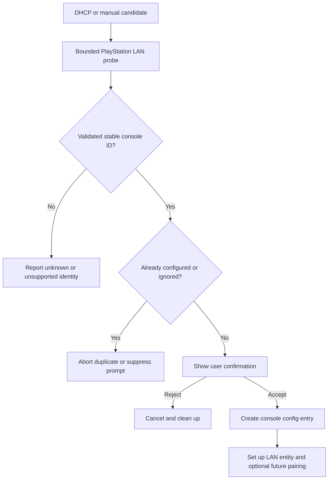

# ADR-0004 — Identity, multi-console ownership and Home Assistant configuration boundaries

**Status:** Proposed for architectural review; not approved or implemented  
**Date:** 2026-11-05  
**Decision drivers:** Independent multi-console discovery, stable historical identity, optional multiple PSN accounts, native Home Assistant lifecycle, no MQTT or extra App  
**Affects:** Protocols 01–04, 07–10, proposed ADR-0005/0006/0007/0008/0009 and the sidebar API  
**Source of truth:** `ARCHITECTURE_GUIDE.md`, [cross-protocol review](../architecture/cross-protocol-review-01-10.md)  
**Review rule:** Separate confirmed upstream semantics from proposals. Do not mark the ADR accepted until the user approves the choices and source/compatibility blockers are resolved.

## 1. Context and problem

The previous monitor was built around one PS5-MQTT feed, an explicitly configured player and a Home Assistant App. The replacement PlayStation Hub is a **single installable HACS integration** which must discover and independently manage more than one real PlayStation console, optionally associate multiple PSN accounts, retain durable statistics and show all data in one native sidebar panel.

The official Home Assistant `playstation_network` integration is primarily a PSN **account/platform** model. Its DHCP matchers can offer a **Discovered** setup, but they do not prove the physical identity of every PS5, nor does an account+platform key distinguish two consoles of the same type. The generic DHCP fallback does not establish our multi-console registration behavior; a dedicated flow is needed. LAN `host-id` exists in the researched playactor discovery responses, but its cross-firmware stability and relationship with MAC or Remote Play `PS5-Mac` are not yet hardware-validated.

**Fundamental identities cannot be conflated:**
- Physical console: locally observed hardware endpoint and pairing target.
- PSN account: provider-stable account identity, independent of hardware and display name.
- User profile on one console: relationship and possibly a local slot, not necessarily a globally unique person.
- Game: PSN title namespace, separately from trophy `npCommunicationId`, concept/product and entitlement identifiers.
- Home Assistant config entry: lifecycle ownership, *not itself* a Sony account ID or console MAC.
- Home Assistant device registry ID: HA-generated local database key, not a portable external identity.
- IP address / hostname / network MAC: addressing and discovery hints, not automatically durable primary keys.

## 2. Goals, non-goals and architectural constraints

### Goals
1. A newly found compatible console can generate a configuration proposal in **Settings > Devices & services > Discovered** when Home Assistant and network discovery permit it.
2. Two same-model PS5 consoles are distinguishable and manageable; a configured first device must not suppress discovery of a second device.
3. A user may manually add a console by IP/hostname with verification when broadcast/DHCP is unavailable.
4. Dynamic IP, rename, restart, sleep, account reauthentication and temporary PSN unavailability cannot silently change a device identity or erase history.
5. One PSN account can map to several consoles; one console can map to several PSN accounts. Attribution requires evidence and may remain unknown.
6. LAN setup/monitoring works independently of PSN authentication and Remote Play pairing.
7. Device/entity unique IDs, associations, credentials, history and backups each have explicit ownership and removal rules.
8. Installation alongside official `playstation_network` must neither reuse its domain nor corrupt its config/device registry.

### Non-goals
- Guaranteed broadcast discovery across routed VLANs.
- Silently claiming a DHCP/MAC prefix is proof of a Sony console.
- Using PSN presence as reliable electrical power state or local device ID.
- Creating a working implementation or deciding the SQLite ADR here.
- Assuming every PS4/PS5 firmware exposes an immutable unique identifier.
- Automatic account linkage without authorization or bypassing Sony privacy restrictions.

## 3. Options considered

| Option | Advantages | Limitations | Assessment |
| --- | --- | --- | --- |
| A — One global integration config entry, all consoles as children | Simple aggregate runtime and single panel owner | Removal, per-console error handling and reconfiguration tightly coupled; discovery and unique-ID dedupe more complex | Not preferred for physical-console lifecycle |
| B — One config entry per physical console, separate account config entries | Native HA per-device lifecycle; clear reconfigure, rediscovery, unload and command target | Cross-entry account mapping and shared history ownership require additional coordination | **Preferred candidate**, contingent on verifying multi-entry config-flow rules |
| C — One config entry per PSN account, consoles as account children | Mirrors official PSN integration | Fails LAN-only setup; one account can span consoles and vice versa | Rejected as primary hardware ownership |
| D — One config entry per IP/hostname | Easy initial setup | Breaks after DHCP change or rename, duplicates devices and statistics | Rejected |
| E — One config entry per network MAC alone | Familiar hardware key | OUI is not unique; MAC may be missing or differ by interface and privacy model | Rejected as universal rule |
| F — Install/use official PSN integration as source | Less PSN code | Runtime dependency, account-centric physical identity and incomplete local control | Rejected per ADR-0001 |

## 4. Proposed decision — two logical roots

**Proposed, not accepted:** Use separate native config entries for physical consoles and PSN accounts under the **single `playstation_hub` integration domain**. Each console entry owns its network reachability and optional Remote Play pairing. Each account entry owns the identity and optional PSN authorization state. An independent association repository records optional many-to-many links.

```text
playstation_hub (one HACS integration)
  Integration singleton (ephemeral runtime coordination; not a global singleton device)
    Console config entry A -> Physical Console A -> LAN state, control, entities
    Console config entry B -> Physical Console B -> LAN state, control, entities
    PSN account config entry X -> Account X -> PSN presence & metadata
    PSN account config entry Y -> Account Y -> PSN presence & metadata

    Account <-> Console associations (0..N / 0..N, explicit provenance)
    Shared read models / session ledger (storage ADR pending)
    One sidebar panel showing available authorized devices and accounts
```

**Lifecycle constraints:** One console's `async_unload_entry` must stop only its transport tasks and entities. Unloading a PSN account must not unload LAN consoles. Shared managers must have reference-counted or integration-owned lifetime and not be destroyed by unloading the first entry. If HA config flow constraints or minimum-version support make separate entry categories impractical, revisit this proposal instead of faking entries or building global mutable state.

### 4.1 Entry typing proposal

- `entry_kind="console"`: stable console identity, non-secret current network preferences, validated local model and user-selected options.
- `entry_kind="psn_account"`: verified PSN provider account identity and options; secret material governed by ADR-0007, not exposed to frontend.
- `entry_kind` is our own schema discriminator, **not** a known Home Assistant ConfigEntry standard field.
- Each entry must have an integration-defined unique ID in a non-colliding namespace, such as `console:ps5:<canonical-host-id>` and `psn:<provider-account-id>`, if and only if the underlying identifiers are validated and suitable. These are **illustrative formats, not adopted IDs**.
- Never assume HA config entries with two types automatically have different platform forwarding behavior; design independent setup paths and runtime types.

### 4.2 Why a pure account-centric model is insufficient

The same PSN account can be used on multiple pieces of hardware; PSN primary platform/presence may only describe the last-used platform. A `media_player` whose unique ID is account+PS5 is therefore an account-platform view, not a unique PS5. Our console uses a validated hardware identity; the PSN account has its own service identity and should not automatically become the console's `via_device` parent.

## 5. Canonical physical-console identity policy

### 5.1 Candidate identifiers

| Input | Source | Evidence level | Proposed usage |
| --- | --- | --- | --- |
| `host-id` | PlayStation LAN discovery response | Source observed, firmware stability not live validated | Preferred candidate for stable console identity after parser and consistency checks |
| `PS5-Mac` | Remote Play registration response | Source observed, pairing credential scope | Secondary identity evidence only after explicit authorized pairing |
| DHCP MAC | Router/HA DHCP observation | Discovery evidence, may be absent/different | Match candidate and diagnostics, not sole universally trusted identity |
| IPv4 address | DHCP/ARP/manual | Mutable locator | Current network routing only |
| Hostname / `host-name` | DHCP/LAN device response | Mutable label | Display name and candidate hint |
| `system-version`, `host-type` | LAN response | Mutable version / model | Compatibility and diagnostic metadata |
| PSN `account_id` | Sony PSN API | Account not hardware | Never primary key of console |
| HA device registry ID | Home Assistant | Local installation UUID | Foreign key for frontend actions only, not export or external console identity |

### 5.2 Validation procedure

1. Receive a candidate from DHCP, directed LAN query or optional broadcast scan.
2. Validate source IP/address family, bounded payload length, response method/status/version and required host attributes.
3. Normalize `host-id` **only using an empirically verified format**; no speculative MAC parsing or lossy case/zero trimming.
4. Verify `host-type` and protocol version against the declared supported capability matrix.
5. Compare normalized ID with already configured entries and active flows. Do not create a second entry if identity matches.
6. When safe, compare the DHCP MAC and response identity as *corroborating* observations, never assume a specific byte equivalence absent evidence.
7. Present identity/name/model/IP to user for confirmation, with source and uncertainty as appropriate.
8. After initial setup, re-probe identity before credentialed actions when reachable; reject and alert on a known address now responding for a **different** console.
9. If no stable identifier is validated, do **not** invent a permanent hardware ID from IP or filename. Offer a clearly labeled manual setup / pending verification workflow or block configuration with an actionable diagnostic until a safe policy is approved.

**Collision detection:** Two simultaneously responding consoles with the same supposedly unique host ID are a serious ambiguity. Do not silently merge their data or send Remote Play commands; mark identity collision, stop credentialed operations and require diagnostics/manual reconciliation.

**Change-of-identity case:** A factory reset or hardware replacement may alter the advertised identifier. The system must never automatically transfer credentials or history to the new identity just because the IP/hostname matches.

## 6. Address and rediscovery policy

Keep current IPv4 host address as a re-discoverable locator with explicit last-seen and source. DHCP-derived addresses may replace a stale address only after a successful identity probe. Manual override should have priority for reachability **but still require identity confirmation** before credentialed actions. Changes of IP should update connection data without regenerating entity unique IDs. `last_seen`, `last_successful_probe`, `last_dhcp_candidate` and `address_source` are operational metadata, not evidence of constant uptime.

Discovery can originate from:
- HA-managed DHCP matchers in `manifest.json`.
- PS5-specific directed/broadcast UDP `SRCH` per Protocol 01.
- Manual IPv4/hostname entry (when network topology hides broadcast).
- Previously persisted known device identity and bounded reconnect checks.

All paths converge on the **same canonical identity resolver** and the **same duplicate protection**. A discovery candidate is not added without explicit user acceptance. A repeated discovery of an ignored ID must respect HA ignore semantics and must not spam the user.

**Network constraints:** A router, VLAN or Wi-Fi client isolation may prevent broadcast, DHCP observation or direct IP reachability. Absence of reply is not proof of power-off. IPv6 discovery remains an unverified future capability; do not promise it based solely on IPv4 sources.

## 7. Proposed Home Assistant config-flow design

### 7.1 Entry points

`async_step_user`: explicit user choice **Add console** or **Connect PSN account**, with a structured selection in a single domain. The UI flow may use separate subsequent steps; no need for separate HACS packages.

`async_step_dhcp`: explicitly handle a `DhcpServiceInfo` candidate. Avoid relying on generic base flow when one entry already exists. Validate, probe and set stable ID only after protocol confirmation; `async_step_confirm` requests user acceptance. For probes requiring awaitable network calls, use the supported async progress/flow pattern in the target HA Core release.

`async_step_reconfigure`: update console address/options only after re-checking identity; for PSN reconfiguration, validate account ID as in the Core PSN reference. A `reauth` flow belongs to PSN/Remote Play credential scopes, not DHCP discovery.

`async_step_ignore` / abort: follow HA's supported flow APIs for discovered-device dismissals; exact method names and semantics must be checked on the minimum supported release before implementation.

### 7.2 Proposed flow state machine



**Discovery UX invariants:** The initial invitation should be useful even if the user has never authenticated to PSN. Pairing is a separate explicitly triggered action; no waking or login on background DHCP detection. Never log full Sony credentials or raw packets for diagnosis.

## 8. Associations and attribution

### 8.1 Many-to-many relation

```text
ConsoleAccountAssociation
  association_id: integration-controlled immutable id
  physical_console_id: validated console id
  psn_account_id: provider-stable id
  relationship: linked | suggested | unknown
  provenance: user_confirmed | provider_reported | inferred
  created_at_utc: UTC
  updated_at_utc: UTC
  last_verified_at_utc: optional UTC
  active: bool
```

These are **conceptual fields**; do not create a schema until ADR-0008 and ADR-0005 specify storage and observation contracts. A user-confirmed account association means the user has declared an association; it does **not** automatically prove every PSN game report occurred on that console. Provenance belongs on **each activity observation**, not only association records.

### 8.2 Examples

- **One console, two accounts:** both may be linked, but if one PSN account reports a game and the other is offline, a local game attribution remains inferred unless a direct signal proves the player.
- **Two consoles, one account:** association is many-to-many; do not split one PSN duration equally or attribute all time to the nearest/last-seen PS5.
- **Offline mode:** physical console may be awake while PSN reports offline; no forced unpair/unlink and no assumption of no gaming.
- **Child account:** consent and visibility restrictions remain binding. Display/track only information permitted by the linked account and Home Assistant access model.
- **Console replaced:** new physical ID; old history retained under old identity unless an explicit reviewed migration operation is implemented.

### 8.3 Separate authoritative facts

P01/P02: local console reachability/power when confirmed; P03–P07: Remote Play authenticated command and command-confirmation state; P08: account credentials; P09: account reported online/current game; P10: game names/IDs/artwork/entitlements. The domain reconciler (ADR-0005) must never allow P09/P10 to overwrite P01/P02 physical power state.

## 9. Device registry and entity identity

**PROPOSED device hierarchy:**

- Physical console: `DeviceInfo.identifiers={(DOMAIN, stable_console_key)}`, manufacturer/model where genuinely confirmed, observed SW version, suitable configured friendly name.
- PSN account: a distinct *service* device or other suitable account representation, only if provider authorization and HA entity design support it. Use a different identity namespace from physical consoles.
- Entities: `unique_id` generated from immutable integration domain + canonical console/account key + semantic entity key, **not** address/name/room/player nickname.
- A media player representing PSN account activity is not automatically the same entity as the physical console power state.
- Avoid copying or changing the official `playstation_network` entity/device identifiers. Both integrations can coexist; duplicate user-visible concepts should be clearly labeled.
- HA `device_id` and `entity_id` can be user-installation-specific and may change; never use them as external/historical immutable keys.

**Migration rule:** If a canonical identity changes after formal review, migrations must preserve existing HA entity unique IDs when safe or explicitly record an alias/mapping and user-visible migration consequence. Do not silently fork statistics into a duplicate console because of a canonicalization change.

## 10. Credentials and security boundaries

Remote Play pairing keys belong to a validated `physical_console_id` plus the authorized pairing principal where protocol permits it. PSN NPSSO/access/refresh tokens belong to `psn_account_id`. Never reuse or cross-store the two credential classes.

- No pairing or authenticated command using a DHCP-only candidate.
- Before executing wake/standby, resolve the selected target by canonical identity and validate that the destination has not been reassigned to a different console.
- Address spoofing/MITM risk remains in LAN; a host-id string alone is not cryptographic proof of identity. Define the minimum command-authenticity and network trust assumptions in a threat model.
- No exposed secrets in UI, entity attributes, logs, diagnostics or public repo.
- Secrets and their lifecycle are handled by ADR-0007, not embedded in config flow example code here.
- Keep per-console locks (pair/command), per-account refresh locks, and shared budgeted discovery separate.

## 11. Lifecycle, ownership and deletion matrix

| User action / event | Console entry | PSN account entry | Association | History | Credentials |
| --- | --- | --- | --- | --- | --- |
| HA restart | Rehydrate and verify address/ID when reachable | Restore authorized credentials | Preserve | Preserve; mark cached state stale | Restore per secure repository |
| LAN timeout | Keep entry, mark unavailable | Unaffected | Preserve | Preserve; no fabricated elapsed time | Preserve |
| PSN auth expired | Unaffected | Reauth-required | Preserve pending review | Preserve | Handle rotation/reauth |
| Reconfigure IP | Same stable entry after verification | Unaffected | Preserve | Preserve | Preserve if identity confirmed |
| User renames console | Friendly name only | Unaffected | Preserve | Preserve | Preserve |
| Unpair Remote Play | Keep LAN console entry | Unaffected | Preserve unless user requests unlink | Preserve | Delete targeted pairing keys |
| Unlink PSN account | Keep consoles | Remove/disable account | Disable/remove relevant edges | Retention/deletion selection required | Delete account secrets; remote revoke unverified |
| Remove console entry | Remove device runtime and entities | Unaffected | Mark edges inactive/unlink | Retain/archive or delete based on explicit policy | Delete console pairing secrets |
| Full uninstall | Stop all tasks and remove UI | Stop all tasks | Remove managed active records | Data-retention policy must be explicit | Remove managed secrets as authorized |
| Hardware replacement | Create new ID/entry, never silent transfer | Unaffected | Explicit remapping | Old history retained separately | Do not transfer pairing keys blindly |

**OPEN:** Home Assistant does not automatically delete every auxiliary file of a HACS integration when uninstalling its code. Design explicit user-facing cleanup/export and robust `async_remove_entry` hooks as supported, including secure file handling and preservation choices. Actual storage ownership must be approved in ADR-0008.

## 12. Sharing domain resources safely

A single HACS installation may have many config entries. Proposed runtime layers:

1. Per-console `ConsoleRuntime`: LAN UDP status polling, selected address, state coordinator, pairing/command lock, entities.
2. Per-account `PsnAccountRuntime`: token manager, PSN requests, provider budget, account entities.
3. Integration-scope `IdentityRegistry`, `AssociationRepository`, `SessionRepository` and sidebar WebSocket dispatcher, with explicitly defined initialization and shutdown reference semantics.
4. Pure `IdentityResolver` and `AssociationPolicy` independent of Home Assistant.
5. No mutable process globals shared across unrelated Home Assistant instances or test cases.

**Avoid lifecycle circularity:** Shared managers must be created by an integration-level owner, not whichever console config entry happens to load first. They should unload after the last dependent entry or during integration teardown under a documented registration lifecycle. The single sidebar panel should register once and not disappear when one of several consoles is removed.

## 13. Identity error taxonomy

| Error | Cause | Required outcome |
| --- | --- | --- |
| `candidate_unverified` | DHCP candidate but no valid response | No permanent identity or credentialed command |
| `identity_missing` | Valid response without trustworthy stable ID | Actionable manual/pending state |
| `identity_collision` | Same supposedly unique ID from incompatible endpoints | Stop merge and privileged commands |
| `identity_mismatch` | Known IP now answers for another console | Reject target, rediscover; never send pairing keys |
| `duplicate_console` | Existing entry for canonical ID | Abort new flow, show existing configuration |
| `duplicate_account` | PSN account already linked | Reuse/account-specific abort |
| `account_mismatch` | Reauth returns another PSN account | Reject token replacement |
| `unsupported_console` | Version/type not validated | No unsupported commands; explain compatibility |
| `address_unreachable` | Timeout or routed network failure | Unknown/unavailable, not OFF |
| `orphan_association` | Historical link references removed entry | Mark inactive and preserve audit pending retention |
| `unsafe_credential_scope` | Attempted cross-console/account key reuse | Block action and raise sanitized diagnostic |

These are **project design categories**, not official Sony protocol error names.

## 14. Acceptance tests — synthetic and Home Assistant

### Identity parsing and resolution
- [ ] Valid `host-id`, response type and version produce one canonical candidate.
- [ ] Invalid/missing `host-id`, malformed port, unexpected protocol version and hostile payload never create a trusted identity.
- [ ] Leading zeros/case/format normalization follows independently validated rules; no accidental collision.
- [ ] IP or hostname changes with matching stable host ID preserve config entry, entity IDs and history.
- [ ] One IP now reporting a new host ID cannot inherit existing credentials or historical attribution.
- [ ] Two devices with identical claimed IDs trigger collision and safe command inhibition.
- [ ] PSN account ID and game title ID cannot be parsed as console ID.

### Discovery & config flow
- [ ] `async_step_dhcp` displays Discovered for a verifiable console even before any Sony login.
- [ ] Second and third console can be discovered when the first is already configured.
- [ ] DHCP plus directed/broadcast discovery of same hardware yields one flow/entry.
- [ ] Ignored and already configured devices do not spam new notifications.
- [ ] User rejection cancels all pending probe tasks/sockets.
- [ ] Manual IP/hostname setup validates identity and deduplicates existing entries.
- [ ] VLAN/no-DHCP/no-broadcast cases offer manual directed probe without false 'off'.
- [ ] Unrecognized Sony OUI, unrelated hostname and spoofed response are not accepted as proof.
- [ ] Home Assistant Core version/manifest discovery constraints tested with custom component (not assumed from built-in integration).

### Accounts & associations
- [ ] Two accounts on one PS5 and one account on two PS5 correctly create distinct records and many-to-many links.
- [ ] Changing an account's online ID does not change its unique_id or history.
- [ ] Linking an already linked account is idempotent or presents a precise conflict.
- [ ] PSN presence reports account online while both local consoles are awake: attribution ambiguous.
- [ ] Removing account leaves LAN monitoring operational.
- [ ] Account reauth with a different provider ID is rejected.
- [ ] Console removal does not delete unrelated PSN tokens.
- [ ] Unknown player never becomes a confirmed named gaming session.

### Lifecycle & safety
- [ ] Console A unload does not stop Console B or global panel.
- [ ] Account A unload does not invalidate LAN Console A.
- [ ] Removing last entry releases shared managers only under approved owner lifecycle.
- [ ] Repeated setup/unload/reconfigure causes no stale callbacks, extra sockets or leaked tasks.
- [ ] Permission-bound command targets canonical console ID; never default to first console.
- [ ] Backup restore and address renames do not silently join two hardware histories.
- [ ] Secrets and private stable IDs redacted in public diagnostics/export.
- [ ] Installed official `playstation_network` coexists without mutating its config entries or devices.

## 15. Migration and compatibility plan

1. Build deterministic synthetic identity fixtures from Protocol 01 without real hardware identifiers.
2. Pin upstream source revisions and test PS4/PS5 parsing separately; PS4 support requires an explicit product scope decision.
3. Run HA config-flow tests for existing/no entry, secondary discovery, ignored candidates, manual entry and mismatched ID.
4. Implement an alias/migration strategy only after the canonical key function has been tested on real device responses.
5. When implementation begins, do not import the legacy `develop` hardcoded MQTT topics, player names, IPs or private SQLite data.
6. Test HACS upgrade, HA reboot and rollback where supported; entity IDs should remain stable.
7. Preserve historical IDs and offer explicit migration tools if future protocol changes require key replacement.

## 16. Alternatives rejected or deferred

- **Automatic PSN identity assignment from console LAN:** Deferred until a source establishes a direct reliable account mapping; PSN presence alone cannot prove it.
- **One config entry per user with console children:** Not suitable for LAN independence, many-to-many account/console links and independent console unload.
- **Automatic full migration of historical sessions between replaced consoles:** Rejected by default; would corrupt hardware-specific statistics without explicit user intent.
- **MAC OUI-only discovery as trusted identity:** Rejected; it is an initial heuristic, not an identity.
- **Silent credential transfer after host-ID change:** Rejected as unsafe.
- **Runtime dependency on built-in PlayStation Network integration:** Rejected per ADR-0001.
- **Automatically link/activate every detected PlayStation:** Rejected; explicit confirmation required.

## 17. Consequences and tradeoffs

**Benefits:** Better multi-console ownership, true LAN independence, clear HA lifecycle, robust IP-change handling, per-account token isolation, stable history and future extension to multiple console generations.

**Costs:** More entries/flows, shared service ownership, user-visible distinctions between console and account, relationship management, cautious handling of missing IDs, custom discovery tests and metadata migration work. The UI must explain why a detected PlayStation is only a candidate until protocol verification.

**Risks:** `host-id` consistency or authenticated identity validation may be weaker than expected; Home Assistant API evolution can change multi-entry discovery practices; Sony privacy, Remote Play protocol and OAuth terms can restrict cross-source mapping. All require evidence before final acceptance.

## 18. Open questions and decision checklist

- [ ] Confirm empirically whether `host-id` remains stable across standby, reboot, IP change, Wi-Fi/Ethernet, firmware update and console factory reset.
- [ ] Compare `host-id`, DHCP MAC and Remote Play `PS5-Mac` on controlled test fixtures; do not assume identical formats.
- [ ] Choose and approve canonical ID namespace/normalization rules.
- [ ] Approve or reject **separate console and PSN-account config entries** under one integration domain.
- [ ] Confirm exact HA native config-flow behavior with two entry kinds and an existing entry.
- [ ] Approve whether a hardware-less `pending verification` candidate is kept in memory or persisted.
- [ ] Approve account/console association UI, optional auto-suggestion and confidence policy.
- [ ] Decide whether supported hardware scope is PS5-only v1, with PS4 deferred, or both.
- [ ] Define deletion/retention policy for sessions, accounts, console entries and shared DB.
- [ ] Resolve credential and storage ADRs, and integration-wide shared manager lifecycle.
- [ ] Confirm no implicit Sony API requirement for LAN-only console setup.
- [ ] Finalize target HA Core baseline and automated discovery tests.
- [ ] Document any user confirmation necessary before wake/standby commands.

**Recommendation for decision review:** Prefer Option B (one console entry per validated physical console, separate PSN account entries) and one many-to-many association model, subject to the above HA and hardware identity checks. This is **not yet an accepted ADR**.

## 19. Source register

### Project
- [Protocol 01 — LAN discovery](../protocols/01-lan-discovery.md)
- [Protocol 02 — Console status](../protocols/02-console-status.md)
- [Protocol 03 — Console wake](../protocols/03-console-wakeup.md)
- [Protocol 04 — Remote Play registration](../protocols/04-remote-play-registration.md)
- [Protocol 08 — PSN authentication](../protocols/08-psn-authentication.md)
- [Protocol 09 — PSN presence](../protocols/09-psn-presence.md)
- [Protocol 10 — Game metadata](../protocols/10-game-metadata.md)
- [Cross-protocol review](../architecture/cross-protocol-review-01-10.md)
- [HA Core PSN deep audit](../research/home-assistant-core-playstation-network-audit.md)
- [ADR-0001 — First-party connectivity](ADR-0001-first-party-connectivity.md)
- [ADR-0002 — Sidebar panel](ADR-0002-sidebar-panel.md)
- [ADR-0003 — Persistence proposed](ADR-0003-persistence-provisional.md)

### Official Home Assistant
- https://developers.home-assistant.io/docs/config_entries_index/
- https://developers.home-assistant.io/docs/data_entry_flow_index/
- https://developers.home-assistant.io/docs/core/device_registry_index/
- https://developers.home-assistant.io/docs/core/entity/
- https://developers.home-assistant.io/docs/dev_101_services/
- https://developers.home-assistant.io/docs/integration_setup_failures/
- https://www.home-assistant.io/integrations/dhcp/
- https://github.com/home-assistant/core/blob/dev/homeassistant/config_entries.py
- https://github.com/home-assistant/core/blob/dev/homeassistant/components/playstation_network/config_flow.py
- https://github.com/home-assistant/core/blob/dev/homeassistant/components/playstation_network/manifest.json

### Protocol/community references (not Sony official API licensing)
- https://github.com/dhleong/playactor/blob/main/src/discovery/messages.ts
- https://github.com/dhleong/playactor/blob/main/src/discovery/model.ts
- https://github.com/dhleong/playactor/blob/main/src/remoteplay/registration.ts
- https://github.com/FunkeyFlo/ps5-mqtt/blob/main/ps5-mqtt/server/src/playactor/discovery.ts
- https://github.com/isFakeAccount/psnawp
- https://github.com/achievements-app/psn-api

**Outcome:** Detailed preferred identity and ownership model documented, with validation gates. No code was implemented or console interrogated. ADR status remains **Proposed**, not approved.

## 20. Official Home Assistant device-registry clarification — 2026-11-05

The [2026.11 official-source re-audit](../research/official-source-reaudit-home-assistant-2026-11.md) confirms that modern Home Assistant registry devices belong to **one config entry and at most one config subentry**. Avoid deprecated multi-entry DeviceEntry assumptions such as `config_entries` or `primary_config_entry`; use `config_entry_id`. DeviceInfo/ChildDeviceInfo are dataclasses in Core 2026.11, with typed fields, `UNDEFINED` handling and `as_dict()` for serialization. This supports, but does not itself approve, distinct console-owned and account-owned config entries with associations maintained in our domain rather than merging the underlying HA DeviceEntry. Source-level confirmation is not real console identity validation. ADR status remains Proposed.

## 21. Core 2026.11 multi-console discovery source audit (2026-11-05)

The [pinned Config Entry / coordinator audit](../research/ha-core-2026-11-multi-console-runtime-source-audit.md) and [SPEC-008](../specifications/SPEC-008-multi-console-runtime-and-coordinator-lifecycle.md) clarify that HA's `dhcp` integration should discover candidates and launch **our explicit `async_step_dhcp(DhcpServiceInfo)`**. Native PlayStation UDP `SRCH` is bounded candidate verification/status, not a second DHCP service. Core's default `async_step_dhcp` delegates to the generic no-unique-ID fallback; the built-in `playstation_network` has DHCP matchers but no dedicated DHCP config step. That is insufficient for guaranteeing independent multi-console onboarding.

Use a verified stable identifier with `async_set_unique_id` and update known addresses through `_abort_if_unique_id_configured(updates=...)` only when the **same** physical console identity is established. Explicit user confirmation, ignored flows and DHCP/manual races require tests; potentially different provisional IDs for one host may require `is_matching`/matching-flow logic. Do not assume a source-asserted host-id is cryptographically authenticated. A physical device is owned by its console entry, while an optional PSN account Config Entry need not create a synthetic DeviceEntry unless grouping semantics justify it. The full design remains **Proposed**, not hardware validated.


## Archived ledger and logical hub identity supplement — 2026-11-06

**Status unchanged: PROPOSED.** [Storage/root source audit](../research/ha-core-2026-11-storage-layout-restore-authority-archive-root.md), [ADR-0011](ADR-0011-storage-layout-restore-authority-archive-hub.md), [SPEC-011](../specifications/SPEC-011-storage-roots-restore-authority-archive-hub-lifecycle.md) propose a separate, user-confirmed Hub/Archive Config Entry, with its own reserved unique-ID namespace, not a physical-console ID, PlayStation DeviceEntry, or SQLite ledger UUID.

A previously recorded physical console remains keyed to validated immutable console identity regardless of Config Entry removal, IP changes or a future Hub entry. An externally preserved ledger may be newer than restored HA Config Entries; restoring outdated entry E1 while the ledger has newer console K2/E2 must create a reviewable identity conflict, never silent reassignment or mass history reattribution. Keep ledger_uuid, Config Entry entry_id, hub unique ID, physical console key and PSN account key separate. No new identity source is cryptographically proven by this research, and no ADR is accepted.


## Maintainer conceptual approval and snapshot lineage separation — 2026-11-06

The maintainer accepted the *product architecture* of a user-created logical Hub/Archive Config Entry plus separate physical console and optional PSN account entries, with a single process-wide controller and panel. This is recorded as accepted in [ADR-0011 §12](ADR-0011-storage-layout-restore-authority-archive-hub.md#12-maintainer-acceptance-register--2026-11-06). **ADR-0004's unvalidated physical Sony identity and migration details remain PROPOSED.** A Hub unique ID identifies the logical HA configuration anchor, not the ledger UUID, PSN account ID, console hardware ID or restored backup source.

[ADR-0012](ADR-0012-immutable-snapshot-backup-and-restore-authority.md), [source audit](../research/ha-core-2026-11-immutable-sqlite-snapshot-protocol-source-audit.md) and [SPEC-012](../specifications/SPEC-012-immutable-snapshot-publication-and-backup-admission.md) require snapshot lineage/ledger_uuid and canonical physical identity checks before user-approved recovery. An archived raw DB/WAL copied in a Supervisor tar is not trusted merely because its HA Config Entry records refer to it. No hardware authentication proof or restore implementation has been created.


## Restore lineage versus physical identity — source audit 2026-11-06

**ADR-0004 remains PROPOSED in its unvalidated console identity details.** [Restore authority source audit](../research/ha-core-2026-11-restore-authority-and-portable-storage-source-audit.md), [ADR-0013](ADR-0013-restore-authority-and-storage-topology.md), and [SPEC-013](../specifications/SPEC-013-restore-authority-storage-topology-and-reconciliation.md) strengthen the distinction between HA installation identity, Hub Config Entry unique ID, HA entry_id, ledger UUID, lineage/restore epoch and immutable physical console or PSN account identity. A full config restore or a share-only restore can align an old Config Entry with a newer or older external ledger. Even same ledger UUID and same cursor can hide a post-restore fork with different events. No history or Remote Play credential may be reassigned based on hostname, IP, account display name or Config Entry ID. On mismatch, freeze affected writes/actions and require an authorized reconciliation while preserving historical data. User approval of the logical Hub/Archive product architecture in ADR-0011 does not prove physical Sony identity. No code or hardware tests.


## Generation pointer promotion does not establish hardware identity — 2026-11-06

[ADR-0015](ADR-0015-crash-safe-ledger-promotion-and-recovery-journal.md), [SPEC-015](../specifications/SPEC-015-crash-atomic-recovery-journal-and-generation-promotion.md) and [crash source audit](../research/ha-core-2026-11-crash-atomic-recovery-journal-and-generation-promotion-audit.md) introduce a proposed active SQLite generation UUID distinct from ledger_uuid, HA Hub Config Entry unique ID, HA Config Entry entry_id and any canonical physical PlayStation or PSN account key. A journal can record expected association revision and restore parent, but is not proof that a restored old HA Config Entry still controls the same console. Following pointer promotion, independently revalidate device identity and account authorization before historical writes or privileged wake/standby controls. Do not attach prior history by IP, MAC or friendly name, and never import Sony tokens from immutable gameplay snapshots. Earlier physical-identity unvalidated claims stay unvalidated; ADR-0004 remains proposed.


## Degraded operation authority and identity conflict under history hold — 2026-11-06

[ADR-0017](ADR-0017-degraded-operation-capabilities-and-sqlite-close-evidence.md), [SPEC-017](../specifications/SPEC-017-degraded-capability-matrix-and-sqlite-close-proofs.md) and the [Core/worker audit](../research/ha-core-2026-11-degraded-capabilities-worker-proof-and-aiosqlite-022-audit.md) clarify that a physical source status (AWAKE/STANDBY) and a Home Assistant native entry state (LOADED) do not establish permission for historical attribution or wake/standby/Remote Play. Backend command admission must revalidate canonical physical identity, current entry and manager generation and caller ACL even if an entity or button looks available. Identity conflicts always deny physical controls and account relinks; ephemeral source-only state during shared RECOVERY_HOLD is a separately proposed OBSERVATION_ONLY capability, never an ACTIVE history lease. Restored PSN account IDs do not authorize token reuse or physical console ownership. Identity protocols remain unvalidated; this does not accept ADR-0004's technical identity choices.


## First-boot Hub unique ID, ledger UUID and physical-console identity separation — 2026-11-06

[First-boot source research](../research/ha-core-2026-11-first-boot-ledger-provisioning-and-missing-data-audit.md), [ADR-0018](ADR-0018-first-boot-consent-and-ledger-provisioning.md), and [SPEC-018](../specifications/SPEC-018-first-boot-ledger-provisioning-and-recovery-classifier.md) formalize separate namespaces for the single logical Hub Config Entry unique ID, mutable HA entry_id, application ledger_uuid, active SQLite generation_uuid, idempotent provision operation UUID, canonical physical console key and PSN account key. A new Hub Config Entry may exist without a provisioned ledger; it cannot be used as proof of a new database, nor may the same Hub unique ID automatically bind a foreign/restored old ledger. No hardware identity or Sony credentials are created as a side effect of history genesis.

Official Home Assistant Config Flow requires stable unique ID and duplicate abort. Do not apply manifest-wide single_config_entry since multiple console and PSN entries are accepted product scope; enforce uniqueness of the logical Hub within its own namespace. A console discovered at the same IP/name as a previously removed one is not proof of identical hardware, and a saved PSN account name is not a live login authorization. History genesis and old association reconciliation remain proposed, never tested.


## 2026-11-06 — Real legacy database lacks canonical physical PS5 identifier

[Direct develop branch source audit](../research/legacy-develop-to-native-migration-provenance-audit-2026-11.md), [ADR-0019](ADR-0019-legacy-history-provenance-and-cutover.md) and [SPEC-019](../specifications/SPEC-019-legacy-history-migration-and-mqtt-retirement.md) show that the old schema v3 sessions/events/checkpoints/monitoring_state contain no canonical immutable hardware-console key. The old App's mqtt_topic and player_name settings are one-source selection labels, not a verified Sony device or PSN account. Proposed import must preserve historical sessions with LEGACY_UNATTRIBUTED physical owner and source namespace; never automatically bind them to the first or same-IP new physical PS5, silently relink PSN credentials or claim that old synthetic MQTT monitoring device identifiers establish console identity. User-reviewed optional association requires independent evidence with immutable original provenance and no historical time rewrite. ADR-0004 physical identity protocol remains unapproved and untested.
