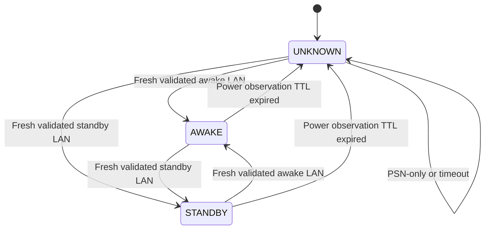

# ADR-0005 — Observation envelope, source authority and state reconciliation

**Status:** Proposed — detailed architecture for review, not accepted or implemented  
**Date:** 2026-11-05  
**Scope:** LAN discovery/status (01–02), Remote Play wake/registration/session/commands (03–07), PSN authentication/presence (08–09), game metadata (10), event/session accounting and Home Assistant/UI projection  
**Dependencies:** [ADR-0004 identity and multi-console ownership](ADR-0004-identity-and-multi-console-ownership.md) (also proposed), Protocols 01–10  
**Downstream:** ADR-0006 session accounting, ADR-0008 storage, ADR-0009 HA entities/actions, ADR-0010 sidebar API  
**Implementation:** Not started; no real-device/protocol verification

> This is a design proposal. Distinguish facts witnessed in upstream source from verified PlayStation Hub behaviors. A received packet, an HTTP response, a provider-reported game, successful socket write, a Sony profile and a physical PlayStation power mode are different kinds of evidence. No third-party PSN API authorization or live console validation is implied.

## 1. Decision drivers and objectives

PlayStation Hub must merge independent observations about **physical hardware** and **PSN accounts** without making false claims when sources disagree, disappear or become stale. Existing documents appropriately separate local power from cloud game activity, but do not yet define a common observation envelope, source ordering, recovery rules or output contract.

The integration shall:
1. Keep physically distinct consoles and PSN accounts isolated (ADR-0004).
2. Publish **source-specific facts** before deriving cross-source claims.
3. Represent **freshness, visibility and uncertainty explicitly**, not as synthetic on/off states.
4. Remain useful on LAN without PSN and avoid mandatory Remote Play sessions.
5. Never let a delayed response overwrite newer state or an old lifecycle callback recreate removed state.
6. Gate credentialed commands by validated identity and appropriate permissions, without optimistic success.
7. Expose immutable, bounded, serializable domain snapshots with stable schema versions for future storage and UI APIs.
8. Preserve the last confirmed state as historical context while allowing current state to become unavailable.
9. Keep session/time accounting a separate consumer (ADR-0006), not a side effect of reading entity properties.
10. Use pure reconciler logic independently testable without Home Assistant imports, transport sockets or real Sony credentials.

## 2. Alternatives considered

| Option | Benefits | Failure modes | Recommendation |
| --- | --- | --- | --- |
| A. One merged `online` bool from whichever source responds | Easy frontend | Incorrect physical state, stale cloud overrides, loss of provenance | Reject |
| B. Prefer PSN when online, LAN otherwise | Easier game enrichment | PSN account can be active elsewhere; obscures standby/unknown | Reject |
| C. Separate source-specific observations plus immutable reconciled projection | Auditable, testable, resilient across outages | More models and policies | **Preferred, proposed** |
| D. Read all provider APIs directly from HA entity getters | Short initial path | Blocking I/O, inconsistent timing, rate explosions | Reject |
| E. Treat every missed poll as physical OFF and close sessions | Deterministic numbers | Invented power transitions and incorrect durations | Reject |
| F. Never infer anything from PSN | Most conservative | Loses optional useful association | Allow explicitly labeled inferred views, never confirmed facts |

## 3. Evidence sources and bounded authority

| Source | What it may directly establish | What it cannot establish alone |
| --- | --- | --- |
| `LAN_DISCOVERY` | Responding device's protocol fields, source IP, reported status code, timestamp and a candidate host ID | Cryptographic identity, permanent IP, who is playing |
| `LAN_STATUS` | Valid current PS4/PS5 status response and compatible reported power mode | Exact unseen transition instant or named PSN player |
| `REMOTE_PLAY_REGISTRATION` | Outcome of explicit PIN pairing and accepted per-console credentials | Current power, gameplay time, global Sony account session |
| `REMOTE_PLAY_SESSION` | Successfully authenticated control-session state and bounded liveness | Game running, exact power transition after a request |
| `REMOTE_PLAY_COMMAND` | Target, requested command and transmission/acknowledgment progress | Verified standby or wake without later reliable observation |
| `PSN_AUTH` | Provider account authorization/credential health | Physical console power or identity |
| `PSN_PRESENCE` | Account-reported online/availability/platform/title data visible to requester | Which physical console, exact local session times |
| `PSN_CATALOG` | Source-provided game metadata/library/entitlement snapshots | Currently running game, permanent ownership, installation or local session duration |
| `USER_ASSOCIATION` | User explicitly linked account and console as an association | Definitive actual active player on a given console at all times |

**Critical rule:** Authority is fact-specific, not a global ranking. Never say “LAN beats PSN” without specifying the fact: LAN is authoritative *for validated local power observations*, PSN for *provider-reported account presence*. The reconciler must preserve both when they conflict and may add a separate conflict diagnostic.

### 3.1 Local power taxonomy

`AWAKE` and `STANDBY` are source-derived recognized modes from Protocols 01–02, subject to live wire verification. `OFF` requires a **separate, explicitly validated source**; it is *not* the default interpretation of a timeout, PSN offline or missing UDP reply. For current release planning, the safe projection is `AWAKE | STANDBY | UNKNOWN` with reachability tracked independently. Future authenticated OFF support must include evidence and firmware tests.

A console can be in `STANDBY` **and** respond to discovery; network availability is not a power state. An unrecognized but structurally valid response can establish reachability but yield `UNKNOWN` power. A missing reply establishes neither power nor definite physical absence.

### 3.2 PSN presence taxonomy

Normalize PSN `online`/`offline` and availability independently; preserve raw unknown enum strings and optional away/mobile-app variants. The exact PSN response shape is Protocol 09's responsibility. Account privacy/403 and absent titles produce *restricted/unknown*, not confirmed offline or no gameplay. A PSN `PS5` platform value is not a hardware ID. A current title observation is *provider-confirmed as reported*; attribution to a particular local console is a distinct inference.

## 4. Proposed immutable observation envelope

Conceptual, versioned contract:

```text
ObservationEnvelope<T>
  schema_version: int
  observation_id: opaque locally unique identifier
  source: LAN_DISCOVERY | LAN_STATUS | REMOTE_PLAY_SESSION |
          REMOTE_PLAY_COMMAND | PSN_AUTH | PSN_PRESENCE |
          PSN_CATALOG | USER_ASSOCIATION
  source_instance_id: locally stable adapter runtime scope
  run_id: opaque HA integration runtime generation
  request_id: optional source request correlation identifier
  physical_console_id: optional validated stable ID
  psn_account_id: optional stable provider account ID
  source_sequence: optional provider/protocol sequence
  source_attempt_generation: int
  requested_at_utc: optional timezone-aware instant
  received_at_utc: timezone-aware instant
  provider_event_at_utc: optional timezone-aware instant
  monotonic_received_at: process-local monotonic clock marker (never persisted)
  validity: VALID | PARTIAL | INVALID
  payload: normalized immutable typed fact(s), never credentials
  source_error: optional typed redacted error
```

**Separation of fields:**
- `received_at_utc` = locally observed response time, not the time the game actually began.
- `provider_event_at_utc` = source-defined event such as last-online; not necessarily a measurement of current response freshness.
- `requested_at_utc` + `received_at_utc` may bound a response interval, not prove the physical event instant.
- `monotonic_received_at` is only comparable within a running process and cannot be restored from SQLite/backups.
- `run_id` and `source_attempt_generation` reject callbacks from previous integration lifecycles and outdated requests.
- `observation_id` gives idempotent ingestion into the eventual session ledger.
- `physical_console_id` must satisfy ADR-0004; never silently use an IP or hostname as the canonical ID.
- `psn_account_id` is never a substitute for physical console ID.
- `payload` must be redacted and bounded; credentials belong to Protocol 08/Remote Play repositories, not observation serialization.

**Canonical serialization rule:** All persisted instants are UTC and timezone-aware; fields with unknown meaning or timestamps must be null/typed unknown. Error payloads cannot contain raw cookie headers, Remote Play keys, Sony tokens or full sensitive URLs.

### 4.1 Why one global timestamp order is wrong

Two independent sources may have differing clocks and network latencies; a later **received** PSN observation is not necessarily more authoritative over an earlier **LAN** power observation. Ordering is primarily within `(source, source_instance, target, run_id)`. Cross-source evaluation uses each source's freshness and fact-specific authority, not a global “last write wins”.

Out-of-order responses from overlapping requests: allocate increasing attempt generation at request start, accept only according to an explicit policy (normally newest relevant request generation). Avoid using completion timestamp alone: an older request could finish after a newer request and appear freshest. For transport push events with genuine source sequence, use a validated sequence comparer; wrapping counters and reset must be tested. When generation resets after restart, old run ID events are rejected.

## 5. Freshness, availability and health are three independent dimensions

### 5.1 Proposed state definitions

- **Fresh**: recent accepted observation within a source-specific verified TTL.
- **Stale**: last accepted observation is retained for historical display but no longer considered current.
- **Unavailable**: source cannot currently supply a trustworthy observation, e.g. timeout, fatal error, missing auth, persistent expiry.
- **Unknown**: fact value cannot be determined; may occur with a fresh yet unrecognized response.
- **Restricted**: provider denied access for privacy/authorization policy; do not retry through alternate identities.
- **Healthy/degraded/failed**: transport/scheduler diagnostics, distinct from the facts above.

Proposed orthogonal snapshot fields:

```text
SourceSnapshot<T>
  target_id: canonical console or account key
  latest_accepted: optional ObservationEnvelope<T>
  latest_attempt_at_utc: optional UTC
  latest_success_at_utc: optional UTC
  freshness: FRESH | STALE | NONE
  reachability: REACHABLE | UNREACHABLE | UNKNOWN | NOT_APPLICABLE
  operational_health: HEALTHY | DEGRADED | FAILED | STOPPED
  error_category: optional normalized error
  retry_after_utc: optional UTC
```

**Do not collapse** `UNAVAILABLE` into `OFF`; in HA, entity `available` and its state must be considered separately. A source may be available while a particular property is unknown.

### 5.2 TTL policy (proposal, not fixed time constants)

Define `FreshnessPolicy` per source and fact, using measured polling interval, response reliability, usage and rate limits. Example conceptual policy:
`ttl = max(minimum_floor, multiplier * expected_poll_interval + jitter_allowance)`.
This is a design discussion **not** an approved universal formula or numeric TTL.

- LAN power should have a bounded freshness expiry based on its actual status polling.
- PSN presence should have separate freshness, respecting provider rate limits and auth failures.
- Static game metadata has a much longer caching TTL than current account presence.
- A command's verification window must be bounded separately and may trigger a controlled directed probe, not unlimited network requests.
- Account/profile availability must not make all LAN consoles unavailable.

A restoration from Home Assistant backup should mark cached external current state as stale until an actual observation succeeds; simply loading a stored `observed_at_utc` from a file cannot make it fresh.

### 5.3 Timing examples

```text
t0: LAN AWAKE accepted; console current state AWAKE/FRESH.
t1: LAN query times out; AWAKE remains last-known, no fabricated OFF.
t2: LAN TTL expires; current power UNKNOWN/UNAVAILABLE; last-known AWAKE with t0.
t3: PSN reports game; account activity is fresh, physical console remains UNKNOWN.
t4: LAN STANDBY accepted; current console STANDBY/FRESH.
```

The duration between t0 and t4 cannot be automatically declared continuous game play; ADR-0006 defines the gap ledger and uncertainty policy.

## 6. Reconciliation algorithm (proposed deterministic stages)

1. **Ingest** candidate observation from a transport adapter, bound and validate schema.
2. **Resolve target** using ADR-0004 registry; reject identity mismatch and collision.
3. **Check lifecycle**: reject event from invalid `run_id`, removed entry, superseded generation or cancelled poll.
4. **Classify source** and parse a typed source-specific result; do not mix unknown response with a valid power state.
5. **Apply per-source ordering** and idempotency to the correct source snapshot only.
6. **Update health** (even on a failed attempt) without converting network error into physical-state fact.
7. **Compute freshness** using a monotonic deadline in the current process; retain last-known accepted snapshot separately.
8. **Compose fact-specific projections**: hardware power/reachability; command progress; account PSN status; title activity; associations.
9. **Evaluate conflicts** without destroying either source's history; tag as observed disagreement or attribution ambiguity.
10. **Emit only meaningful domain changes** (and necessary health/freshness transitions) to consumers; do not re-persist identical high-frequency heartbeats as separate activity transitions.
11. **Dispatch** immutable projections to session engine, HA coordinator/entities and sidebar API; no network I/O in entity getters.
12. **Record diagnostics** as aggregated sanitized counters and timestamps, never raw provider credentials.

**Single-writer proposal:** Each target's reconciliation state should be updated by one serialized owner (or an equivalent guarded reducer), even if sources fetch concurrently. There must be no mutable globally shared console state that allows account A to overwrite console B.

## 7. Reconciliation decision matrix

| LAN power and freshness | Remote Play command | PSN account/presence | Current safe result |
| --- | --- | --- | --- |
| AWAKE fresh | None | Online with game | Physical AWAKE confirmed, account game reported; physical attribution unconfirmed unless separately bound |
| AWAKE fresh | None | Offline | Physical AWAKE; account PSN offline; no automatic power-off |
| STANDBY fresh | None | Online with game | Physical STANDBY, PSN account active possibly elsewhere or sampled at different time; flag discrepancy |
| Unknown/unavailable | None | Online with game | Physical unknown, account game reported; do not assert local PS5 playing |
| AWAKE fresh | Standby packet sent | Online with game | Remain AWAKE until reliable new standby observation; command VERIFYING |
| STANDBY fresh | Standby requested | Any | Idempotent already-in-standby without waking console (if freshness/identity valid) |
| STANDBY fresh | Wake packet sent | Any | Stay STANDBY until observed awake; command VERIFYING |
| LAN stale | Wake/standby requested | Any | Reject unsafe auto-control or require explicit suitable preflight; never select arbitrary target |
| LAN AWAKE fresh | No command | PSN 403 private | LAN AWAKE; PSN restricted/unknown |
| LAN AWAKE fresh | No command | PSN 429/5xx/timeout | LAN AWAKE; PSN degraded/unavailable |
| Two consoles AWAKE | None | One PSN account game | Both AWAKE, account game reported, device/game attribution AMBIGUOUS |
| LAN response unknown status code | None | Any | Reachable if identity/format validated, power UNKNOWN; do not force AWAKE |
| No response ever | None | PSN offline | Physical UNKNOWN; no proof of OFF |
| Old console ID replaced at same IP | Any pending | Any | Reject identity-mismatched response, suspend privileged commands, no silent history/credential reassignment |

**Important:** Where valid LAN standby and fresh PSN account presence coexist, both claims can be true in different scopes. This is not automatically evidence that either source is broken. A conflict flag describes uncertainty in an *inferred association*, not necessarily a protocol contradiction.

## 8. Attribution confidence is per claim, not per observation

A single observation may directly confirm one fact while leaving another unknown. For example:
- PSN directly reports account `account_X` playing title `title_Y`: **CONFIRMED_PROVIDER_REPORT** for *what Sony reported at sampling time*.
- “Physical console A is running title Y”: **INFERRED** if only account association and platform match exist, not directly confirmed.
- “Console A is powered awake”: **CONFIRMED_LOCAL** if a current, identity-matched recognized LAN response exists.
- “User X played for 17 minutes”: **not confirmed** without an accepted session-accounting policy and appropriate player attribution.

Suggested claim confidence: `CONFIRMED | INFERRED | AMBIGUOUS | UNKNOWN`, plus explicit `evidence_source` and `assertion_scope`. Never use a numerical confidence score without calibration. Do not promote a user-declared many-to-many association into proof that a specific gameplay observation came from a particular console.

### 8.1 Account/console association validation

An account-console mapping can be `user_confirmed`, `provider_reported` or `inferred`; it describes the **relationship**, not automatically the physical origin of every game. One PSN account on two awake PS5 consoles makes physical attribution ambiguous even if the game is unambiguous at account scope. Do not assign exclusive game duration to both.

## 9. State machine for derived console display



`OFF` is intentionally absent pending real protocol proof. Keep `last_known_power` and `last_known_at` independent from `current_power`.

The component should maintain separate `command_state`: `IDLE | REQUESTED | IN_PROGRESS | VERIFYING | CONFIRMED | FAILED | UNKNOWN | CANCELLED`. A command is confirmed only by adequate direct observation or a proven authenticated acknowledgment semantic; UDP send/socket closure alone cannot prove the final physical state.

## 10. Source/event versioning, replay and restart safety

- Use a documented schema version for each observation kind and for the derived domain snapshot.
- During in-process fetch, assign unique `run_id` and source attempt generation; reject completion after cancellation/unload.
- Persist enough source provenance for history without persisting process-local monotonic clocks.
- Separate last-known externally observed values from current state rehydration.
- On restart, recover last-known metadata with `STORED_LAST_KNOWN` label; new live observation required to move current state to FRESH.
- Deduplicate repeated identical source observation IDs and transitions.
- If two sources disagree, do not create an endless alternation of a single merged boolean.
- Avoid hard-coded global Europe/Lisbon timezone in domain models: persist UTC, choose configured locale/timezone at presentation/reporting.
- Retain only minimal necessary raw provider data; hash/remove sensitive identifiers in diagnostics.

## 11. Error semantics and negative evidence

A failed query is primarily **failure to observe**, not a negative fact about the target. Distinguish:
- `TRANSPORT_TIMEOUT`: no response in bounded time; do not infer power OFF.
- `INVALID_SOURCE_IDENTITY`: response from wrong target; quarantine and do not use.
- `UNKNOWN_PROTOCOL_STATE`: response recognized but state code unsupported; reachable may remain true.
- `PROTOCOL_MALFORMED`: discard payload, sanitized diagnostic.
- `PSN_AUTH_REQUIRED`: Protocol 08 reauth; not console offline.
- `PSN_PRIVACY_RESTRICTED`: do not infer non-gaming.
- `PSN_RATE_LIMITED`: respect provider budget and retry-after.
- `PSN_SCHEMA_CHANGED`: provider adapter degraded, preserve last-good stamped account data.
- `COMMAND_UNCONFIRMED`: send succeeded but final state not observed.
- `DATA_STORE_FAILED`: do not silently confirm durable session changes; defer to ADR-0006/0008.
- `CANCELLED`: expected lifecycle termination, not a device failure.

**Negative-evidence policy:** A valid explicit `STANDBY` response is positive evidence of standby. A valid provider `offline` response is positive evidence of *provider-reported account offline*, but **not** negative evidence that a physical console is awake or running a game locally. Lost packets are not positive evidence of anything beyond failed observation.

## 12. Home Assistant entity and sidebar projection

**Proposed HA representation:**
- Physical console state: a categorical sensor or equivalent semantically justified platform for `awake | standby | unknown`; use the entity availability mechanism on source failure rather than asserting `off`.
- Source diagnostic entity: last LAN observation time, reachability and health if useful and privacy-safe.
- PSN account status: separate account-scoped sensor(s), with provider data freshness and last-seen.
- Game now-playing info: account-scoped, optional entity/media view clearly distinguishing account presence from local physical attribution.
- Command action: explicit targeted HA service/action and optional button where its semantics are appropriate, not an unvalidated optimistic switch.
- Sidebar WebSocket data: per-target snapshot versions, `source`, `observed_at`, `last_known`, freshness and confidence, all sanitized and authorized.

**User-facing wording:** “Console responding / Awake”, “Rest mode”, “Status unavailable”, “Last confirmed awake at …”, “PSN reports playing …” and “Device attribution uncertain” are materially different messages. UI must not render “Off” just because PSN is offline.

For HA Core conventions, property getters read memory and do not make provider requests; updates are driven by coordinators/subscriptions. Native entity `available` and state classes must be aligned with the final entity ADR, not decided by this document alone.

## 13. Session engine and storage boundary

ADR-0005 produces a **reconciled observation stream**, not a finished historical duration. The future ADR-0006 must define:
- Which observation constitutes session start/end/heartbeat.
- How uncertainty intervals are represented and whether estimated periods are displayed.
- Whether no fresh LAN observation stops confirmed counting at a last checkpoint.
- How PSN title changes or privacy restrictions affect inferred player session attribution.
- How overlapping consoles/accounts prevent double-counting.
- How provider lifetime game playtime remains separate.
- How restart, loss of network, clock adjustments and DST affect the event ledger.

ADR-0008 will define durable storage and backup; SQLite is currently **proposed only** (ADR-0003). If persistence fails, source observations may still be shown live as non-durable state but must not be claimed to have been saved, and any historical accounting output must expose the durability failure.

## 14. Failure modes and security

- A malformed UDP response cannot override a previous valid state.
- A device at the same IP with a new ID must not receive Remote Play secrets or commands for the previous ID.
- A misconfigured PSN account must not force LAN consoles to unload.
- A borrowed mobile-app OAuth client or undocumented endpoint is not an approved Sony API; Protocol 08 remains a release gate.
- A private PSN profile or child account must not be probed through alternate account credentials to bypass visibility.
- No Remote Play/NPSSO/refresh tokens in observations, diagnostics, event-bus state, image URLs, frontend, or GitHub.
- Limit input sizes, parse strict types, constrain retries, and use cancellation-safe async I/O.
- Do not emit unbounded raw data when storing source errors; sanitized categories only.
- During operator commands, verify user permissions and explicitly selected physical console; no automatic remote action during discovery.

## 15. Implementation interface boundaries (conceptual)

```text
ProtocolAdapter
  fetch() -> source-specific immutable observation or typed failure
  stop() -> cancellation-safe resource disposal

ObservationIngestor
  ingest(envelope) -> accepted | duplicate | superseded | rejected

SourceSnapshotStore
  get_target_source_snapshot(target_id, source) -> immutable snapshot
  update_if_newer(...) -> new source snapshot

StateReconciler
  reduce(source_snapshots, associations, now) -> ReconciledDomainSnapshot

CommandConfirmationMonitor
  observe(command_id, matching_validated_lan_result) -> progression

DomainEventBus
  publish(versioned_changed_state) -> subscribers

HAProjection / SidebarApi
  render_or_emit(reconciled_snapshot) -> authorized read-only data
```

**Rules:** Core/domain models have no `homeassistant` import. Transport adapters don't import UI modules. Entity getters don't perform I/O. Concurrency should be serialized per target; entity subscriptions use update snapshots rather than independent PSN calls. Identical state payload plus new heartbeat can update freshness/last-seen without creating a false power transition.

## 16. Worked scenarios

### Scenario A — Console awake, Sony offline

- 10:00: a valid P02 LAN packet identifies console A as awake.
- 10:00:05: P09 reports account X offline.
- Result: console A remains `AWAKE/FRESH`; account X = `OFFLINE/FRESH`; player and title unknown. No device power-off, no forced session end.

### Scenario B — Missing LAN samples

- 10:00: console A awake.
- 10:00:30: LAN timeout.
- At configured freshness expiry: current physical state becomes unknown/unavailable, last-known `AWAKE at 10:00` remains visible.
- At 10:05: fresh standby arrives; state becomes standby with a known transition observed *between* last confirmed awake and standby; exact transition instant is unknown. ADR-0006 handles accounting.

### Scenario C — Standby command without observed result

- Physical console A awake/fresh; user explicitly requests standby.
- Remote Play command sent; socket closes, but fresh P02 confirmation never arrives.
- Result: command `UNKNOWN` or `FAILED_CONFIRMATION` after timeout; don't claim console standby. Power status follows its own source freshness.

### Scenario D — Two PS5s, one account online

- A and B both awake/fresh; one PSN account X reports title Y on PS5.
- Result: A/B awake separately confirmed; account X/title Y provider-reported; neither hardware assignment is confirmed. Mark ambiguity rather than giving both consoles gaming minutes for title Y.

### Scenario E — After Home Assistant restore

- Backup contains “last known awake” observation and PSN title from yesterday.
- At startup display historical last-known with timestamp and current unknown/unavailable; no fresh confirmations until probes succeed.
- Any stale PSN refresh token is handled independently by Protocol 08 and does not invalidate LAN devices.

### Scenario F — IP reused by different console

- Console A config entry points to old IP.
- New LAN query at that IP returns a valid but different host ID for console B.
- Reject A's candidate response, mark identity mismatch, do not send A's registered keys to B, request safe rediscovery.

## 17. Deterministic test matrix

### Source and ordering
- [ ] Valid LAN awake and standby responses create source-specific accepted observations.
- [ ] Unrecognized LAN code may establish reachable but returns power unknown.
- [ ] Partial/malformed payload produces failure without mutating accepted facts.
- [ ] Delayed old request response cannot override newer request.
- [ ] Old `run_id` response after unload/reload is discarded.
- [ ] Same observation ID replay is idempotent.
- [ ] Different sources arriving in either order yield the same fact-specific projection given same fresh snapshots.
- [ ] Monotonic TTL expires without relying on local wall clock jumps.
- [ ] Backup-restored observations remain historical until a fresh sample arrives.

### Cross-source reasoning
- [ ] PSN online doesn't imply console awake.
- [ ] PSN offline doesn't imply console standby/off.
- [ ] PSN privacy/403 and 429 preserve independent LAN state.
- [ ] LAN standby and PSN game may coexist with account-device attribution uncertain.
- [ ] Two consoles, one account yields no duplicate claimed game duration.
- [ ] Console A/Console B observation never crosses account/device registry boundaries.
- [ ] Provider lastOnlineDate never overrides local observation timestamp.
- [ ] No game reported doesn't automatically mean player not gaming locally.

### Commands, persistence and HA
- [ ] UDP wake send doesn't mark AWAKE; only adequate direct response can confirm.
- [ ] Standby socket closure doesn't mark STANDBY.
- [ ] Unexpected target ID blocks credentialed command.
- [ ] Command after stale status follows conservative preflight rules.
- [ ] One console unload leaves other console's observations alive.
- [ ] PSN account unlink preserves local state and accepted history.
- [ ] A fresh heartbeat updates source freshness without fabricating a state transition.
- [ ] Data-store failure doesn't claim a history write succeeded.
- [ ] Entity getters read cached snapshots only; no blocking calls.
- [ ] UI payloads contain provenance and age but no bearer secrets.
- [ ] Different HA user access rights cannot bypass command permission checks.

### Property-based/replay cases
- [ ] Arbitrary arrival order of a fixed generation-labeled observation set gives deterministic last accepted per source.
- [ ] Duplicate event replay never increases accepted session counts.
- [ ] Unknown/expired observations cannot be upgraded to `confirmed` by PSN catalog metadata.
- [ ] No transition to `OFF` exists without an explicitly supported OFF fact.
- [ ] Each snapshot either references a valid configured console/account or is quarantined.

## 18. Open choices and approval checklist

- [ ] Approve C: separate source snapshots and a pure reconciled domain projection.
- [ ] Approve concrete source IDs, key namespace and observation schema version.
- [ ] Approve clock, `run_id`, request-generation and idempotency semantics.
- [ ] Calibrate per-source TTL and status poll intervals in synthetic/real-device tests; no hard-coded universal threshold yet.
- [ ] Approve precise semantics for `available`, stale, unknown, privacy restricted and command uncertainty in HA entities.
- [ ] Approve whether user-declared association can support *inferred* (not confirmed) local player activity.
- [ ] Determine authoritative OFF signaling, if any, by supported firmware; don't invent it.
- [ ] Define whether conflicts trigger a repair issue, diagnostic, or passive UI notice.
- [ ] Confirm per-target single-writer approach and listener cleanup.
- [ ] Complete ADR-0006 for session gaps, timing and attribution.
- [ ] Complete ADR-0008 for durable observation/session storage, backups and restore.
- [ ] Complete ADR-0009 for concrete HA entity/service APIs and translations.
- [ ] Execute unit/property tests, HA OS tests and authorized device checks before claiming compatibility.

**Provisional recommendation:** Accept option C as a design direction after review, then freeze an initial versioned observation schema and proceed with the session-ledger ADR. No coding is authorized by this document.

## 19. Sources

### Internal canonical documents
- [ADR-0004 identity and multi-console](ADR-0004-identity-and-multi-console-ownership.md)
- [Cross-protocol review](../architecture/cross-protocol-review-01-10.md)
- [Protocol 01 LAN discovery](../protocols/01-lan-discovery.md)
- [Protocol 02 console status](../protocols/02-console-status.md)
- [Protocol 03 wake](../protocols/03-console-wakeup.md)
- [Protocol 07 Remote Play commands](../protocols/07-remote-play-commands.md)
- [Protocol 08 PSN authentication](../protocols/08-psn-authentication.md)
- [Protocol 09 presence](../protocols/09-psn-presence.md)
- [Protocol 10 metadata](../protocols/10-game-metadata.md)
- [Architecture guide](../../ARCHITECTURE_GUIDE.md)

### Official Home Assistant platform references
- https://developers.home-assistant.io/docs/core/entity/
- https://developers.home-assistant.io/docs/integration_fetching_data/
- https://developers.home-assistant.io/docs/integration_listen_events/
- https://developers.home-assistant.io/docs/dev_101_services/
- https://developers.home-assistant.io/docs/frontend/extending/websocket-api
- https://developers.home-assistant.io/docs/core/diagnostics/
- https://github.com/home-assistant/core/tree/dev/homeassistant/components/playstation_network

### Community reference implementations (not Sony protocol guarantees)
- https://github.com/dhleong/playactor
- https://github.com/FunkeyFlo/ps5-mqtt
- https://github.com/isFakeAccount/psnawp
- https://github.com/achievements-app/psn-api

**Outcome:** A detailed, cross-protocol state reconciliation contract and error/test policy has been proposed. All direct Sony device facts still require implementation and live validation. No executable code, credentials or PS5 operations were performed.

## Core 2026.11 coordinator and observation ownership checkpoint (2026-11-05)

[Official source audit](../research/ha-core-2026-11-multi-console-runtime-source-audit.md) and [SPEC-008](../specifications/SPEC-008-multi-console-runtime-and-coordinator-lifecycle.md) identify a key domain/lifecycle invariant: the authoritative stream of console observations must **not** depend on browser tabs or HA entity-listener count. In pinned Core 2026.11, a normally polling DataUpdateCoordinator schedules refresh with the first listener and unschedules when the last disappears. A per-console entry-owned monitor feeding a **push-only** DataUpdateCoordinator is the preferred proposal; a polling coordinator intentionally retained by a scoped internal listener is an alternate pending testing. **Never run both automatic polling systems for one console.**

Keep independent physical power, reachability, source health, observation freshness, last-known historic state, command state and persistence health. `async_set_updated_data` marks coordinator delivery/update success, but that does not establish that a LAN probe succeeded or that the ledger was written; the immutable domain snapshot needs explicit evidence/durability fields. If HA polling is disabled, the proposed policy pauses automatic observation and records coverage gaps. One source failure must not contaminate another console or PSN account.

## Upstream source correction: console-scoped LAN app metadata (2026-11-06)

[Deep audit of pinned upstream repositories](../research/upstream-source-deep-audit-lan-remoteplay-psn-ha-2026-11-06.md) identifies an additional **source authority category for future verification**: `LAN_RUNNING_APP`. [Chiaki-ng](https://github.com/chiaki-ng/chiaki-ng/blob/43728af2e639fecb8a7af1cd68c29820a40de973/lib/src/discovery.c#L115-L135) parses `running-app-titleid`/`running-app-name` from LAN discovery response headers. Unlike `PSN_PRESENCE`, such data is obtained from a discovered physical console endpoint, but it is not proof of the foreground game, player identity, exact start/stop time, or universally available PS5 firmware support. **If** validated, it may carry `physical_console_id`, source `LAN_DISCOVERY`, title ID/name, header presence and sample timestamp as an optional local observed app fact. Leave unverified/unavailable when absent.

The cross-source authority table must treat that app metadata independently from LAN power and provider account title, with explicit source identity, freshness and semantic test flags. The decoder should use source-verified candidate response codes `200`/READY, `620`/STANDBY, and otherwise `UNKNOWN`: playactor currently maps every non-620 code to AWAKE, whereas Chiaki-ng preserves unknown modes. Neither source was validated on the maintainer's actual PS5. Do **not** silently upgrade `LAN_RUNNING_APP` into `player_game` durable seconds or equate its title ID namespace with PSN IDs. This ADR remains PROPOSED pending hardware tests.
