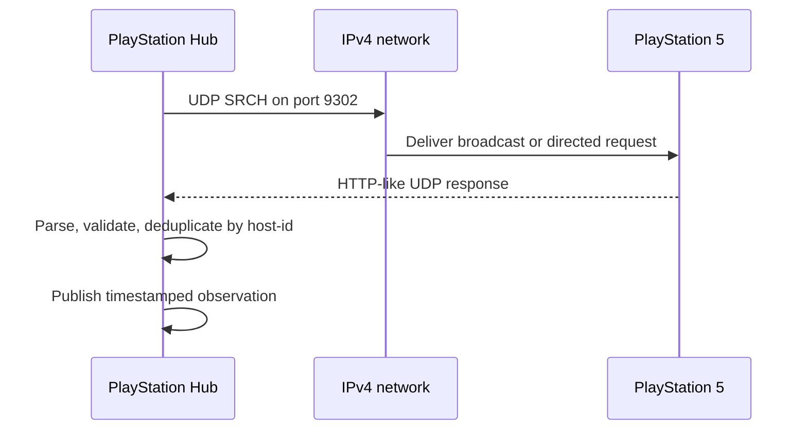

# Protocol 01 — PlayStation LAN discovery

**Status:** Source-derived protocol specification, not live validated  
**Last reviewed:** 2026-11-05  
**Reference implementation:** [playactor](https://github.com/dhleong/playactor), tree `93ee087445db368acaba9ad50099bce56ca9141d`  
**Additional integration reference:** [PS5-MQTT](https://github.com/FunkeyFlo/ps5-mqtt), tree `7ab3075d276f3eeecd81a3322c72231af8cd51bd`  
**Target module:** `custom_components/playstation_hub/transport/discovery.py`

## 1. Purpose

Discover PlayStation consoles on a local IPv4 network, obtain stable device identity and current observed power status, and expose a reusable async transport for Home Assistant. This module must operate without PSN authentication, Node.js, MQTT, or an external add-on.

This document distinguishes **SOURCE** (observed in upstream code), **DECISION** (PlayStation Hub policy), and **OPEN** (not established).

## 2. Transport and protocol identifiers

| Item | Value | Evidence |
| --- | --- | --- |
| Transport | IPv4 UDP | SOURCE — playactor `discovery/udp.ts` |
| PS5 discovery destination | UDP 9302 | SOURCE — `waker/udp.ts` and `discovery/standard.ts` |
| PS4 discovery destination | UDP 987 | SOURCE — same files; optional future compatibility |
| PS5 discovery protocol version | `00030010` | SOURCE — `discovery/model.ts` |
| PS4 discovery protocol version | `00020020` | SOURCE — same |
| Discovery request method | `SRCH` | SOURCE — `discovery/udp.ts` |
| Default broadcast | `255.255.255.255` | SOURCE — `discovery/udp.ts` |
| Local UDP bind port | Ephemeral by default (`0`) | SOURCE — `discovery/udp.ts` |
| Initial discovery request | Immediately after discovery starts | SOURCE — `discovery.ts` |
| Upstream retry interval | 5 seconds | SOURCE — `discovery/model.ts` |
| Upstream total discovery timeout | 30 seconds | SOURCE — `discovery/model.ts` |

These are upstream defaults, **not** final PlayStation Hub polling or timeout decisions.

## 3. Outbound request wire format

The upstream `formatDiscoveryMessage` uses newline-separated UTF-8 text, with no trailing blank line added by the formatter:

```text
SRCH * HTTP/1.1
device-discovery-protocol-version:00030010
```

The literal byte stream ends with a newline (`\n`). No `\r\n` normalization is performed by that function. It sends this buffer as a UDP datagram to the destination address and port.

The formatter permits specific additional fields (e.g. `app-type`, `auth-type`, `client-type`, `model`, `user-credential`) but plain discovery does not require them in the inspected upstream implementation. Do not add credential-bearing fields to basic discovery.

## 4. Incoming responses and identity

The upstream parser treats an incoming first line beginning with `HTTP` as a device response, splits subsequent lines on colon separators, and lowercases header keys.

Known fields include:

| Header | Purpose |
| --- | --- |
| `host-id` | Stable console identifier, subject to validation |
| `host-name` | Console name |
| `host-type` | PS4 or PS5 classification |
| `host-request-port` | Advertised request port |
| `system-version` | Console software version |
| `device-discovery-protocol-version` | Advertised protocol version |

The source maps HTTP-like response code `620` to `STANDBY` and **every other** code to `AWAKE`. **DECISION:** Our parser will not inherit that broad assumption. Unknown, malformed, missing or unexpected codes must become `UNKNOWN` or a typed parse error until separately documented.

The upstream `createDevices` implementation directly parses `host-request-port` with `parseInt` and casts `host-type` and `status` without strict validation. **DECISION:** Validate mandatory fields, supported types, port range, source address, identifier length and protocol version before accepting an observation.

## 5. Discovery sequence



**SOURCE:** playactor sends the initial ping immediately and subsequent pings at a configured interval until timeout/cancellation. It deduplicates device IDs by default. **DECISION:** Our implementation must close sockets and cancel retries on timeout, unload and cancellation, and must never let an old response overwrite a newer observation.

## 6. Network topology

PS5-MQTT extends upstream discovery to send requests to the limited broadcast and each local interface's subnet-directed broadcast, using a single discovery instance to avoid duplicate listeners. It also accepts a manually configured broadcast override.

**DECISION:** Support explicit IPv4 address for routed networks/VLANs, limited and per-interface broadcast discovery where network permissions allow, and stable host-ID deduplication. Do not promise that broadcasts traverse VLAN routers or that every Home Assistant installation exposes all interfaces.

## 7. Normalized observation contract (proposed)

```text
ConsoleDiscoveryObservation
  console_id: str
  host_name: str | None
  address: IPv4Address
  device_type: PS5 | PS4
  protocol_version: str
  system_version: str | None
  request_port: int | None
  power_state: AWAKE | STANDBY | UNKNOWN
  observed_at: UTC datetime
  source: LAN_DISCOVERY
```

**DECISION:** This is a conceptual schema, not a committed Python API. A missed discovery response means **no fresh observation**, not definitive proof that the console is powered off. Availability and last-known state must be tracked separately.

## 8. Errors, concurrency and security

- Invalid datagrams must not crash discovery or leak raw packets into logs.
- Timeouts, interface failures and permission errors are typed transport failures.
- Discovery may receive multiple responses per console; deduplicate and retain the freshest observation.
- Limit datagram size and parser resource use; reject untrusted metadata and malformed addresses.
- Never perform blocking network operations in Home Assistant's event loop.
- Cancel background work and close sockets on unload/reload.
- Discovery must not send pairing keys or PSN tokens.

## 9. Planned tests during implementation

- [ ] Exact `SRCH` byte encoding, version and destination port.
- [ ] Parse valid PS5 response and preserve identity/metadata.
- [ ] Interpret `620` as standby and explicitly handle unknown response codes.
- [ ] Reject missing ID, invalid port, wrong device type and malformed datagrams.
- [ ] Deduplicate multiple responses from the same console.
- [ ] Discover multiple consoles and across available interfaces.
- [ ] Support direct-IP discovery when broadcast fails.
- [ ] Verify socket closure on timeout, cancellation and integration unload.
- [ ] Test offline, rest, awake, unreachable and stale observations.
- [ ] Validate behavior on a PS5 when implementation begins.

## 10. Sources

- [Discovery model](https://github.com/dhleong/playactor/blob/main/src/discovery/model.ts)
- [Standard network factories](https://github.com/dhleong/playactor/blob/main/src/discovery/standard.ts)
- [UDP transport](https://github.com/dhleong/playactor/blob/main/src/discovery/udp.ts)
- [Discovery orchestration](https://github.com/dhleong/playactor/blob/main/src/discovery.ts)
- [Discovery response parser](https://github.com/dhleong/playactor/blob/main/src/discovery/messages.ts)
- [Request formatter](https://github.com/dhleong/playactor/blob/main/src/protocol.ts)
- [PS5-MQTT multi-interface discovery](https://github.com/FunkeyFlo/ps5-mqtt/blob/main/ps5-mqtt/server/src/playactor/discovery.ts)

## 11. Unresolved before implementation

Exact accepted HTTP-like status codes beyond `620`, firmware-specific response variants, broadcast restrictions across HA installation types, and appropriate operational polling intervals require further evidence or tests.

**Next specification:** [02 — Console status](02-console-status.md).  
**Index:** [Protocols](README.md).

## 12. Deep upstream implementation cross-check — multihomed LAN discovery (2026-11-06)

**Source:** [Pinned source audit](../research/upstream-source-deep-audit-lan-remoteplay-psn-ha-2026-11-06.md), sections 2.1–2.3. This is a source-review amendment, not proof of a working PlayStation Hub implementation.

Pinned [PS5-MQTT v1.8.1 discovery adapter](https://github.com/FunkeyFlo/ps5-mqtt/blob/7ab3075d276f3eeecd81a3322c72231af8cd51bd/ps5-mqtt/server/src/playactor/discovery.ts) explicitly handles multihomed systems: a single limited broadcast (`255.255.255.255`) may leave PS5s on a non-default directly attached subnet undiscovered; for each non-internal IPv4 interface, it computes a subnet broadcast from address/netmask, plus global broadcast, with an opt-in override. Its previous one-scanner-per-target implementation triggered excessive listeners on a shared playactor UDP socket (issue #692); the current code sends multiple targets from **one discovery session** and deduplicates by device ID. This does **not** prove successful broadcast across a routed/filtered VLAN.

**Proposed native Python implementation constraints:** bounded enumeration of safe IPv4 interfaces and selectable explicit IP; one integration-/protocol-scoped listener ownership instead of a scanner per interface/console, no accidental extra sockets/callbacks on Config Entry reload; independent per-owner status probes; deduplicate only after verifying physical identity. Use the same test evidence for multiple NICs, Home Assistant OS bridges, VLAN routes, duplicate replies, stale addresses, spoofed host-id and device replacement at same DHCP address. Never copy the Node-specific listener model into Python as-is. The `5s` and `60s` PS5-MQTT poll/discovery recommendations are not Sony guarantees.

**Additional LAN metadata:** Chiaki-ng's parser also extracts `running-app-name` and `running-app-titleid` from optional discovery response headers. Preserve bounded, sanitized app fields as `LAN_RUNNING_APP` candidate facts when available. Protocol 02 and Protocol 10 own the semantics; field existence is NOT guaranteed on PS5 firmware or confirmation of game play.

## 13. Source triangulation: parser grammar, shared listeners and fixture origin (2026-11-06)

[Second deep upstream audit](../research/upstream-protocol-triangulation-and-lan-title-forensics-2026-11-06.md) compared commit-pinned playactor, Chiaki-ng, pyremoteplay (archived 2022), ps5-remoteplay (2026 playactor port), PS5-Wake C (PS5-specific) and Chiaki-KM. **Do not count the Python playactor port's synthetic byte vectors as independent hardware validation.**

**Provisional native LAN parser contract:** strictly bound UDP datagram length, validate response line and protocol type/version, normalize LF/CRLF, split headers at the FIRST colon (a game/friendly name can include colons), sanitize UTF-8 and controls, and distinguish missing/empty/invalid headers. Never key durable console ownership by an unverified `host-id`, DHCP IP or friendly name; reject conflicting duplicate identity fields and old-generation replies. See [playactor parser](https://github.com/dhleong/playactor/blob/a9e72d67a3930a8f06455927edb547a1754ef0ac/src/discovery/messages.ts) versus [ps5-remoteplay Python parser](https://github.com/iharosi/ps5-remoteplay/blob/61e1f7dc065a77f7e8b1de5057889a08b0208d9d/src/ps5_remoteplay/discovery.py). The former loses later colon-separated content, and may retain `\r` in CRLF header values; the latter uses `split(":", 1)` and removes CRs.

**Local app metadata:** `running-app-titleid` / `running-app-name` in a syntactically valid DDP response are optional, console-scoped and unverified per firmware. Recognizing them is not evidence of gameplay, so they must be an independent `LAN_RUNNING_APP` candidate observation with field-presence/freshness, rather than a mandatory extension to every discovery DTO or a player-game duration. A polling session must preserve source observations even when the HA frontend state does not change. The separate Chiaki-KM consumer of these headers strengthens the use case but not the Sony compatibility claim.

**Future tests:** cross-interface duplicates and listeners, LF vs CRLF, multiline/colon title names, unknown response codes, Unicode, invalid fields, same-IP different hosts, several consoles, no app field and spoofed identity. The 500ms discovery cadence in the interactive Chiaki-KM fork is NOT an always-on Home Assistant default.

## 14. Maintainer decision: implement LAN discovery ourselves, no package dependency (2026-11-06)

**Authoritative requirement:** [First-party dependency sovereignty](../architecture/first-party-dependency-sovereignty-policy.md), with [native HA/Python feasibility audit](../research/first-party-protocol-implementation-and-runtime-boundaries-2026-11-06.md). References to playactor, Chiaki, PS5-MQTT, pyremoteplay, PS5-Wake and related code above are **read-only research evidence**, not selected runtime adapters or vendor code.

Implement SRCH/response framing, strict 200/620/UNKNOWN parser, bounded optional running-app fields, source identity and per-console independent monitoring in our own Python code using stdlib asyncio UDP/datagrams. For multi-interface discovery, HA Core 2026.11 exposes **\`network.async_get_adapters(hass)\` and \`network.async_get_ipv4_broadcast_addresses(hass)\`** in its native [network component](https://github.com/home-assistant/core/blob/2026.11.0/homeassistant/components/network/__init__.py); use supported HA API instead of netifaces/ifaddr or copying PS5-MQTT's Node OS adapter scanner. Confirm manifest dependency on the HA \`network\` component under hassfest, not a new pip package. Adapter configuration, broadcast reachability, source address and duplicates need actual HA OS tests. Do not claim broadcast traverses VLAN routers.

**Wire source candidate:** \`SRCH * HTTP/1.1\` + \`device-discovery-protocol-version:00030010\` over UDP to PS5 9302 is evidenced independently in [playactor](https://github.com/dhleong/playactor/blob/a9e72d67a3930a8f06455927edb547a1754ef0ac/src/protocol.ts) and [Chiaki-ng](https://github.com/chiaki-ng/chiaki-ng/blob/43728af2e639fecb8a7af1cd68c29820a40de973/lib/src/discovery.c#L67-L90). These are third-party implementation observations, not Sony official protocol documentation or a PS5 hardware test.

**No package requirement:** No playactor/Chiaki/PS5-MQTT/pyremoteplay, no extra Node/CLI/background service and no Python protocol dependency. The possible non-cryptographic LAN core stays independent of Remote Play and optional PSN.
