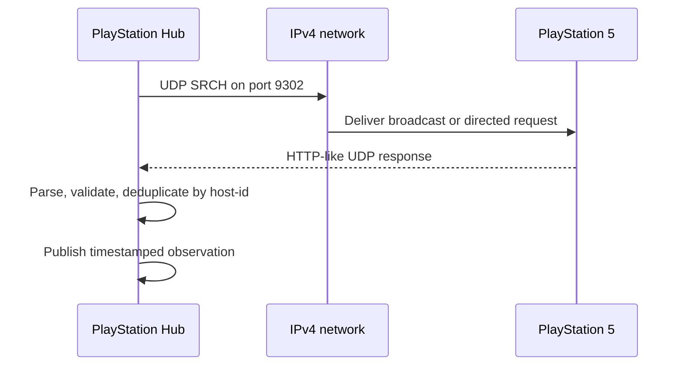

# Protocol 01 — PlayStation LAN discovery

**Status:** Source-derived protocol specification, not live validated  
**Last reviewed:** 2026-11-05  
**Reference implementation:** [playactor](https://github.com/dhleong/playactor), tree `93ee087445db368acaba9ad50099bce56ca9141d`  
**Additional integration reference:** [PS5-MQTT](https://github.com/FunkeyFlo/ps5-mqtt), tree `7ab3075d276f3eeecd81a3322c72231af8cd51bd`  
**Target module:** `custom_components/playstation_hub/transport/discovery.py`

## 1. Purpose

Discover PlayStation consoles on a local IPv4 network, obtain stable device identity and current observed power status, and expose a reusable async transport for Home Assistant. This module must operate without PSN authentication, Node.js, MQTT, or an external add-on.

This document distinguishes **SOURCE** (observed in upstream code), **DECISION** (PlayStation Hub policy), and **OPEN** (not established).

## 2. Transport and protocol identifiers

| Item | Value | Evidence |
| --- | --- | --- |
| Transport | IPv4 UDP | SOURCE — playactor `discovery/udp.ts` |
| PS5 discovery destination | UDP 9302 | SOURCE — `waker/udp.ts` and `discovery/standard.ts` |
| PS4 discovery destination | UDP 987 | SOURCE — same files; optional future compatibility |
| PS5 discovery protocol version | `00030010` | SOURCE — `discovery/model.ts` |
| PS4 discovery protocol version | `00020020` | SOURCE — same |
| Discovery request method | `SRCH` | SOURCE — `discovery/udp.ts` |
| Default broadcast | `255.255.255.255` | SOURCE — `discovery/udp.ts` |
| Local UDP bind port | Ephemeral by default (`0`) | SOURCE — `discovery/udp.ts` |
| Initial discovery request | Immediately after discovery starts | SOURCE — `discovery.ts` |
| Upstream retry interval | 5 seconds | SOURCE — `discovery/model.ts` |
| Upstream total discovery timeout | 30 seconds | SOURCE — `discovery/model.ts` |

These are upstream defaults, **not** final PlayStation Hub polling or timeout decisions.

## 3. Outbound request wire format

The upstream `formatDiscoveryMessage` uses newline-separated UTF-8 text, with no trailing blank line added by the formatter:

```text
SRCH * HTTP/1.1
device-discovery-protocol-version:00030010
```

The literal byte stream ends with a newline (`\n`). No `\r\n` normalization is performed by that function. It sends this buffer as a UDP datagram to the destination address and port.

The formatter permits specific additional fields (e.g. `app-type`, `auth-type`, `client-type`, `model`, `user-credential`) but plain discovery does not require them in the inspected upstream implementation. Do not add credential-bearing fields to basic discovery.

## 4. Incoming responses and identity

The upstream parser treats an incoming first line beginning with `HTTP` as a device response, splits subsequent lines on colon separators, and lowercases header keys.

Known fields include:

| Header | Purpose |
| --- | --- |
| `host-id` | Stable console identifier, subject to validation |
| `host-name` | Console name |
| `host-type` | PS4 or PS5 classification |
| `host-request-port` | Advertised request port |
| `system-version` | Console software version |
| `device-discovery-protocol-version` | Advertised protocol version |

The source maps HTTP-like response code `620` to `STANDBY` and **every other** code to `AWAKE`. **DECISION:** Our parser will not inherit that broad assumption. Unknown, malformed, missing or unexpected codes must become `UNKNOWN` or a typed parse error until separately documented.

The upstream `createDevices` implementation directly parses `host-request-port` with `parseInt` and casts `host-type` and `status` without strict validation. **DECISION:** Validate mandatory fields, supported types, port range, source address, identifier length and protocol version before accepting an observation.

## 5. Discovery sequence



**SOURCE:** playactor sends the initial ping immediately and subsequent pings at a configured interval until timeout/cancellation. It deduplicates device IDs by default. **DECISION:** Our implementation must close sockets and cancel retries on timeout, unload and cancellation, and must never let an old response overwrite a newer observation.

## 6. Network topology

PS5-MQTT extends upstream discovery to send requests to the limited broadcast and each local interface's subnet-directed broadcast, using a single discovery instance to avoid duplicate listeners. It also accepts a manually configured broadcast override.

**DECISION:** Support explicit IPv4 address for routed networks/VLANs, limited and per-interface broadcast discovery where network permissions allow, and stable host-ID deduplication. Do not promise that broadcasts traverse VLAN routers or that every Home Assistant installation exposes all interfaces.

## 7. Normalized observation contract (proposed)

```text
ConsoleDiscoveryObservation
  console_id: str
  host_name: str | None
  address: IPv4Address
  device_type: PS5 | PS4
  protocol_version: str
  system_version: str | None
  request_port: int | None
  power_state: AWAKE | STANDBY | UNKNOWN
  observed_at: UTC datetime
  source: LAN_DISCOVERY
```

**DECISION:** This is a conceptual schema, not a committed Python API. A missed discovery response means **no fresh observation**, not definitive proof that the console is powered off. Availability and last-known state must be tracked separately.

## 8. Errors, concurrency and security

- Invalid datagrams must not crash discovery or leak raw packets into logs.
- Timeouts, interface failures and permission errors are typed transport failures.
- Discovery may receive multiple responses per console; deduplicate and retain the freshest observation.
- Limit datagram size and parser resource use; reject untrusted metadata and malformed addresses.
- Never perform blocking network operations in Home Assistant's event loop.
- Cancel background work and close sockets on unload/reload.
- Discovery must not send pairing keys or PSN tokens.

## 9. Planned tests during implementation

- [ ] Exact `SRCH` byte encoding, version and destination port.
- [ ] Parse valid PS5 response and preserve identity/metadata.
- [ ] Interpret `620` as standby and explicitly handle unknown response codes.
- [ ] Reject missing ID, invalid port, wrong device type and malformed datagrams.
- [ ] Deduplicate multiple responses from the same console.
- [ ] Discover multiple consoles and across available interfaces.
- [ ] Support direct-IP discovery when broadcast fails.
- [ ] Verify socket closure on timeout, cancellation and integration unload.
- [ ] Test offline, rest, awake, unreachable and stale observations.
- [ ] Validate behavior on a PS5 when implementation begins.

## 10. Sources

- [Discovery model](https://github.com/dhleong/playactor/blob/main/src/discovery/model.ts)
- [Standard network factories](https://github.com/dhleong/playactor/blob/main/src/discovery/standard.ts)
- [UDP transport](https://github.com/dhleong/playactor/blob/main/src/discovery/udp.ts)
- [Discovery orchestration](https://github.com/dhleong/playactor/blob/main/src/discovery.ts)
- [Discovery response parser](https://github.com/dhleong/playactor/blob/main/src/discovery/messages.ts)
- [Request formatter](https://github.com/dhleong/playactor/blob/main/src/protocol.ts)
- [PS5-MQTT multi-interface discovery](https://github.com/FunkeyFlo/ps5-mqtt/blob/main/ps5-mqtt/server/src/playactor/discovery.ts)

## 11. Unresolved before implementation

Exact accepted HTTP-like status codes beyond `620`, firmware-specific response variants, broadcast restrictions across HA installation types, and appropriate operational polling intervals require further evidence or tests.

**Next specification:** [02 — Console status](02-console-status.md).  
**Index:** [Protocols](README.md).
