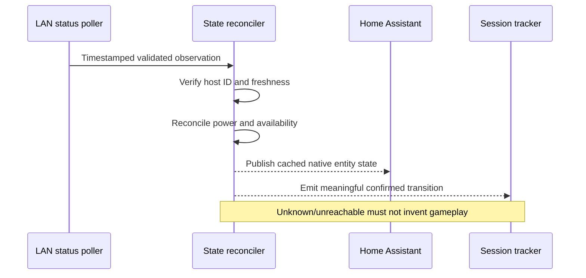

# Protocol 02 — Console status and availability

**Status:** Source-derived technical specification; live validation deferred to implementation  
**Reviewed:** 2026-11-05  
**Proposed module:** `custom_components/playstation_hub/transport/state.py` (transport observations) and a separate domain-level state reconciler  
**Source revisions:** playactor tree `93ee087445db368acaba9ad50099bce56ca9141d`; PS5-MQTT tree `7ab3075d276f3eeecd81a3322c72231af8cd51bd`.

## 1. Purpose and boundaries

Determine the observed power state and network reachability of each configured console. Keep **power**, **reachability**, **game activity**, **observation freshness** and **command progress** separate. Status detection is available without PSN; title and player identity are not established by this protocol.

Evidence labels: **SOURCE** = directly visible in the cited upstream code; **DECISION** = our architecture; **OPEN** = not yet source-confirmed or requiring implementation-stage tests.

## 2. Observed upstream wire semantics

The LAN discovery response parser in playactor recognizes HTTP-like responses and extracts a numeric status code from the first line. Its `statusCode === "620"` branch maps to `STANDBY`; all other response codes are mapped to `AWAKE`. The parser lowercases header keys and returns device metadata including `host-id`, `host-name`, `host-type`, `system-version`, and `device-discovery-protocol-version`.

**SOURCE:** The library's behavior is an implementation heuristic. **OPEN:** This review does not establish a complete Sony-defined mapping of all possible response codes. **DECISION:** Unknown response codes and malformed responses will not be assumed to mean AWAKE.

A valid LAN observation must include a stable host ID and a recognizable PS5 device type. Source IP address, receive time and discovery protocol version must be retained for diagnostics and stale-observation rejection.

## 3. PS5-MQTT's current state handling

**SOURCE:** `check-devices-state.ts` polls each registered device via playactor `check`. On success it updates HA when the power state changes or a previously unavailable console returns; it marks `available=true`. On exception it publishes `status=UNKNOWN`, `available=false` and clears activity.

**SOURCE:** `update-ha.ts` publishes separate fields: `power`, `device_status` (online/offline), `activity` (playing/idle/none), players and title metadata. This separation is useful but the MQTT payload is **not** the protocol contract for our new native integration.

**SOURCE:** `poll-devices.ts` repeats checks using a configurable interval. **DECISION:** Our polling frequency, retries and backoff are not fixed by this upstream implementation; define them according to network load, responsiveness and HA guidance.

**Observed weakness:** Upstream `check-devices-state.ts` uses `break` when a device is transitioning, which exits the device loop rather than continuing to the next console. **DECISION:** Our multi-console monitoring must isolate command transitions per console; one transition must not suppress checks of other consoles.

## 4. Domain state model (proposed)

| Dimension | Values | Meaning |
| --- | --- | --- |
| `power_state` | `AWAKE`, `STANDBY`, `UNKNOWN` | Current confirmed power observation or lack of one |
| `availability` | `AVAILABLE`, `UNAVAILABLE` | Whether a recent valid status observation exists |
| `activity_state` | `PLAYING`, `IDLE`, `UNKNOWN`, `NOT_APPLICABLE` | Derived from separately sourced game/account activity |
| `command_state` | `IDLE`, `REQUESTED`, `IN_PROGRESS`, `VERIFYING`, `FAILED` | Independent control operation lifecycle |
| `last_known_power_state` | `AWAKE`, `STANDBY`, `UNKNOWN` | Most recent confirmed historical observation, not current status |

**DECISION:** `OFF` is **not** a confirmed LAN power state. An unanswered UDP query could mean fully off, unreachable, firewalled, wrong IP, VLAN restrictions, or transient packet loss. Present it as unavailable, not powered off.

**DECISION:** A console can be `STANDBY` and `AVAILABLE` simultaneously if it responds to discovery. `UNKNOWN` power and `UNAVAILABLE` are not synonymous: an unexpected but validly received response can imply reachability without proving power mode.

## 5. Observation model and ordering

```text
ConsoleStatusObservation
  console_id: str
  source: LAN_DISCOVERY
  source_address: IPv4Address
  raw_status_code: str | None
  power_state: AWAKE | STANDBY | UNKNOWN
  observed_at: UTC datetime
  received_sequence: int
  metadata: validated optional fields
```

The domain reconciler maintains a per-console snapshot with `last_successful_observation_at`, `last_attempt_at`, `last_error_category`, `last_known_power_state`, and a freshness deadline.

**DECISION:** Process each console independently; discard out-of-order observations and responses for an unexpected host ID. Do not allow a delayed previous query to overwrite a newer confirmed state. Use monotonic elapsed time for in-process deadlines and UTC timestamps for persistence/display.

## 6. Proposed transition behavior

| Input / event | Current power | Availability | Required behavior |
| --- | --- | --- | --- |
| Valid response with recognized awake code | AWAKE | AVAILABLE | Update confirmed state and timestamp |
| Valid response code 620 | STANDBY | AVAILABLE | Update confirmed state and timestamp |
| Recognized console but unrecognized response code | UNKNOWN | AVAILABLE, if validated as reachable | Preserve raw code for safe diagnostics |
| One missed response | Retain last-known separately | Policy-dependent | Do not immediately assert OFF |
| Freshness deadline exceeded | UNKNOWN | UNAVAILABLE | Retain historical last-known state |
| Later valid response | Observed state | AVAILABLE | Recover without creating false power transitions |
| Command sent, no confirmation | Unchanged/UNKNOWN | Independently evaluated | Keep command pending then fail/unknown on timeout |
| PSN unavailable | Unchanged | Unchanged | Game/activity data becomes stale/unknown separately |

**OPEN:** Which specific non-620 codes represent awake must be established from further source evidence or implementation-stage fixtures. The table does not assert a universal awake status code.

## 7. State reconciliation sequence



**DECISION:** The state reconciler emits events only for meaningful confirmed changes. Entity properties read cached state and perform no network or database I/O. A transient failure must not silently create a fabricated gaming session end without a documented session recovery policy.

## 8. Multi-console scheduling and recovery

- Maintain independent status tasks or coordinator records per console.
- Serialize overlapping checks for the **same** console; allow bounded concurrency across different consoles.
- Use bounded timeouts, jitter and capped backoff after repeated failures.
- Resume normal intervals after a successful observation.
- Stop timers and sockets on unload; never let an outstanding callback resurrect removed entities.
- Keep configuration and actual runtime availability separate.

## 9. Home Assistant presentation policy

**DECISION:** Expose an appropriate native entity for console power status and availability. A binary sensor should only be used where its semantics are unambiguous; an enumerated sensor may be preferable for awake/standby/unknown. Use native entity availability rather than fabricating a power state. Final platform and translation keys will be selected when reviewing HA entity contracts.

The sidebar panel displays current observation, last-seen time, optional last-known state and clear stale/offline messaging in the selected language. No raw PSN account identifiers or sensitive diagnostic payloads appear in frontend state.

## 10. Failure categories and diagnostics

- `DISCOVERY_TIMEOUT`: no timely response.
- `NETWORK_UNREACHABLE`: network/socket error.
- `INVALID_RESPONSE`: malformed or unsupported wire format.
- `IDENTITY_MISMATCH`: response from unexpected console.
- `STALE_OBSERVATION`: response older than accepted state.
- `INTERNAL_ERROR`: unexpected integration failure.

These are **proposed internal error categories**, not upstream protocol error codes. Diagnostics should include counts, timestamps and sanitized status codes, never credentials or full raw packets.

## 11. Implementation-stage tests

- [ ] Valid standby response (`620`), and a source-supported awake response.
- [ ] Unexpected status codes remain UNKNOWN, not AWAKE.
- [ ] Missing or malformed host identity is rejected.
- [ ] No reply does not imply OFF.
- [ ] Available standby remains distinguishable from unavailable console.
- [ ] Late/out-of-order observations cannot overwrite newer ones.
- [ ] Console A transitioning does not block console B polling.
- [ ] Reconnect after temporary network loss preserves accurate history.
- [ ] PSN outage does not change LAN power state.
- [ ] Command timeout never creates an optimistic successful state.
- [ ] Entity properties perform no I/O; unloading cancels active checks.
- [ ] Session tracker receives only the explicitly defined transition events.

## 12. Sources

- [playactor response parser](https://github.com/dhleong/playactor/blob/main/src/discovery/messages.ts)
- [playactor discovery model](https://github.com/dhleong/playactor/blob/main/src/discovery/model.ts)
- [playactor UDP device mapping](https://github.com/dhleong/playactor/blob/main/src/discovery/udp.ts)
- [PS5-MQTT status check saga](https://github.com/FunkeyFlo/ps5-mqtt/blob/main/ps5-mqtt/server/src/redux/sagas/check-devices-state.ts)
- [PS5-MQTT polling saga](https://github.com/FunkeyFlo/ps5-mqtt/blob/main/ps5-mqtt/server/src/redux/sagas/poll-devices.ts)
- [PS5-MQTT HA publication](https://github.com/FunkeyFlo/ps5-mqtt/blob/main/ps5-mqtt/server/src/redux/sagas/update-ha.ts)
- [PS5-MQTT state types](https://github.com/FunkeyFlo/ps5-mqtt/blob/main/ps5-mqtt/server/src/redux/types.ts)

## 13. Outstanding questions

Confirm the full response-code mapping, select availability deadlines and polling intervals, finalize HA entity semantics and session interruption policy. These are design or implementation-stage validation gates, not reasons to postpone documentation.

**Related:** [01 — LAN discovery](01-lan-discovery.md) · [03 — Console wake-up](03-console-wakeup.md) · [Protocol index](README.md).

## 14. Deep source correction — recognized status codes and optional running-app headers (2026-11-06)

**Cross-referenced:** [Pinned cross-repository research](../research/upstream-source-deep-audit-lan-remoteplay-psn-ha-2026-11-06.md). The source-derived policy below is not yet verified on the user's actual firmware.

**Important correction of earlier open mapping:** [Chiaki-ng `lib/src/discovery.c`, lines 102–112](https://github.com/chiaki-ng/chiaki-ng/blob/43728af2e639fecb8a7af1cd68c29820a40de973/lib/src/discovery.c#L102-L112) explicitly maps HTTP-like code **200 => READY** (PlayStation Hub candidate `AWAKE`), **620 => STANDBY**, and all other codes **UNKNOWN**. [playactor `messages.ts`](https://github.com/dhleong/playactor/blob/a9e72d67a3930a8f06455927edb547a1754ef0ac/src/discovery/messages.ts#L28-L35), in contrast, maps *every* other code to AWAKE; this is an upstream permissiveness risk. **Preferred decoder contract:** allowlisted `200`/READY and `620`/STANDBY; reject invalid HTTP-like responses; unknown well-formed codes indicate `UNKNOWN` mode (reachability can be recorded independently). Never infer power OFF from no UDP reply or from PSN offline.

**New high-value source fields:** Chiaki-ng parses `running-app-titleid` and `running-app-name` from response headers ([lines 129–132](https://github.com/chiaki-ng/chiaki-ng/blob/43728af2e639fecb8a7af1cd68c29820a40de973/lib/src/discovery.c#L115-L135)). playactor preserves unmodeled response headers in `device.extras` ([`udp.ts`](https://github.com/dhleong/playactor/blob/a9e72d67a3930a8f06455927edb547a1754ef0ac/src/discovery/udp.ts#L115-L126)). **Propose optional `LAN_RUNNING_APP` observation with validated physical console owner + source timestamp + title ID/name and field-presence metadata.** It must remain independent of `PSN_PRESENCE` and not automatically become confirmed game session duration.

**Firmware validation matrix required:** awake at home screen, foreground native PS5 game, PS4 game on PS5, multimedia app, game in background, title switch, rest mode, console offline from PSN and unrecognized response code. Record header absence vs empty header vs recognized title, correct time/identity association and rate/freshness. Do not label this feature implemented, consistently available, exact foreground game, player identity or exact transition time before hardware tests.

## 15. Cross-implementation status mapping and real-world metadata limits (2026-11-06)

[Deep parser triangulation](../research/upstream-protocol-triangulation-and-lan-title-forensics-2026-11-06.md) adds two further source lines: [ps5-remoteplay `discovery.py`](https://github.com/iharosi/ps5-remoteplay/blob/61e1f7dc065a77f7e8b1de5057889a08b0208d9d/src/ps5_remoteplay/discovery.py#L56-L69) is a playactor port and also classifies all non-620 response codes as AWAKE; this is **not** independent corroboration. [PS5-Wake's PS5 probe](https://github.com/iharosi/ps5-wake/blob/4806b2846e0a5c82ca5ad009731087ead6b9bccb/ps5-wake.c#L461-L474) distinguishes 200 (ready), 620 (standby) and default unknown. Maintain `200 -> LAN_REPORTED_READY`, `620 -> LAN_REPORTED_STANDBY`, otherwise UNKNOWN after strict parsing. A reachable PS5 is not necessarily rendering gameplay.

**Important header parser bug:** [playactor messages.ts](https://github.com/dhleong/playactor/blob/a9e72d67a3930a8f06455927edb547a1754ef0ac/src/discovery/messages.ts#L43-L49) destructures a split on all colons, truncating a value like `running-app-name:Example Game: Director's Cut`. It also does not visibly strip CR from `host-id:ABC\r\n`. Our parser must preserve the title value after the first colon and normalize line endings before identity validation.

**LAN title confidence:** [Chiaki-KM's input profile](https://github.com/leonanluppi/chiaki-km/blob/9f84d0baf82ac87072781f7ad0a909291c46e2b5/gui/src/inputprofile.cpp#L1-L49) explicitly distinguishes absent source metadata from an empty app after a local discovery response, and recognizes PS4 CUSA IDs on a PS5 for backward-compatible titles. This is software behavior, not a live capture by us. Do not treat absent `running-app-*` fields as proven home screen, foreground game, account or no playback.

## 16. No on-wire request correlation or proof of state-change instant (2026-11-06)

[First-party DDP wire and temporal correlation audit](../research/lan-ddp-wire-and-temporal-correlation-audit-2026-11-06.md) inspected Playactor and Chiaki search packet formatters. The requests carry static \`SRCH\` and protocol-version data, without a source-confirmed echoed request ID. Therefore:
- A packet received within a local polling window does **not prove** it was generated by that exact poll; old UDP responses and unsolicited packets remain possible. The locally assigned \`request_generation\` can fence *our* callbacks but cannot authenticate an on-wire reply or timestamp its physical transition.
- The physical display state \`AWAKE\` remains a normalized **200/READY reported sample** with bounded and explicitly uncertain timing; \`620\` means reported STANDBY; unsupported code stays UNKNOWN. Timeout, UDP loss and host-drop policy never assert OFF.
- Source \`last_seen\` is when the integration received a validated reply, not a Sony-signed observation instant. Protocol status, last-known, availability, source trust, temporal uncertainty and session-accounting budget are distinct.
- Chiaki's discovery service updates a host's last-ping index on receipt but only notifies observers when fields change. A state-only observer is **not** a reliable heartbeat stream; use each accepted same-state source sample for bounded accounting and keep UI notifications change-driven.

A single \`host-id\` header is self-reported and cannot authorize pairing secrets or permanent history reassignment. See [Chiaki discoveryservice.c](https://github.com/chiaki-ng/chiaki-ng/blob/43728af2e639fecb8a7af1cd68c29820a40de973/lib/src/discoveryservice.c#L305-L388), [Python asyncio datagram official docs](https://docs.python.org/3.14/library/asyncio-protocol.html#datagram-protocols), and new audit. No firmware test was conducted.

## 17. Reported application is not foreground gameplay (new research, 2026-11-06)

**Current detailed research:** [LAN running-app identity/foreground audit](../research/lan-running-app-identity-foreground-and-provider-boundary-2026-11-06.md) and [logical app evidence contract](../architecture/lan-running-app-evidence-and-title-identity-contract.md).

**New first-party evidence:** [Sony PlayStation's control-centre help](https://www.playstation.com/en-us/support/games/customize-ps5-control-center/) explicitly explains that some games/apps are paused when Home is displayed. Therefore \`READY/200\` is a **reported console power mode**, \`running-app-titleid/name\` is **reported application metadata**, and neither is reliable proof of foreground game focus or human play. Keep \`foreground_state=UNKNOWN\` for DDP-only input even when a game ID is present.

**Critical source correction:** [Chiaki-ng \`discoveryservice.c\`](https://github.com/chiaki-ng/chiaki-ng/blob/43728af2e639fecb8a7af1cd68c29820a40de973/lib/src/discoveryservice.c#L305-L379) replaces cached optional running-app strings with NULL when a later response lacks them, and notifies on change; that is its **cache behavior**, not proof that the game closed. [PS5-Wake \`ps5-wake.c\`](https://github.com/iharosi/ps5-wake/blob/4806b2846e0a5c82ca5ad009731087ead6b9bccb/ps5-wake.c#L461-L475) labels a 200 reply without app name as \`Home Screen\` — again an application inference, not a Sony-provided home-screen flag. Our own parser/reconciler must differentiate ABSENT / EMPTY / VALUE / INVALID app fields; an absent/invalid optional header makes current app metadata UNKNOWN or stale, not definitely Home or game closed. Real firmware tests remain required.
