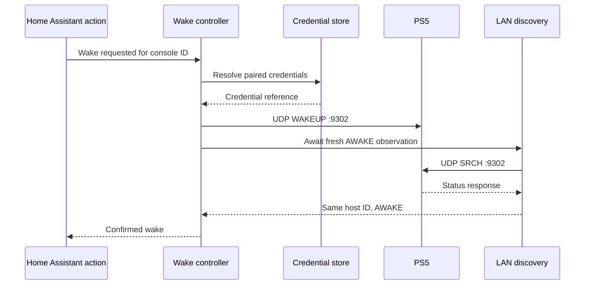

# Protocol 03 — PlayStation console wake-up

**Status:** Source-derived technical specification; real-device validation deferred to implementation  
**Reviewed:** 2026-11-05  
**Proposed Python module:** `custom_components/playstation_hub/transport/wake.py`  
**Pinned upstream reference:** playactor source tree `93ee087445db368acaba9ad50099bce56ca9141d`

## 1. Objective and scope

Wake a previously paired PlayStation 5 over the local network, without requiring PS5-MQTT, Mosquitto, Node.js, or a separate Home Assistant App. The wake operation must be authenticated where the upstream protocol requires it and must confirm the resulting console state using fresh LAN discovery.

**Evidence categories:** SOURCE = confirmed from inspected upstream implementation; DECISION = PlayStation Hub design; OPEN = requires further research or implementation-stage validation.

## 2. Transport and protocol constants

| Property | Upstream value | Evidence |
| --- | --- | --- |
| Transport | IPv4 UDP | `src/waker/udp.ts` |
| PS5 destination | UDP port `9302` | `wakePortsByType` |
| PS4 destination | UDP port `987` | `wakePortsByType` |
| Request method | `WAKEUP` | `src/waker.ts` |
| PS5 discovery version | `00030010` | `src/discovery/model.ts` |
| Recipient | Discovered device IPv4 address | `UdpWakerNetwork.sendTo` |
| Local bind | Configured interface address, otherwise OS-selected | `UdpWakerNetwork.open` |
| Response confirmation | Discovery of same host ID in `AWAKE` | `Waker.deviceAwakened` |
| Default discovery timeout | 30 seconds in upstream discovery config | `src/discovery/model.ts` |

These are reference values, not final PlayStation Hub scheduling decisions.

## 3. Credential model and message format

**SOURCE:** The upstream `CredentialManager.getForDevice` retrieves credentials by the discovered console ID. If none exist, the source requires an `AWAKE` console before initiating registration.

The Remote Play credential model includes these outbound discovery fields:

| Field | Upstream Remote Play value / meaning |
| --- | --- |
| `app-type` | `r` |
| `auth-type` | `R` |
| `client-type` | `vr` |
| `user-credential` | Credential material, **secret** |
| `model` | Optional upstream model selector |

**SOURCE:** `formatDiscoveryMessage` serializes allowlisted credential fields as newline-separated text and appends `device-discovery-protocol-version`. It does not serialize arbitrary credential-object properties such as the nested registration structure.

Illustrative wire structure, with placeholders **not real credentials**:

```text
WAKEUP * HTTP/1.1
app-type:r
auth-type:R
client-type:vr
user-credential:<REDACTED>
device-discovery-protocol-version:00030010
```

**OPEN:** Exact derivation of `user-credential` for a PS5 Remote Play registration must be documented from the credential requester/registration modules before this can be considered a complete wire-level specification. Do not invent its value.

## 4. Source-confirmed wake sequence

1. Inspect the known device status. If already `AWAKE`, return the upstream `ALREADY_AWAKE` result without sending a wake request.
2. Resolve stored credentials by stable device ID; reject missing credentials if the console is not awake for initial registration.
3. Create an IPv4 UDP socket bound to the configured local interface or an OS-selected interface.
4. Format a credential-bearing `WAKEUP` message using the discovered device protocol version.
5. Send the datagram to the device's IPv4 address on UDP port `9302`.
6. Start LAN discovery with duplicate observations allowed and wait for an observation of the **same device ID** in `AWAKE`.
7. Report success only after confirmation; if discovery ends without matching confirmation, report failure.
8. Close the wake UDP socket in a `finally` block.



The diagram is the intended happy path, not proof that every firmware/network configuration behaves identically.

## 5. PlayStation Hub state machine (DECISION)

| State | Meaning | Next state |
| --- | --- | --- |
| `IDLE` | No wake request pending | `CHECKING` |
| `CHECKING` | Validate identity, fresh status and permissions | `ALREADY_AWAKE`, `SENDING`, `FAILED` |
| `SENDING` | Sending authenticated UDP wake datagram | `VERIFYING`, `FAILED` |
| `VERIFYING` | Await matching fresh LAN observation | `CONFIRMED`, `TIMEOUT`, `UNKNOWN` |
| `CONFIRMED` | Fresh observation confirms awake | Terminal |
| `ALREADY_AWAKE` | Fresh observation confirms no wake needed | Terminal |
| `FAILED` | Explicit validation/transport failure | Terminal |
| `TIMEOUT` | Confirmation deadline expired | Terminal |
| `UNKNOWN` | Command may have been received but outcome cannot be established | Terminal |

**DECISION:** A successful UDP send is only `SENDING` completed; it is not a confirmed wake. After a timeout, avoid claiming that the console remains in standby or that the packet was not delivered.

## 6. Multi-console behavior

- Use the stable console ID, not just IP address, to select credentials and confirm wake.
- Isolate concurrent wake requests per console; deduplicate repeated requests for the same device.
- Allow bounded parallel commands for different consoles.
- Do not block other consoles' status polling during a wake transition.
- If a console's address changes, rediscover it and verify its identity before using stored credentials.
- Reject a response from a different host ID even when it arrives from the expected IP.

## 7. Security and credential handling

- Pairing must be explicit and user-authorized; no automatic credential registration against an unknown device.
- Never log `user-credential`, registration keys, pairing PINs or raw wake datagrams.
- Store credentials using an approved Home Assistant-compatible protected persistence strategy, outside frontend/static files and repository source.
- Use Home Assistant permission checks for wake actions; do not rely on hiding a frontend button.
- Limit destinations to the selected validated console and avoid arbitrary user-supplied broadcast destinations for authenticated wake.
- Implement re-pairing, revocation and unlinking without silently deleting historical game sessions.

## 8. Error taxonomy (proposed)

| Error | Meaning |
| --- | --- |
| `CONSOLE_NOT_PAIRED` | No stored credential for selected console |
| `INVALID_CREDENTIAL` | Stored credential is invalid or malformed |
| `CONSOLE_IDENTITY_CHANGED` | Discovery identity no longer matches |
| `NETWORK_SEND_FAILED` | UDP send returned a transport error |
| `WAKE_CONFIRMATION_TIMEOUT` | No fresh matching awake observation |
| `DISCOVERY_UNAVAILABLE` | Discovery transport could not be started |
| `COMMAND_CANCELLED` | Integration unloading or user/system cancellation |

These are internal application categories, not Sony wire-protocol error codes.

## 9. Upstream behavior and planned improvements

- **SOURCE:** `Waker.wake` uses `ALREADY_AWAKE` when the supplied device object is awake. **DECISION:** Check freshness; a stale awake snapshot cannot automatically prove the console is currently awake.
- **SOURCE:** Upstream wake sends a single packet and then waits. **DECISION:** Any retry policy must be separately specified and bounded; avoid uncontrolled repeated wake requests.
- **SOURCE:** `CredentialManager` stores credentials keyed by console ID. **DECISION:** Credentials must be isolated across consoles, accounts and config entries.
- **SOURCE:** `UdpWakerNetwork` closes its socket; `Waker` closes in `finally`. **DECISION:** Ensure cancellation-safe cleanup for wake and discovery sockets.
- **SOURCE:** Upstream tests simulate standby followed by awake discovery. **DECISION:** Expand tests to cover failures, stale state and identity mismatch.

## 10. Implementation-stage test plan

- [ ] Exact wake message field order/encoding with synthetic credential data.
- [ ] Destination port 9302 and correct selected console IP.
- [ ] Already-awake behavior with fresh versus stale observations.
- [ ] Missing/invalid credential handling without leaking secrets.
- [ ] Successful UDP send followed by confirmed awake response.
- [ ] UDP send success but no confirmation: timeout/unknown, not success.
- [ ] Wrong console ID response rejected.
- [ ] Multiple consoles and overlapping wake requests.
- [ ] Network-interface selection, IP changes and VLAN restrictions.
- [ ] Cancellation and socket cleanup on unload.
- [ ] Verify wake behavior from rest mode and limitations when fully powered off.
- [ ] Confirm Home Assistant authorization and translated error messages.

## 11. Sources

- [Wake controller](https://github.com/dhleong/playactor/blob/main/src/waker.ts)
- [UDP wake transport](https://github.com/dhleong/playactor/blob/main/src/waker/udp.ts)
- [Credential manager](https://github.com/dhleong/playactor/blob/main/src/credentials.ts)
- [Credential model](https://github.com/dhleong/playactor/blob/main/src/credentials/model.ts)
- [Credential storage](https://github.com/dhleong/playactor/blob/main/src/credentials/disk-storage.ts)
- [Discovery request formatter](https://github.com/dhleong/playactor/blob/main/src/protocol.ts)
- [Wake test](https://github.com/dhleong/playactor/blob/main/test/waker-test.ts)
- [PS5-MQTT wake wrapper](https://github.com/FunkeyFlo/ps5-mqtt/blob/main/ps5-mqtt/server/src/playactor/client.ts)

## 12. Remaining research

Trace the `user-credential` derivation, inspect registration credential construction, review credential persistence safety and decide a bounded retry policy. These are documentation tasks; live tests will be performed during implementation.

**Related:** [01 — LAN discovery](01-lan-discovery.md) · [02 — Console status](02-console-status.md) · [04 — Remote Play registration](04-remote-play-registration.md) · [Protocol index](README.md).

## 13. Cross-repository wake confirmation and error traps (2026-11-06)

**Research:** [Pinned upstream source audit](../research/upstream-source-deep-audit-lan-remoteplay-psn-ha-2026-11-06.md), section 3. [playactor `waker.ts`](https://github.com/dhleong/playactor/blob/a9e72d67a3930a8f06455927edb547a1754ef0ac/src/waker.ts) sends PS5 `WAKEUP` over UDP port `9302` (as declared by [`waker/udp.ts`](https://github.com/dhleong/playactor/blob/a9e72d67a3930a8f06455927edb547a1754ef0ac/src/waker/udp.ts)), then waits for the **matching device ID** to be freshly discovered as AWAKE. This is stronger than claiming success from UDP send alone. However, playactor's discovery status parser mistakenly treats all non-620 response codes as AWAKE; the status decoder must be corrected to candidate `200`/READY, `620`/STANDBY, other codes UNKNOWN before inheriting wake confirmation.

[PS5-MQTT wake saga](https://github.com/FunkeyFlo/ps5-mqtt/blob/7ab3075d276f3eeecd81a3322c72231af8cd51bd/ps5-mqtt/server/src/redux/sagas/turn-on-device.ts) publishes AWAKE when playactor's wake method resolves; its [wake-failure e2e source test](https://github.com/FunkeyFlo/ps5-mqtt/blob/7ab3075d276f3eeecd81a3322c72231af8cd51bd/ps5-mqtt/server/e2e/wake-failure.e2e.test.ts) asserts failed wake does not publish a successful transition. These are upstream mock-backed tests, not evidence of our future implementation. PlayStation Hub should use a versioned command operation with bounded verification, validated target console ID and a fresh recognized state response; no optimistic durable state or session change after only a socket write, CLI exit or command HTTP acknowledgement.

## 14. Library completion semantics: confirmed versus sent (2026-11-06)

[Second source audit](../research/upstream-protocol-triangulation-and-lan-title-forensics-2026-11-06.md) cross-checked [playactor Waker](https://github.com/dhleong/playactor/blob/a9e72d67a3930a8f06455927edb547a1754ef0ac/src/waker.ts) with [ps5-remoteplay Python `wake`](https://github.com/iharosi/ps5-remoteplay/blob/61e1f7dc065a77f7e8b1de5057889a08b0208d9d/src/ps5_remoteplay/wake.py#L13-L23). The Python library method sends WAKEUP and returns WITHOUT a fresh status check; its CLI separately waits for status unless `--no-wait`. Playactor waits for an AWAKE discovery state but inherits its permissive non-620 parser. These are not equivalent success guarantees.

For PlayStation Hub define `SENT` (network write completed), `VERIFYING` (bounded status probes), `CONFIRMED` (new allowlisted 200 reply from the verified target), `INDETERMINATE` (verification deadline expired without proof), and `FAILED` (known rejection/error). Never automatically persist AWAKE on a UDP write, shell exit code or third-party library success. No automatic retries after an uncertain result without idempotent operation identity and current observation policy.

## 15. First-party DDP WAKEUP ownership and credential prerequisite (2026-11-06)

[Accepted dependency policy](../architecture/first-party-dependency-sovereignty-policy.md): native PlayStation Hub implements its own UDP WAKEUP packet and response verification via Python standard asyncio/socket, **without** playactor, ps5-remoteplay, Chiaki or a subprocess. The [Chiaki-ng formatter](https://github.com/chiaki-ng/chiaki-ng/blob/43728af2e639fecb8a7af1cd68c29820a40de973/lib/src/discovery.c#L67-L90) shows source-derived header names and user-credential usage; this is a read-only specification reference, NOT license to copy its code or registration material.

Wake is *not* automatically feasible without credentials: a valid pairing-derived \`user-credential\` is a prerequisite. Basic LAN discovery does not obtain it. If approved credential provisioning is absent, the integration may monitor a PS5 while **wake control remains disabled/unavailable**. A successful UDP send is SENT, not physical AWAKE; only a fresh verified owner-specific 200/READY status observation changes confirmation. No fake "unauthenticated wake" and no optimistic Home Assistant switch state.
