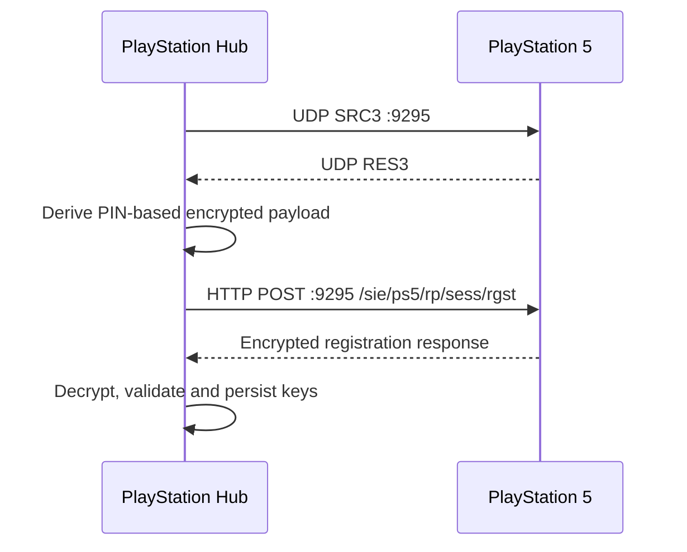

# Protocol 04 — PS5 Remote Play registration

**Status:** Source-derived technical specification; validation during implementation  
**Reviewed:** 2026-11-05  
**Reference:** playactor tree `93ee087445db368acaba9ad50099bce56ca9141d`  
**Proposed module:** `custom_components/playstation_hub/transport/remote_play/registration.py`

## 1. Objective and scope

Pair a user-selected PlayStation 5 for authenticated Remote Play operations, notably standby and credentialed wake. Registration is not required for unauthenticated LAN discovery. This document describes the observed upstream sequence; it is not official Sony protocol documentation.

## 2. Required prerequisites

- Console identified through validated LAN discovery and reachable on its local network.
- User explicitly starts pairing while the console is awake and obtains a Remote Play registration PIN from its interface.
- A PlayStation Network account identifier used by the registration request, not merely an arbitrary username.
- Network access to PS5 UDP/TCP port 9295.
- Secure persistent storage for per-console registration results.

**Design:** Distinguish the Remote Play registration PIN from a later console-user login passcode. Never silently attempt pairing on an unknown device.

## 3. Registration discovery handshake

The upstream PS5 registration process sends the exact ASCII bytes `SRC3` to the selected console's IPv4 address on UDP port **9295**, using a local UDP socket bound to port **9295**. It waits up to **30 seconds** for a response beginning with `RES3`, closes the socket, and delays **100 ms** before the HTTP registration request.

The corresponding PS4 values are `SRC2` and `RES2`. They are not interchangeable with PS5.

**Source limitation:** Upstream accepts a datagram with the expected prefix; our implementation should also validate source IP, payload size and response freshness to avoid accepting unrelated datagrams.

## 4. Registration HTTP request

The source constructs a registration payload containing `Client-Type` and `Np-AccountId` fields, encrypts it using PIN-derived cryptographic material, and sends it via HTTP POST to:

`http://<validated-console-ip>:9295/sie/ps5/rp/sess/rgst`

The request includes `RP-Version: 1.0` for the upstream PS5 Remote Play version mapping. The upstream HTTP helper supplies a Remote Play user-agent and processes response status and `RP-Application-Reason` errors.

**Important:** The registration endpoint uses HTTP as a transport for an encrypted payload; do not assume TLS protects the outer HTTP request. Sensitive data handling must rely on correct protocol encryption, local-network trust assumptions and secure storage.

## 5. Cryptographic preparation

The source uses a cryptographically random 16-byte nonce, a PS5-specific modern crypto strategy, PIN-dependent seed derivation and AES-128-CFB with HMAC-SHA256-derived IV. Its registration preface is 480 bytes and includes protocol-specific signed/derived fields.

The complete algorithm and independent vectors belong in [05 — Remote Play cryptography](05-remote-play-cryptography.md). Do not duplicate lookup tables here or implement custom cryptography from memory.

## 6. Registration response and credentials

After decrypting the response, the upstream parser reads CRLF-separated key/value records. Relevant fields in its credential model include:

| Field | Meaning / handling |
| --- | --- |
| `RP-Key` | Required 16-byte key represented as 32 hex characters; validate before accepting |
| `RP-KeyType` | Registration key type; retain only if needed |
| `PS5-RegistKey` | PS5 registration key used for later session initialization |
| `PS5-Mac` | Optional console identifier metadata |
| `PS5-Nickname` | Optional console nickname |
| `AP-Bssid`, `AP-Name` | Additional upstream registration metadata |

**Design:** Require the fields needed for the actual PS5 session and wake operation; never log decrypted response bodies or raw registration keys. A syntactically valid response is not proof of future session compatibility.

## 7. Proposed registration state machine

`NOT_PAIRED → PRECHECK → AWAITING_PIN → REGISTRATION_DISCOVERY → ENCRYPTING → REGISTERING → VALIDATING → PAIRED`

Any stage can transition to `FAILED` or `CANCELLED`. Persist credentials only after complete validation; clean up UDP sockets, HTTP connections and transient secrets on failure. Never leave a partially paired configuration entry appearing ready.

## 8. Error categories and recovery

- `CONSOLE_UNREACHABLE`: selected console cannot be contacted.
- `REGISTRATION_DISCOVERY_TIMEOUT`: no valid RES3 response.
- `PIN_REJECTED`: explicit registration rejection, if confirmed by response.
- `PSN_ACCOUNT_INVALID`: invalid account identifier or authorization failure.
- `REMOTE_PLAY_IN_USE`: upstream error category for an occupied session.
- `REMOTE_PLAY_VERSION_MISMATCH`: protocol version rejection.
- `INVALID_REGISTRATION_RESPONSE`: missing/invalid key fields.
- `REGISTRATION_CANCELLED`: user or integration cancellation.

These are proposed application error categories, not a complete official Sony error-code list.

## 9. Multi-console and Home Assistant integration decisions

- Pairing is scoped to the selected stable console ID and authorized account.
- Credentials for different consoles must not overwrite one another.
- Use a native Home Assistant Config Flow/reauthentication flow and translated errors.
- Do not place keys in the sidebar panel configuration, diagnostics or static JavaScript.
- Pairing and account unlinking must not delete game history automatically.
- LAN-only discovery/status remains available without registration.
- The user must explicitly authorize any future power-control operation.

## 10. Security and license considerations

The upstream source uses protocol-specific crypto tables and behavior influenced by reverse-engineered Remote Play clients. Review their provenance and licenses before reusing source, tables or fixtures. Validate PIN format and limit retry attempts. Never log secrets or use a remote pairing proxy. All network destinations must be derived from the validated console identity, not arbitrary untrusted URLs.

## 11. Implementation-stage test plan

- [ ] Exact SRC3/RES3 datagrams, port and source-address validation.
- [ ] Timeout and socket cleanup after no RES3.
- [ ] Correct HTTP endpoint, RP-Version and encrypted payload framing.
- [ ] Known-answer PS5 registration payload test.
- [ ] Reject incorrect PIN and malformed/short encrypted response.
- [ ] Require RP-Key and PS5-RegistKey as appropriate to selected session flow.
- [ ] Handle cancellation, power loss and concurrent pairing attempts.
- [ ] Keep credentials isolated between consoles.
- [ ] Ensure redaction in exceptions, diagnostics and logs.
- [ ] Verify paired wake/standby on a test PS5 during implementation.

## 12. Sources

- [Registration flow](https://github.com/dhleong/playactor/blob/main/src/remoteplay/registration.ts)
- [Registration tests](https://github.com/dhleong/playactor/blob/main/test/remoteplay/registration-test.ts)
- [Credential model](https://github.com/dhleong/playactor/blob/main/src/credentials/model.ts)
- [Crypto entry point](https://github.com/dhleong/playactor/blob/main/src/remoteplay/crypto.ts)
- [Modern PS5 crypto](https://github.com/dhleong/playactor/blob/main/src/remoteplay/crypto/modern.ts)
- [Crypto base](https://github.com/dhleong/playactor/blob/main/src/remoteplay/crypto/base.ts)
- [Remote Play version and errors](https://github.com/dhleong/playactor/blob/main/src/remoteplay/model.ts)
- [Remote Play HTTP transport](https://github.com/dhleong/playactor/blob/main/src/remoteplay/protocol.ts)

## 13. Open research

Trace the precise construction of wake `user-credential` from the registration results, check PSN account ID acquisition and review the full crypto key-table provenance. Live firmware validation remains intentionally deferred.

**Related:** [03 — Console wake-up](03-console-wakeup.md) · [05 — Cryptography](05-remote-play-cryptography.md) · [Protocol index](README.md).

## 14. Independent pairing-source confirmation and license boundary (2026-11-06)

**Research:** [Cross-repository source audit](../research/upstream-source-deep-audit-lan-remoteplay-psn-ha-2026-11-06.md). In [playactor registration](https://github.com/dhleong/playactor/blob/a9e72d67a3930a8f06455927edb547a1754ef0ac/src/remoteplay/registration.ts), discovery/search is an actual **pairing precondition**, not optional UI: it primes registration before the encrypted registration request on port `9295`. [Chiaki-ng `lib/src/regist.c`](https://github.com/chiaki-ng/chiaki-ng/blob/43728af2e639fecb8a7af1cd68c29820a40de973/lib/src/regist.c) independently models version-specific request paths, search, stop and response handling. [Chiaki-ng `test/rpcrypt.c`](https://github.com/chiaki-ng/chiaki-ng/blob/43728af2e639fecb8a7af1cd68c29820a40de973/test/rpcrypt.c) carries PS5 registration IV/crypto vectors.

The canonical Chiaki source repository now lives at `chiaki-ng/chiaki-ng` (formerly `streetpea/chiaki-ng`) and is **AGPL-3.0**. We may inspect and compare behavior, but directly copying or linking cryptography/tables/vectors into a separately licensed integration requires an explicit licensing and attribution decision. The Python `playdirector` package changed in version **0.4.x** to an embedded pyremoteplay engine/API and **GPL-3.0-only** license; old 0.3.x MIT examples are not valid for latest-version dependency selection ([PyPI 0.4.2](https://pypi.org/project/playdirector/0.4.2/)). No dependency selected or paired device was tested.

## 15. From-scratch registration with an explicit encryption backend gate (2026-11-06)

**Superseding runtime direction:** [First-party package-free policy](../architecture/first-party-dependency-sovereignty-policy.md). PlayStation Hub will not import/run any playactor, Chiaki, pyremoteplay, PSNAWP or PS5-MQTT runtime library, binary, JS process or vendorized source. Instead, it may later implement registration's HTTP framing, nonce/counter, byte parsing and state machine itself using Python stdlib/HA supported services, from independently reviewed protocol evidence.

**Do not invent crypto:** Existing source describes AES-128-CFB and HMAC-SHA256 during PS5 Remote Play registration/control. Python stdlib includes HMAC/SHA256/randomness but no general raw AES-CFB/CBC API; `ssl` implements TLS, not Sony protocol AES. The registration and secure credential creation are **BLOCKED_CRYPTO_BACKEND** unless a suitable well-audited HA-supported primitive is proven and explicitly approved, or the maintainer separately authorizes a narrowly vetted runtime primitive. No hand-written AES/ctypes OpenSSL ABI workaround or copied AGPL/GPL key tables. Thus no registration, standby or credential-derived wake is promised solely because LAN discovery works. Actual protocol/source/license and Sony service permissions remain gates.

## 16. Deep first-party pairing wire audit: SRC3 vs SRCH, account and user-PIN split (2026-11-06)

**New complete source audit:** [PS5 Remote Play registration/control source review](../research/first-party-ps5-remote-play-registration-control-source-audit-2026-11-06.md), [own operation contract](../architecture/first-party-remote-play-registration-control-contract.md). The official [Sony manual-pairing guide](https://www.playstation.com/pt-pt/support/games/playstation-remote-play-on-pc-and-mac/) confirms a user manually enters the number from **PS5 Settings → System → Remote Play → Pair Device** on the same local network; this is separate from a PlayStation user passcode requested later by authenticated Remote Play.

**Wire-stage distinction:** Playactor and independently implemented Chiaki use **UDP SRC3/RES3 on 9295** as a registration preflight, **not** passive DDP SRCH on UDP 9302. The pinned [playactor registration](https://github.com/dhleong/playactor/blob/a9e72d67a3930a8f06455927edb547a1754ef0ac/src/remoteplay/registration.ts) sends raw `SRC3` and waits for `RES3`; [Chiaki-ng regist.c](https://github.com/chiaki-ng/chiaki-ng/blob/43728af2e639fecb8a7af1cd68c29820a40de973/lib/src/regist.c#L451-L492) sends `SRC3` **with terminal NUL**, and the Python port sends bytes without explicit NUL. This and timing differences are compatibility cases requiring real PS5 firmware tests. Don't bind to any arbitrary RES3 reply without validating source/selected owner and user pairing intent.

Successful preflight is followed by **TCP 9295 POST `/sie/ps5/rp/sess/rgst`**, with RP-Version and a PIN/account-derived encrypted payload; validate `PS5-RegistKey` and `RP-Key` and any supported key type before accepting a credential record. The Sony account ID required by the community registration source must come from a legitimate authorized source, not from a presumed device name or somebody else's OAuth client credentials. Keep account, Pair Device number, user login passcode and RP keys as **different** security scopes. No code/pairing/session test performed. Cipher backend and permissible key/protocol provenance remain approval-gated.

## 17. Registration nonce and table-dependency audit (2026-11-07)

[PS5 Remote Play crypto source/rights audit](../research/ps5-remote-play-crypto-derivation-versions-and-security-source-audit-2026-11-07.md) distinguishes the **new random 16-byte registration nonce**, the ephemeral user Pair Device PIN, a PIN-derived 16-byte encryption seed, the 480-byte registration preface, version-specific lookup transformations, the decrypted output `RP-Key`/RegistKey and the later session server `RP-Nonce`. The fact that these inputs and outputs share a 16-byte size does not make them interchangeable.

The source-reviewed local-registration preface is filled with ASCII `A`; its two lookup offset selectors in this implementation evaluate to 1 and 8. This is a code-level deterministic feature, not a Sony protocol requirement. The table bytes themselves, other source vectors and third-party code must NOT be copied/embedded without independently reviewed lawful provenance and the maintainer's approval. The encrypted register operation and legitimate PSN account ID procurement remain blocked; no pairing, PIN input, key retrieval or console test was performed.
