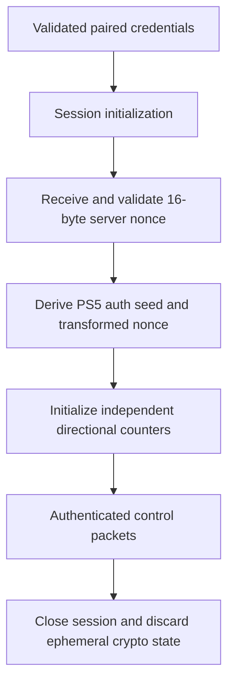

# Protocol 05 — PS5 Remote Play cryptography

**Status:** Source-derived technical specification; interoperability validation deferred to implementation  
**Reviewed:** 2026-11-05  
**Pinned upstream reference:** [playactor](https://github.com/dhleong/playactor), tree `93ee087445db368acaba9ad50099bce56ca9141d`  
**Proposed module:** `custom_components/playstation_hub/transport/remote_play/crypto.py`

## 1. Purpose and evidence

Specify the cryptographic mechanisms observed in the open-source PS5 Remote Play implementation for registration and authenticated control sessions. This document is not official Sony documentation and does not assert protocol stability or successful PlayStation Hub interoperability.

**SOURCE** means directly confirmed in upstream code; **DECISION** means PlayStation Hub architecture; **OPEN** means not established or awaiting implementation-stage tests.

## 2. Algorithm selection

| Context | Upstream algorithm / primitive | Evidence |
| --- | --- | --- |
| PS5 Remote Play registration and session | AES-128-CFB | `remoteplay/crypto/base.ts` |
| IV derivation | HMAC-SHA256, first 16 digest bytes | `remoteplay/crypto/base.ts` |
| Registration nonce | 16 cryptographically random bytes | `remoteplay/crypto.ts` |
| Session nonce | 16 bytes from `RP-Nonce` HTTP header | `remoteplay/session.ts` |
| Session packet counters | Independent outbound and inbound counters, initially zero | `remoteplay/codec.ts` |
| Modern PS5 seed derivation | Device-specific lookup tables and byte transformations | `remoteplay/crypto/modern.ts` |
| Legacy Second Screen default | AES-128-CBC | `socket/crypto-codec.ts` |

**Critical distinction:** `CryptoCodec` defaults to AES-128-CBC for legacy paths, but the PS5 Remote Play `BaseCryptoStrategy` explicitly passes `aes-128-cfb`. Do not use the codec's default algorithm for PS5.

## 3. Initialization vector derivation

**SOURCE:** `generateIv(version, nonce, counter)` computes:

```text
counter_bytes = uint64_be(counter)
digest = HMAC_SHA256(hmac_key_for_version, nonce || counter_bytes)
iv = digest[0:16]
```

The upstream PS5 Remote Play version uses a fixed protocol HMAC key in its source. That constant is protocol material, **not** a per-user credential. Reuse and licensing must be reviewed before shipping derived code.

**SOURCE:** The counter is an unsigned 64-bit big-endian integer. `nonce` is 16 bytes; `iv` is 16 bytes. Validate these lengths strictly in Python. Never silently wrap counters.

### Public synthetic known-answer test

The upstream `base-test.ts` contains a PS5 test vector:

```text
nonce (hex): 3e7e7a825973adab2f694346bd44dab5
counter: 0
expected IV (hex): 9044408273f8044dca767b5a16394d64
```

This is a public test fixture, not a real user's secret. A future independent Python implementation must reproduce it exactly.

## 4. PIN-based registration crypto

**SOURCE:** `RemotePlayCrypto.forDeviceAndPin` creates a random 16-byte nonce, selects the modern PS5 strategy and generates a 480-byte preface initially filled with ASCII `A`.

The PS5 `generatePinSeed` function uses `INIT_KEYS[PS5]`, an offset extracted from the preface at `0x18D` masked with `0x1F`, and XORs the four bytes of the numeric PIN into seed positions `0x0c..0x0f`. The derived seed is 16 bytes.

The PS5-specific `generateAeropause` uses the nonce, `AERO_KEYS[PS5]`, a lookup offset from the preface, and byte-wise arithmetic. It places halves of the result at preface offsets `0xC7` and `0x191`.

The registration payload is constructed from CRLF-separated key/value text, encrypted with AES-128-CFB, and prefixed by the signed/modified 480-byte preface. The upstream registration request includes `Client-Type` and `Np-AccountId` fields.

### Public synthetic PIN-seed test

```text
device: PS5
initKeyOff: 0x1e
PIN (test-only): 78703893
expected seed (hex): e29d644c141b9d617431a56d34cfc17f
```

**OPEN:** The complete lookup-table provenance and independent PS5 registration cryptographic vectors must be audited before incorporating them into PlayStation Hub.

## 5. Session authentication crypto

**SOURCE:** The session initialization request uses the registration key and obtains a 16-byte `RP-Nonce` from the console.

`createCodecForAuth` validates the 16-byte `RP-Key`, transforms the server nonce using PS5-specific `AUTH_NONCE_KEYS`, derives a 16-byte authentication seed using `AUTH_SEED_KEYS`, and derives the IV using the transformed nonce and a directional packet counter.

For PS5, the upstream nonce transform subtracts `0x2d + index` from each server-nonce byte before XOR with a lookup key. The authentication seed transform adds `0x18 + index` to each byte of the RP key, XORs the server nonce, then XORs a lookup key. Arithmetic is byte-sized (modulo 256).

**OPEN:** The inspected `modern-test.ts` has known-answer tests for PS5 PIN seed, but its authentication nonce/seed fixtures cover PS4 only. A complete PS5 auth fixture must be obtained or independently generated.

## 6. Packet encryption and framing

**SOURCE:** `RemotePlayPacketCodec` preserves the first eight bytes of each packet as a cleartext header. For packets with payload, it encrypts the payload using AES-128-CFB and an IV derived from the current outgoing counter; inbound payloads are decrypted with a separate incoming counter.

```text
packet = header[8 bytes] || encrypted_payload
header = payload_length_u32_be || command_type_u16_be || reserved_u16_be
```

The upstream code bypasses payload crypto when the packet is header-only. Counters increment when `encodeBuffer` or `decodeBuffer` is invoked.

**DECISION:** Implement framing and crypto as distinct units. Do not assume a TCP `recv` corresponds to one complete packet. Use a bounded frame reader, preserve counter sequencing, and reject truncated, oversized, malformed and out-of-order frames.

## 7. Crypto state lifecycle (proposed)



**DECISION:** Per-console/per-session crypto state must never be shared. A failed handshake must close the connection and invalidate ephemeral nonce, counters and cipher state. Reconnection creates a fresh session; never resume a partially used cipher stream without a proven protocol mechanism.

## 8. Security design

- Use maintained, audited Python cryptographic primitives; do not implement AES or HMAC algorithms manually.
- Treat PIN, account ID, `RP-Key`, registration key, derived seeds, encrypted/decrypted payloads and live session state as sensitive.
- No raw payload, nonce, key or PIN logging. Even encrypted traffic can reveal sensitive metadata.
- Validate nonce/key lengths, PIN format, lookup offsets, packet sizes and counter bounds.
- Keep cryptographic code independent of Home Assistant entities, persistence and frontend.
- Never ship real credentials in source, test fixtures or diagnostics.
- Review license and provenance of upstream key tables and Chiaki-derived test fixtures before reuse.
- AES-CFB is confidentiality-oriented and does not itself provide modern authenticated encryption. Do not claim protocol-level message authenticity beyond what the studied Remote Play protocol actually verifies.

## 9. Proposed Python boundaries

```text
remote_play/
  crypto.py           # Key/IV derivation and cipher adapter
  packets.py          # Frame encoding and decoding
  registration.py     # PIN-based registration workflow
  session.py          # Nonce, counters and authenticated control lifecycle
```

The module must expose typed, deterministic functions for derivations and an isolated session codec. No blocking crypto/file I/O on the Home Assistant event loop; benchmark CPU cost and use an executor where needed.

## 10. Test plan for implementation stage

- [ ] Reproduce the PS5 IV known-answer vector.
- [ ] Reproduce the PS5 PIN-seed known-answer vector.
- [ ] Reproduce the synthetic registration payload vector after provenance/license review.
- [ ] Add independent PS5 auth nonce and seed known-answer vectors.
- [ ] Verify AES-128-CFB encrypt/decrypt round trips and upstream-compatible byte output.
- [ ] Verify independent send/receive counters and correct endian encoding.
- [ ] Test malformed nonce, key, PIN, packet header and oversized frame.
- [ ] Test partial TCP frames and multi-frame input.
- [ ] Test cancellation, reconnect and per-console isolation.
- [ ] Check no secrets appear in logs, exception strings, diagnostics or exports.
- [ ] Validate registration/session interoperability with a test PS5.

## 11. Sources

- [Remote Play crypto entry](https://github.com/dhleong/playactor/blob/main/src/remoteplay/crypto.ts)
- [Base crypto strategy](https://github.com/dhleong/playactor/blob/main/src/remoteplay/crypto/base.ts)
- [Modern PS5 strategy](https://github.com/dhleong/playactor/blob/main/src/remoteplay/crypto/modern.ts)
- [Protocol lookup tables](https://github.com/dhleong/playactor/blob/main/src/remoteplay/crypto/keys.ts)
- [Generic cipher adapter](https://github.com/dhleong/playactor/blob/main/src/socket/crypto-codec.ts)
- [Remote Play packet codec](https://github.com/dhleong/playactor/blob/main/src/remoteplay/codec.ts)
- [Remote Play session](https://github.com/dhleong/playactor/blob/main/src/remoteplay/session.ts)
- [IV known-answer tests](https://github.com/dhleong/playactor/blob/main/test/remoteplay/crypto/base-test.ts)
- [Modern strategy tests](https://github.com/dhleong/playactor/blob/main/test/remoteplay/crypto/modern-test.ts)
- [Registration tests](https://github.com/dhleong/playactor/blob/main/test/remoteplay/registration-test.ts)

## 12. Outstanding research

Complete the independent PS5 auth derivation fixtures, review full lookup tables and provenance, confirm AES-CFB segment behavior in chosen Python library, and inspect packet error recovery and heartbeat details in Protocol 06.

**Related:** [04 — Registration](04-remote-play-registration.md) · [06 — Session](06-remote-play-session.md) · [Protocol index](README.md).

## 13. Independent C implementation and known-answer test boundary (2026-11-06)

The current canonical [chiaki-ng source repository](https://github.com/chiaki-ng/chiaki-ng) (moved from `streetpea/chiaki-ng`) provides independently reviewed PS5 registration/session crypto in [`lib/src/rpcrypt.c`](https://github.com/chiaki-ng/chiaki-ng/blob/43728af2e639fecb8a7af1cd68c29820a40de973/lib/src/rpcrypt.c), with PS5 IV and key known-answer assertions in [`test/rpcrypt.c`](https://github.com/chiaki-ng/chiaki-ng/blob/43728af2e639fecb8a7af1cd68c29820a40de973/test/rpcrypt.c). This adds cross-implementation evidence beyond playactor's TypeScript strategy, but chiaki-ng is **AGPL-3.0**. Do **not** copy key tables, code or test data wholesale into our separately licensed integration without formal licensing review. Independently specified behavior, original clean tests and user-authorized device interoperability remain future implementation work.

Python `playdirector` version **0.4.2** is a changed GPL-3.0-only embedded pyremoteplay engine and not API/license-equivalent to the previous MIT `0.3.x` package ([current PyPI](https://pypi.org/project/playdirector/0.4.2/)). No crypto dependency, library, PS5 firmware compatibility or Remote Play registration behavior has been approved or tested. See the [pinned upstream source audit](../research/upstream-source-deep-audit-lan-remoteplay-psn-ha-2026-11-06.md).

## 14. Authoritative maintainer override: no external PlayStation packages and NO custom AES (2026-11-06)

**New requirement:** [First-party dependency sovereignty](../architecture/first-party-dependency-sovereignty-policy.md), [native runtime research](../research/first-party-protocol-implementation-and-runtime-boundaries-2026-11-06.md). Our own source must implement packet framing, transform orchestrations and state management if Remote Play is later implemented, but there will be **no dependency** on playactor, Chiaki, PS5-MQTT, pyremoteplay, playdirector, third-party cryptography CLI or copied vendor source/key tables. The prior phrase "use maintained audited Python cryptographic primitives" is now **a security constraint and explicitly unresolved backend selection**, not permission to add an undeclared external library.

The reviewed [playactor crypto/base.ts](https://github.com/dhleong/playactor/blob/a9e72d67a3930a8f06455927edb547a1754ef0ac/src/remoteplay/crypto/base.ts) uses AES-128-CFB and HMAC-SHA256, while [socket/crypto-codec.ts](https://github.com/dhleong/playactor/blob/a9e72d67a3930a8f06455927edb547a1754ef0ac/src/socket/crypto-codec.ts) separately references AES-128-CBC; these are **distinct codec contexts**, not permission to interchange modes. `hashlib`, `hmac`, `secrets` and `ssl` do not expose a Python standard-library general-purpose AES-CFB/CBC encrypt/decrypt API. Home Assistant's documented `aiohttp` and TLS wrappers likewise do not themselves provide that AES protocol function.

**Mandatory blocker: BLOCKED_CRYPTO_BACKEND.** Never hand-code AES, copy upstream GPL/AGPL crypto tables or call native OpenSSL through unstable `ctypes`/ABI just to claim zero pip dependencies. Determine whether a supported HA platform interface can safely provide the primitive **before** authorizing Remote Play implementation; if none is suitable under the maintainer's rule, encrypted Remote Play functionality is deferred. Passive LAN monitoring, title reports, SQLite history and panel remain fully independent.

## 15. Core 2026.11 cryptography pin: possible no-new-package AES exception, NOT approved (2026-11-06)

**Correcting a too-broad conclusion:** Python **stdlib** has no general AES-128-CFB/CBC interface; however [HA Core 2026.11.0 `pyproject.toml`](https://github.com/home-assistant/core/blob/2026.11.0/pyproject.toml) already pins `cryptography==50.0.2` as a platform requirement. [PyCA's 50.0.2 Decrepit cipher modes](https://cryptography.io/en/50.0.2/hazmat/decrepit/) include `CFB` for legacy compatibility; general primitives provide AES and CBC. CFB moved into the decrepit module and is discouraged except for required legacy interop.

Under **zero new pip requirements** we could potentially author our complete Remote Play transport and cryptographic *orchestration* ourselves while delegating only AES primitives to the already-installed vetted PyCA runtime. Under a **literal ban on any third-party library**, even that direct import remains disallowed. The maintainer has NOT selected an exception; this feature is **BLOCKED_CRYPTO_BACKEND_APPROVAL**. Do not present PyCA as a native HA AES API, Python stdlib, automatically approved dependency or tested PlayStation-compatible solution. No AES code, import, tables, device test or new package was introduced.

Full research and alternatives: [first-party runtime audit §11](../research/first-party-protocol-implementation-and-runtime-boundaries-2026-11-06.md#11-newly-verified-ha-core-platform-aes-candidate--zero-additional-pip-packages-but-still-third-party-code), [dependency policy §7](../architecture/first-party-dependency-sovereignty-policy.md#7-platform-preinstalled-cryptography-clarification--candidate-only).

## 16. Source-confirmed ordered cipher counters and protocol-stage separation (2026-11-06)

The [first-party Remote Play source audit](../research/first-party-ps5-remote-play-registration-control-source-audit-2026-11-06.md) and [operation contract](../architecture/first-party-remote-play-registration-control-contract.md) now document concrete cipher sequencing hazards. Pinned [Playactor RemotePlayPacketCodec](https://github.com/dhleong/playactor/blob/a9e72d67a3930a8f06455927edb547a1754ef0ac/src/remoteplay/codec.ts) maintains **independent encryptCounter and decryptCounter**; its eight-byte header-only frames bypass encrypted-payload counters. [ps5-remoteplay session.py](https://github.com/iharosi/ps5-remoteplay/blob/61e1f7dc065a77f7e8b1de5057889a08b0208d9d/src/ps5_remoteplay/session.py#L78-L102) explicitly says encrypted control HTTP field order sets counters `0..4`. Negotiation decrypts an encrypted server response header before binary login frames; resetting/advancing counters incorrectly would corrupt subsequent traffic. These are source observations, not our own tests or official Sony public protocol guarantees.

**Crypto scope:** Reviewed versions use AES-128-CFB and HMAC-SHA256 IV derivation with version-specific key transformations, not an arbitrary interchangeable AES mode. Our framing, byte counters and state machine must be first-party, but no hand-rolled AES or copied AGPL/GPL key tables. `cryptography==50.0.2` is already a HA Core runtime dependency, with legacy CFB in PyCA Decrepit, yet **direct usage remains NOT APPROVED** under the maintainer's no-external-library restriction. No import/key material/known-answer fixture is authorized or executable. Blocked feature: `BLOCKED_CRYPTO_BACKEND_APPROVAL`, independent of passive LAN.

## 17. PS5 derivation mathematics, CFB128 and independent oracle gaps (2026-11-07)

**Latest research:** [Pinned PS5 crypto derivation/version/security audit](../research/ps5-remote-play-crypto-derivation-versions-and-security-source-audit-2026-11-07.md). The analysis directly compares Playactor `base.ts`, `modern.ts`, `codec.ts` and `keys.ts`, Chiaki-ng `rpcrypt.c` plus its tests, the Python port's `crypto.py`/`test_crypto.py` and official PyCA/Mbed TLS documentation. This is **source research, no code/test/console validation**.

**Confirmed-by-source cipher variant:** Modern PS5 path uses **AES-128-CFB128**, evidenced by Chiaki's `mbedtls_aes_crypt_cfb128` and OpenSSL `EVP_aes_128_cfb128`, Playactor's explicit `aes-128-cfb` strategy and the Python port's `CFB` rather than `CFB8`. A generic codec's **CBC default** is unrelated to a Remote Play strategy that explicitly chooses CFB; CBC, CFB8, CFB128 and GCM are **not** interchangeable wire formats. A 480-byte Pair Device registration preface is protocol-specific packaging, not CBC block padding.

**IV relationship:** for a 16-byte stage-specific/transformed nonce, compute HMAC-SHA256 over nonce concatenated with an **unsigned 64-bit big-endian counter**, using the version-specific IV key. HMAC returns **32 bytes**; only the first **16** form the AES-CFB128 IV. Do not confuse the full HMAC output length with IV length. A registration random nonce, the 16-byte `RP-Key`, the 16-byte `RP-Nonce` server result, a transformed auth nonce and a PIN-derived seed are DIFFERENT stage-specific data with separate lifetimes and security scopes.

**Table-dependent derivation:** The Modern PS5 branch selects PIN-seed, registration aeropause, authentication nonce-transform and authentication seed-transform lookups from large version/device-specific embedded tables, then combines them using arithmetic/XOR modulo 256. In the reviewed **local registration preface of ASCII 'A'**, source offset selectors `preface[0x18D] & 0x1f` and `preface[0] >> 3` resolve to fixed **1** and **8** respectively; these are an implementation choice, **not a firmware or security guarantee**. We will NOT copy/source-vendor these GPL/AGPL/proprietary lookup tables or their complete test-vector bytes. A separate lawful independently verifiable provenance specification is required before coding.

**Counter state:** HTTP control encrypted headers consume outbound counters in their specific order; the encrypted `RP-Server-Type` reply consumes the inbound counter, then the same TCP socket starts binary control. The unencrypted 8-byte `length/type/reserved` header of a zero-payload frame consumes **no payload cipher counter**. A nonempty encrypted payload consumes the appropriate **one** per-direction counter, independently of TCP segmentation. Wrong field ordering, restarts of a cipher context, duplicated packets or counter reuse can desynchronize the session.

**Upstream test limitations:** The Python test file explicitly calls one case `test_generate_iv_playactor_case` and uses vectors based on the TypeScript implementation; Chiaki's PS5 IV and registration seed tests show important mathematical consistency but the inspected `test/rpcrypt.c` encryption/decryption test names are **PS4 pre-10**, not a full modern PS5 control-channel test matrix. Equal publicly circulated vectors are not proof of two independent actual console captures.

**Potential alternate-backend defect — security audit concern, NOT verified exploit:** The pinned conditional Chiaki Mbed TLS HMAC-SHA256 path appears to use an output buffer sized for the **16-byte truncated IV**, while HMAC-SHA256 outputs **32 bytes**. Its OpenSSL path allocates the full digest size. Review and potentially report through coordinated upstream disclosure; never reproduce the C pattern. We did NOT build Mbed TLS or test an exploit. See [research §7](../research/ps5-remote-play-crypto-derivation-versions-and-security-source-audit-2026-11-07.md#7-high-priority-source-safety-finding-conditional-mbed-tls-hmac-output-buffer).

**Version semantic:** `RP-Version: 1.0` maps to the source's PS5 `PS5_1` **protocol target**, not the installed Sony firmware version. Source Chiaki has a retry for reported supported RP version mismatch; our own control must not silently downgrade to an unknown or PS4-specific crypto branch.

**Approval status unchanged:** HA Core 2026.11 pins PyCA cryptography but direct import is a **third-party-library exception NOT APPROVED**. The required key lookup tables/independent test oracles and lawful account registration are separate gates. Encryption remains `BLOCKED_CRYPTO_BACKEND_APPROVAL`; passive LAN unaffected.

## 18. PS5 lookup-table lineage and independently reusable test oracles — 2026-11-07

**Primary source for this new finding:** [Complete table equality, chronological/author provenance, Portuguese/EU interoperability rights and test-tier audit](../research/ps5-remote-play-lookup-table-provenance-rights-and-independent-oracles-2026-11-07.md). It supersedes any wording above suggesting the Playactor and Chiaki key tables are independent sources of cryptographic constants, or that an entire source project's detected license settles rights to **earlier third-party material**.

**Exact source-byte result — research only:** Extracted and compared **all four PS5 numeric lookup arrays** in transient memory from [Chiaki-ng rpcrypt.c `43728af2`](https://github.com/chiaki-ng/chiaki-ng/blob/43728af2e639fecb8a7af1cd68c29820a40de973/lib/src/rpcrypt.c), [Playactor keys.ts `a9e72d67`](https://github.com/dhleong/playactor/blob/a9e72d67a3930a8f06455927edb547a1754ef0ac/src/remoteplay/crypto/keys.ts) and [Python keys.py `61e1f7dc`](https://github.com/iharosi/ps5-remoteplay/blob/61e1f7dc065a77f7e8b1de5057889a08b0208d9d/src/ps5_remoteplay/keys.py): **INIT 512 bytes, AERO 512 bytes, AUTH_NONCE 3,584 bytes, AUTH_SEED 3,584 bytes, total 8,192 bytes, each array exactly equal in all three source revisions.** Chiaki has repeated C definitions in separate registration paths, also equal; none is an additional independent oracle. No bytes/tables copied into PlayStation Hub.

**Provenance evidence:** Two 512-byte arrays were already in [Chiaki's 11 Dec 2020 commit](https://github.com/chiaki-ng/chiaki-ng/commit/20a7e9d12335faf82209f8010ebb4a073ea844fe); all 8,192 by [16 Dec 2020](https://github.com/chiaki-ng/chiaki-ng/commit/aa9939e93c77f815e41fe6c6652f9b0541ca8c4f). Playactor first introduced its first two in [23 Mar 2021](https://github.com/dhleong/playactor/commit/f71f27e5b1d85baaa7988c0ec12eebdd2094ce91), remaining arrays [31 Mar 2021](https://github.com/dhleong/playactor/commit/435482d36c96bc73996caa580e99d804a48de25f); [Playactor PR #16](https://github.com/dhleong/playactor/pull/16) expressly acknowledges building on Chiaki's work. [Python initial port](https://github.com/iharosi/ps5-remoteplay/commit/b74f3b3ae5e60a5753da13ff7452bc18b1689470) in Sep 2026 explicitly says the table file was generated from Playactor. This is **shared historical lineage**, not independent firmware-derived confirmation.

**Licensing is not a boolean based on GitHub badge:** Chiaki source marks AGPL-3.0-only-OpenSSL; Playactor's `package.json` declares ISC even in March 2021; Python port declares AGPL-3.0-only. Source metadata does NOT conclusively prove that the exact array data are protectable, unprotectable, properly licensed, infringing or free to redistribute. [Portugal DL 252/94 Articles 2, 6, 7](https://diariodarepublica.pt/dr/legislacao-consolidada/decreto-lei/1994-34555675), [Directive 2009/24/EC](https://eur-lex.europa.eu/legal-content/en/TXT/?uri=CELEX%3A32009L0024) and [SAS C-406/10](https://eur-lex.europa.eu/legal-content/EN/SUM/?uri=celex%3A62010CJ0406) distinguish program ideas/behavior and interoperability from reproduction of expression. Need specific rights/redistribution analysis before embedding **these constants**; no conclusion that all binary constants require or escape copyright. This is informational, not legal advice.

**Test oracle separation:** [IETF RFC 4231](https://www.rfc-editor.org/info/rfc4231/) provides independently verified HMAC-SHA256 test vectors; [NIST SP 800-38A](https://csrc.nist.gov/pubs/sp/800/38/a/final) provides standard CFB mode behavior; [FIPS 197](https://www.nist.gov/publications/advanced-encryption-standard-aes) defines AES. These validate **standard math** without Sony lookup tables, but cannot prove PS5-specific seed/nonce transform or current firmware pairing. A fake console generated by our own code validates internal consistency only; live user-consented PS5 testing is a distinct gate. The Python port's existing fixtures are not independent from Playactor; don't copy/test them as a stand-in for legal reuse.

**Status:** Exact table equivalence and code lineage SOURCE_CONFIRMED. Rights to redistribute the literal arrays, legitimate Sony identity, current retail PS5 interoperability and user's approval of a preinstalled AES primitive remain OPEN/NOT_RUN. No PlayStation tables, full vector bytes, runtime code or packages have entered the repository.
