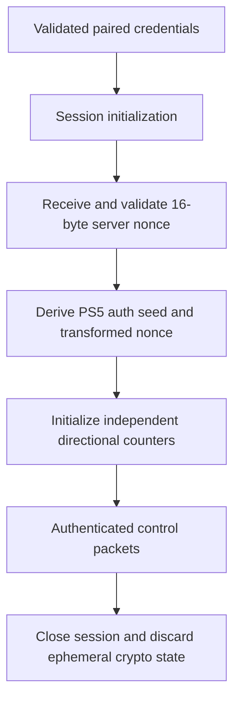

# Protocol 05 — PS5 Remote Play cryptography

**Status:** Source-derived technical specification; interoperability validation deferred to implementation  
**Reviewed:** 2026-11-05  
**Pinned upstream reference:** [playactor](https://github.com/dhleong/playactor), tree `93ee087445db368acaba9ad50099bce56ca9141d`  
**Proposed module:** `custom_components/playstation_hub/transport/remote_play/crypto.py`

## 1. Purpose and evidence

Specify the cryptographic mechanisms observed in the open-source PS5 Remote Play implementation for registration and authenticated control sessions. This document is not official Sony documentation and does not assert protocol stability or successful PlayStation Hub interoperability.

**SOURCE** means directly confirmed in upstream code; **DECISION** means PlayStation Hub architecture; **OPEN** means not established or awaiting implementation-stage tests.

## 2. Algorithm selection

| Context | Upstream algorithm / primitive | Evidence |
| --- | --- | --- |
| PS5 Remote Play registration and session | AES-128-CFB | `remoteplay/crypto/base.ts` |
| IV derivation | HMAC-SHA256, first 16 digest bytes | `remoteplay/crypto/base.ts` |
| Registration nonce | 16 cryptographically random bytes | `remoteplay/crypto.ts` |
| Session nonce | 16 bytes from `RP-Nonce` HTTP header | `remoteplay/session.ts` |
| Session packet counters | Independent outbound and inbound counters, initially zero | `remoteplay/codec.ts` |
| Modern PS5 seed derivation | Device-specific lookup tables and byte transformations | `remoteplay/crypto/modern.ts` |
| Legacy Second Screen default | AES-128-CBC | `socket/crypto-codec.ts` |

**Critical distinction:** `CryptoCodec` defaults to AES-128-CBC for legacy paths, but the PS5 Remote Play `BaseCryptoStrategy` explicitly passes `aes-128-cfb`. Do not use the codec's default algorithm for PS5.

## 3. Initialization vector derivation

**SOURCE:** `generateIv(version, nonce, counter)` computes:

```text
counter_bytes = uint64_be(counter)
digest = HMAC_SHA256(hmac_key_for_version, nonce || counter_bytes)
iv = digest[0:16]
```

The upstream PS5 Remote Play version uses a fixed protocol HMAC key in its source. That constant is protocol material, **not** a per-user credential. Reuse and licensing must be reviewed before shipping derived code.

**SOURCE:** The counter is an unsigned 64-bit big-endian integer. `nonce` is 16 bytes; `iv` is 16 bytes. Validate these lengths strictly in Python. Never silently wrap counters.

### Public synthetic known-answer test

The upstream `base-test.ts` contains a PS5 test vector:

```text
nonce (hex): 3e7e7a825973adab2f694346bd44dab5
counter: 0
expected IV (hex): 9044408273f8044dca767b5a16394d64
```

This is a public test fixture, not a real user's secret. A future independent Python implementation must reproduce it exactly.

## 4. PIN-based registration crypto

**SOURCE:** `RemotePlayCrypto.forDeviceAndPin` creates a random 16-byte nonce, selects the modern PS5 strategy and generates a 480-byte preface initially filled with ASCII `A`.

The PS5 `generatePinSeed` function uses `INIT_KEYS[PS5]`, an offset extracted from the preface at `0x18D` masked with `0x1F`, and XORs the four bytes of the numeric PIN into seed positions `0x0c..0x0f`. The derived seed is 16 bytes.

The PS5-specific `generateAeropause` uses the nonce, `AERO_KEYS[PS5]`, a lookup offset from the preface, and byte-wise arithmetic. It places halves of the result at preface offsets `0xC7` and `0x191`.

The registration payload is constructed from CRLF-separated key/value text, encrypted with AES-128-CFB, and prefixed by the signed/modified 480-byte preface. The upstream registration request includes `Client-Type` and `Np-AccountId` fields.

### Public synthetic PIN-seed test

```text
device: PS5
initKeyOff: 0x1e
PIN (test-only): 78703893
expected seed (hex): e29d644c141b9d617431a56d34cfc17f
```

**OPEN:** The complete lookup-table provenance and independent PS5 registration cryptographic vectors must be audited before incorporating them into PlayStation Hub.

## 5. Session authentication crypto

**SOURCE:** The session initialization request uses the registration key and obtains a 16-byte `RP-Nonce` from the console.

`createCodecForAuth` validates the 16-byte `RP-Key`, transforms the server nonce using PS5-specific `AUTH_NONCE_KEYS`, derives a 16-byte authentication seed using `AUTH_SEED_KEYS`, and derives the IV using the transformed nonce and a directional packet counter.

For PS5, the upstream nonce transform subtracts `0x2d + index` from each server-nonce byte before XOR with a lookup key. The authentication seed transform adds `0x18 + index` to each byte of the RP key, XORs the server nonce, then XORs a lookup key. Arithmetic is byte-sized (modulo 256).

**OPEN:** The inspected `modern-test.ts` has known-answer tests for PS5 PIN seed, but its authentication nonce/seed fixtures cover PS4 only. A complete PS5 auth fixture must be obtained or independently generated.

## 6. Packet encryption and framing

**SOURCE:** `RemotePlayPacketCodec` preserves the first eight bytes of each packet as a cleartext header. For packets with payload, it encrypts the payload using AES-128-CFB and an IV derived from the current outgoing counter; inbound payloads are decrypted with a separate incoming counter.

```text
packet = header[8 bytes] || encrypted_payload
header = payload_length_u32_be || command_type_u16_be || reserved_u16_be
```

The upstream code bypasses payload crypto when the packet is header-only. Counters increment when `encodeBuffer` or `decodeBuffer` is invoked.

**DECISION:** Implement framing and crypto as distinct units. Do not assume a TCP `recv` corresponds to one complete packet. Use a bounded frame reader, preserve counter sequencing, and reject truncated, oversized, malformed and out-of-order frames.

## 7. Crypto state lifecycle (proposed)



**DECISION:** Per-console/per-session crypto state must never be shared. A failed handshake must close the connection and invalidate ephemeral nonce, counters and cipher state. Reconnection creates a fresh session; never resume a partially used cipher stream without a proven protocol mechanism.

## 8. Security design

- Use maintained, audited Python cryptographic primitives; do not implement AES or HMAC algorithms manually.
- Treat PIN, account ID, `RP-Key`, registration key, derived seeds, encrypted/decrypted payloads and live session state as sensitive.
- No raw payload, nonce, key or PIN logging. Even encrypted traffic can reveal sensitive metadata.
- Validate nonce/key lengths, PIN format, lookup offsets, packet sizes and counter bounds.
- Keep cryptographic code independent of Home Assistant entities, persistence and frontend.
- Never ship real credentials in source, test fixtures or diagnostics.
- Review license and provenance of upstream key tables and Chiaki-derived test fixtures before reuse.
- AES-CFB is confidentiality-oriented and does not itself provide modern authenticated encryption. Do not claim protocol-level message authenticity beyond what the studied Remote Play protocol actually verifies.

## 9. Proposed Python boundaries

```text
remote_play/
  crypto.py           # Key/IV derivation and cipher adapter
  packets.py          # Frame encoding and decoding
  registration.py     # PIN-based registration workflow
  session.py          # Nonce, counters and authenticated control lifecycle
```

The module must expose typed, deterministic functions for derivations and an isolated session codec. No blocking crypto/file I/O on the Home Assistant event loop; benchmark CPU cost and use an executor where needed.

## 10. Test plan for implementation stage

- [ ] Reproduce the PS5 IV known-answer vector.
- [ ] Reproduce the PS5 PIN-seed known-answer vector.
- [ ] Reproduce the synthetic registration payload vector after provenance/license review.
- [ ] Add independent PS5 auth nonce and seed known-answer vectors.
- [ ] Verify AES-128-CFB encrypt/decrypt round trips and upstream-compatible byte output.
- [ ] Verify independent send/receive counters and correct endian encoding.
- [ ] Test malformed nonce, key, PIN, packet header and oversized frame.
- [ ] Test partial TCP frames and multi-frame input.
- [ ] Test cancellation, reconnect and per-console isolation.
- [ ] Check no secrets appear in logs, exception strings, diagnostics or exports.
- [ ] Validate registration/session interoperability with a test PS5.

## 11. Sources

- [Remote Play crypto entry](https://github.com/dhleong/playactor/blob/main/src/remoteplay/crypto.ts)
- [Base crypto strategy](https://github.com/dhleong/playactor/blob/main/src/remoteplay/crypto/base.ts)
- [Modern PS5 strategy](https://github.com/dhleong/playactor/blob/main/src/remoteplay/crypto/modern.ts)
- [Protocol lookup tables](https://github.com/dhleong/playactor/blob/main/src/remoteplay/crypto/keys.ts)
- [Generic cipher adapter](https://github.com/dhleong/playactor/blob/main/src/socket/crypto-codec.ts)
- [Remote Play packet codec](https://github.com/dhleong/playactor/blob/main/src/remoteplay/codec.ts)
- [Remote Play session](https://github.com/dhleong/playactor/blob/main/src/remoteplay/session.ts)
- [IV known-answer tests](https://github.com/dhleong/playactor/blob/main/test/remoteplay/crypto/base-test.ts)
- [Modern strategy tests](https://github.com/dhleong/playactor/blob/main/test/remoteplay/crypto/modern-test.ts)
- [Registration tests](https://github.com/dhleong/playactor/blob/main/test/remoteplay/registration-test.ts)

## 12. Outstanding research

Complete the independent PS5 auth derivation fixtures, review full lookup tables and provenance, confirm AES-CFB segment behavior in chosen Python library, and inspect packet error recovery and heartbeat details in Protocol 06.

**Related:** [04 — Registration](04-remote-play-registration.md) · [06 — Session](06-remote-play-session.md) · [Protocol index](README.md).

## 13. Independent C implementation and known-answer test boundary (2026-11-06)

The current canonical [chiaki-ng source repository](https://github.com/chiaki-ng/chiaki-ng) (moved from `streetpea/chiaki-ng`) provides independently reviewed PS5 registration/session crypto in [`lib/src/rpcrypt.c`](https://github.com/chiaki-ng/chiaki-ng/blob/43728af2e639fecb8a7af1cd68c29820a40de973/lib/src/rpcrypt.c), with PS5 IV and key known-answer assertions in [`test/rpcrypt.c`](https://github.com/chiaki-ng/chiaki-ng/blob/43728af2e639fecb8a7af1cd68c29820a40de973/test/rpcrypt.c). This adds cross-implementation evidence beyond playactor's TypeScript strategy, but chiaki-ng is **AGPL-3.0**. Do **not** copy key tables, code or test data wholesale into our separately licensed integration without formal licensing review. Independently specified behavior, original clean tests and user-authorized device interoperability remain future implementation work.

Python `playdirector` version **0.4.2** is a changed GPL-3.0-only embedded pyremoteplay engine and not API/license-equivalent to the previous MIT `0.3.x` package ([current PyPI](https://pypi.org/project/playdirector/0.4.2/)). No crypto dependency, library, PS5 firmware compatibility or Remote Play registration behavior has been approved or tested. See the [pinned upstream source audit](../research/upstream-source-deep-audit-lan-remoteplay-psn-ha-2026-11-06.md).

## 14. Authoritative maintainer override: no external PlayStation packages and NO custom AES (2026-11-06)

**New requirement:** [First-party dependency sovereignty](../architecture/first-party-dependency-sovereignty-policy.md), [native runtime research](../research/first-party-protocol-implementation-and-runtime-boundaries-2026-11-06.md). Our own source must implement packet framing, transform orchestrations and state management if Remote Play is later implemented, but there will be **no dependency** on playactor, Chiaki, PS5-MQTT, pyremoteplay, playdirector, third-party cryptography CLI or copied vendor source/key tables. The prior phrase "use maintained audited Python cryptographic primitives" is now **a security constraint and explicitly unresolved backend selection**, not permission to add an undeclared external library.

The reviewed [playactor crypto/base.ts](https://github.com/dhleong/playactor/blob/a9e72d67a3930a8f06455927edb547a1754ef0ac/src/remoteplay/crypto/base.ts) uses AES-128-CFB and HMAC-SHA256, while [socket/crypto-codec.ts](https://github.com/dhleong/playactor/blob/a9e72d67a3930a8f06455927edb547a1754ef0ac/src/socket/crypto-codec.ts) separately references AES-128-CBC; these are **distinct codec contexts**, not permission to interchange modes. \`hashlib\`, \`hmac\`, \`secrets\` and \`ssl\` do not expose a Python standard-library general-purpose AES-CFB/CBC encrypt/decrypt API. Home Assistant's documented \`aiohttp\` and TLS wrappers likewise do not themselves provide that AES protocol function.

**Mandatory blocker: BLOCKED_CRYPTO_BACKEND.** Never hand-code AES, copy upstream GPL/AGPL crypto tables or call native OpenSSL through unstable \`ctypes\`/ABI just to claim zero pip dependencies. Determine whether a supported HA platform interface can safely provide the primitive **before** authorizing Remote Play implementation; if none is suitable under the maintainer's rule, encrypted Remote Play functionality is deferred. Passive LAN monitoring, title reports, SQLite history and panel remain fully independent.
