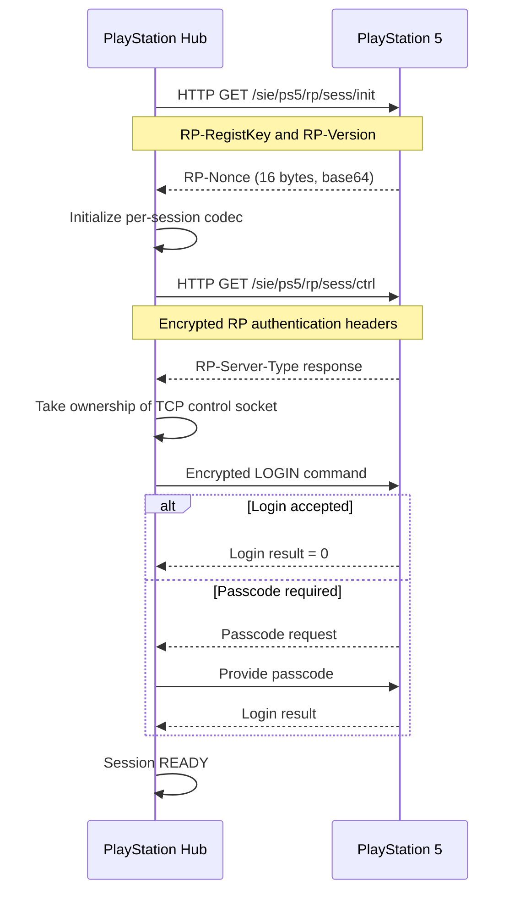

# Protocol 06 — PS5 Remote Play authenticated session

**Status:** Source-derived technical specification; validation deferred to implementation  
**Reviewed:** 2026-11-05  
**Pinned reference:** playactor tree `93ee087445db368acaba9ad50099bce56ca9141d`  
**Proposed module:** `custom_components/playstation_hub/transport/remote_play/session.py`

## 1. Objective and scope

Open, authenticate, maintain and safely close a PS5 Remote Play control session using credentials established by Protocol 04 and cryptography described in Protocol 05. This is required for authenticated console commands such as standby. It is not required for basic LAN discovery/status.

Evidence labels: **SOURCE** = observed in upstream source; **DECISION** = our intended design; **OPEN** = unresolved or reserved for implementation-stage tests.

## 2. Transport and prerequisites

| Property | Source-confirmed behavior |
| --- | --- |
| Destination | Validated console IPv4 address |
| Transport | HTTP over TCP, port `9295`, followed by persistent control socket |
| Initialization path | `/sie/ps5/rp/sess/init` |
| Control path | `/sie/ps5/rp/sess/ctrl` |
| Credentials | Registration key and 16-byte RP-Key |
| Server nonce | `RP-Nonce` response header, base64 encoded, 16 decoded bytes |
| Client version | `RP-Version` derived from the PS5 Remote Play version |
| Client identity | Encrypted RP-Did and other RP headers |
| Session crypto | AES-128-CFB and directional counters (Protocol 05) |

**SOURCE:** The upstream client sends HTTP GET requests with `Content-Length: 0` for requests without bodies because its comments report a 403 response without that header in some circumstances. The user-agent identifies a Remote Play Windows client. This is observed behavior, not an official protocol requirement.

## 3. Session initialization

1. Confirm that the selected console is paired and the credential record contains `PS5-RegistKey`.
2. Resolve the PS5-specific initialization endpoint.
3. Send HTTP request with `RP-RegistKey` and `RP-Version` headers.
4. Check HTTP status and any Remote Play application-reason error.
5. Extract `RP-Nonce` from the response headers.
6. Decode base64 and require exactly 16 bytes.
7. Construct fresh per-session crypto state from the nonce and RP-Key.

**DECISION:** Reject malformed base64, missing headers, invalid key lengths and unexpected HTTP status before opening a control channel. Do not log nonce, registration key or full headers.

## 4. Control-channel initialization

**SOURCE:** The upstream client constructs an eight-byte-header-aware encrypted packet codec and prepares these headers for `/sie/ps5/rp/sess/ctrl`:

| Header | Upstream behavior |
| --- | --- |
| `RP-Auth` | Encrypted registration key padded to 16 bytes, base64 encoded |
| `RP-Version` | Remote Play version |
| `RP-Did` | Encrypted client device-ID structure |
| `RP-ControllerType` | `3` |
| `RP-ClientType` | `11` |
| `RP-OSType` | Encrypted `Win10.0.0` |
| `RP-ConPath` | `1` |
| `RP-StartBitrate` | Encrypted four zero bytes for modern Remote Play |
| `RP-StreamingType` | Encrypted little-endian 32-bit value `1` for modern Remote Play |

**SOURCE:** The upstream DID structure contains a fixed prefix, a 16-byte zero-filled middle section and a fixed suffix. The upstream comment questions the exact semantics. Do not claim it is a real hardware identifier.

The client sends a persistent HTTP control request with keep-alive, decrypts the `RP-Server-Type` response header, and takes ownership of the underlying TCP socket.

**Critical implementation detail:** A conventional HTTP client that consumes the response and closes/releases the socket is insufficient. The Python transport must support safe transfer or deliberate ownership of the persistent control connection, with well-defined cleanup.

## 5. Control session sequence

## 6. Login and optional passcode

**SOURCE:** `RemotePlayLoginProc` sends command `0x05` and awaits response type `0x05` (login) or `0x04` (passcode request).

If a passcode is requested, it reads the optional configured login passcode and sends command `0x8004` with the passcode bytes. A missing passcode triggers `PASSCODE_IS_NEEDED`. The login result parser reads a result byte at offset 8; result `1` maps to passcode mismatch, while other nonzero results become unknown errors.

**DECISION:** A Remote Play pairing PIN is not the same as a console login passcode. The frontend must distinguish these user interactions and display translated error messages. Do not store a passcode unless necessary and explicitly authorized.

## 7. Heartbeat and packet framing

**SOURCE:** The upstream protocol defines incoming heartbeat type `0xFE` and responds with outgoing heartbeat command `0x1FE`. The packet header is eight bytes: 32-bit big-endian payload length, 16-bit big-endian command type and 16-bit reserved field. Only the payload is encrypted by the Remote Play packet codec.

**DECISION:** Implement an async framed reader that can handle partial/multiple TCP frames, enforce maximum payload size, maintain directional cipher counters, and respond to heartbeats without blocking other Home Assistant work. Unknown packet types must be safely handled, not blindly trusted.

## 8. Session state machine (proposed)

| State | Meaning |
| --- | --- |
| `DISCONNECTED` | No session |
| `INITIALIZING` | Requesting server nonce |
| `AUTHENTICATING` | Establishing encrypted control channel |
| `LOGGING_IN` | Awaiting login/passcode result |
| `READY` | Authenticated session available for supported commands |
| `CLOSING` | Graceful teardown |
| `CLOSED` | Resources released |
| `FAILED` | Unrecoverable attempt error; fresh session required |

All transitions must be bounded and cancellation-safe. A failed attempt must close sockets, release pending tasks and discard ephemeral cipher state.

## 9. Multi-console and concurrency policy

- One independent session object per console; never share nonce, counters, registration key or socket.
- Serialize commands using the same console's control connection.
- Do not allow a failed session for one console to stop another console's monitoring.
- Keep the LAN status poller independent of Remote Play session lifecycle.
- Do not automatically create long-lived Remote Play sessions when only passive monitoring is requested.
- On reload/unload, close connections and cancel heartbeat/reader tasks.

## 10. Security requirements

- Never log `RP-RegistKey`, `RP-Key`, `RP-Auth`, `RP-Did`, `RP-Nonce`, login passcode, encrypted headers or decrypted frames.
- Validate the target console IP and identity; do not send authenticated headers to arbitrary destinations.
- Use audited Python cryptographic primitives and enforce strict nonce/key lengths.
- Avoid sharing authentication state between config entries or accounts.
- Treat HTTP transport as not TLS-protected; protocol payload encryption is not equivalent to modern end-to-end authenticated TLS.
- Require Home Assistant permissions for any command that uses this session.
- Translate user-facing failures without exposing secrets.

## 11. Error categories (proposed)

`MISSING_REGISTRATION_KEY`, `INVALID_RP_KEY`, `SESSION_INIT_TIMEOUT`, `MISSING_SERVER_NONCE`, `INVALID_SERVER_NONCE`, `CONTROL_CHANNEL_REJECTED`, `LOGIN_PASSCODE_REQUIRED`, `LOGIN_PASSCODE_INVALID`, `SESSION_DISCONNECTED`, `HEARTBEAT_TIMEOUT`, `SESSION_CANCELLED`.

These are PlayStation Hub categories, not a complete official Sony error-code mapping.

## 12. Implementation-stage tests

- [ ] Initialization request path, headers and HTTP status handling.
- [ ] RP-Nonce base64 decoding and exact 16-byte validation.
- [ ] Control headers and directional cipher counter sequencing.
- [ ] Correct ownership and cleanup of persistent TCP socket.
- [ ] Login accepted, passcode requested, missing/incorrect passcode.
- [ ] Heartbeat request/response and connection liveness.
- [ ] Fragmented, oversized, malformed and unknown packet types.
- [ ] Unexpected socket closure and failed authentication cleanup.
- [ ] Cancellation during init, control handshake, login and command.
- [ ] Independent simultaneous sessions for two consoles.
- [ ] No secrets in logs, exceptions or diagnostics.
- [ ] Live firmware compatibility on a test PS5.

## 13. Sources

- [Remote Play session implementation](https://github.com/dhleong/playactor/blob/main/src/remoteplay/session.ts)
- [Remote Play protocol and heartbeat](https://github.com/dhleong/playactor/blob/main/src/remoteplay/protocol.ts)
- [Packet commands and framing](https://github.com/dhleong/playactor/blob/main/src/remoteplay/packets.ts)
- [Login procedure](https://github.com/dhleong/playactor/blob/main/src/remoteplay/proc/login.ts)
- [Login result parser](https://github.com/dhleong/playactor/blob/main/src/remoteplay/packets/login-result.ts)
- [Passcode request](https://github.com/dhleong/playactor/blob/main/src/remoteplay/packets/passcode-request.ts)
- [Passcode response](https://github.com/dhleong/playactor/blob/main/src/remoteplay/packets/passcode-response.ts)
- [Remote Play connection](https://github.com/dhleong/playactor/blob/main/src/connection/remoteplay.ts)

## 14. Open research

Determine precise HTTP-to-socket handoff behavior for a Python implementation, all control response types, heartbeat timing, full login error mapping, and firmware-specific compatibility. Live validation is deliberately deferred until implementation.

**Related:** [05 — Cryptography](05-remote-play-cryptography.md) · [07 — Commands](07-remote-play-commands.md) · [Protocol index](README.md).
