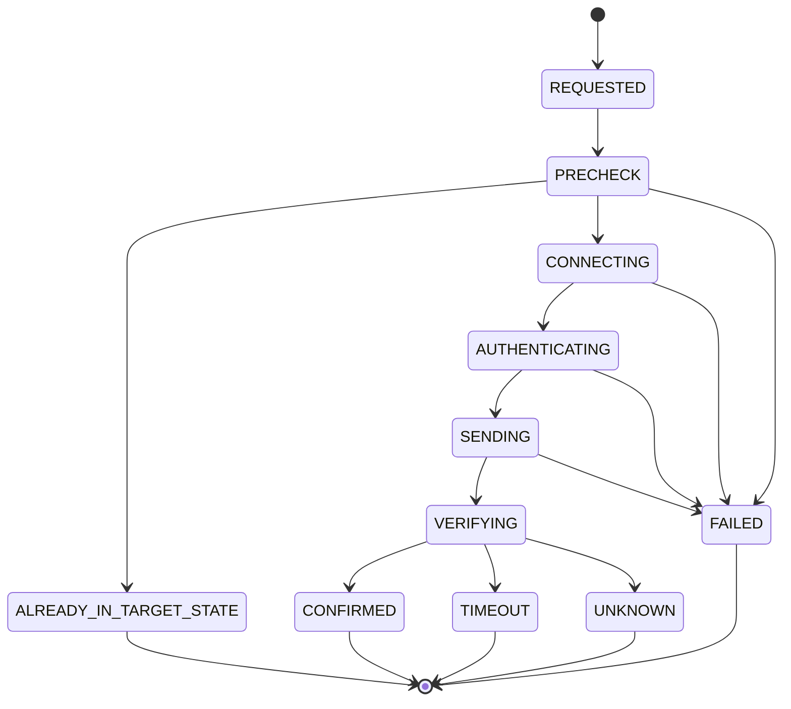

# Protocol 07 — PS5 Remote Play commands

**Status:** Source-derived technical specification; live validation during implementation  
**Reviewed:** 2026-11-05  
**Reference revision:** playactor tree `93ee087445db368acaba9ad50099bce56ca9141d`  
**Proposed module:** `custom_components/playstation_hub/transport/remote_play/commands.py`

## 1. Objective and scope

Execute explicitly authorized console control operations, beginning with **entering rest mode (standby)**. Wake is a separate UDP protocol covered by Protocol 03; login, heartbeat and session authentication are covered by Protocol 06.

The project must not claim arbitrary PS5 button presses, full shutdown, application launch, media controls or game launching merely because an authenticated Remote Play session exists. These are future capabilities only if their protocol support is separately researched.

Evidence labels: **SOURCE** (inspected upstream code), **DECISION** (our architecture), **OPEN** (not yet proven).

## 2. Confirmed upstream command catalogue

| Command | Hex | Direction | Meaning |
| --- | --- | --- | --- |
| Standby | `0x0050` | Client → PS5 | Request rest mode |
| Login | `0x0005` | Client → PS5 | Authenticate session |
| Heartbeat | `0x01FE` | Client → PS5 | Respond to server heartbeat |
| ProvidePasscode | `0x8004` | Client → PS5 | Submit console-user login passcode |
| Login response | `0x0005` | PS5 → client | Login result |
| Passcode request | `0x0004` | PS5 → client | Passcode challenge |
| Heartbeat request | `0x00FE` | PS5 → client | Liveness message |

**SOURCE:** The command values above come from `src/remoteplay/packets.ts`. Login and heartbeat are session control messages, not user-facing dashboard actions.

## 3. Wire format

The outgoing packet builder creates an eight-byte unencrypted header:

```text
offset  size  encoding   field
0       4     uint32 BE  encrypted/plain payload length
4       2     uint16 BE  command type
6       2     uint16 BE  reserved = 0
8       N     bytes      payload (encrypted for Remote Play)
```

For standby the upstream implementation creates `RemotePlayOutgoingPacket(RemotePlayCommand.Standby)` with no payload, yielding this synthetic eight-byte packet:

```text
00 00 00 00 00 50 00 00
```

**SOURCE:** `RemotePlayPacketCodec` bypasses payload encryption for header-only packets. This does not make the session unauthenticated; standby is sent only after the Remote Play session has been established and logged in.

## 4. Source-confirmed standby sequence

1. The CLI discovers the selected console and returns early if already in `STANDBY`.
2. The device connection layer chooses Remote Play for Remote Play credentials and can call `Waker.wake` before opening the session.
3. The Remote Play session is initialized, authenticated and logged in.
4. The connection sends standby command `0x50`.
5. The implementation consumes incoming packets until the control socket closes.
6. The CLI closes the connection in `finally`.

**Critical distinction:** Waiting for a socket to close is the upstream completion condition. It is **not** a fresh LAN confirmation that the console entered rest mode.

**Important behavioral consequence:** The upstream `openRemotePlay` path calls wake before opening the connection. Our command policy must explicitly decide what to do if standby is requested while the console is already asleep, offline or its last state is stale. We must not wake a sleeping console merely to send a redundant standby command.

## 5. PlayStation Hub command state machine (DECISION)



A successful socket write or disconnect does not mean `CONFIRMED`. Confirmation requires a **fresh, identity-matched LAN observation** of `STANDBY`.

## 6. Preconditions and permissions

- Select a stable console ID and verify that the command targets the expected console.
- Require explicit user intent and Home Assistant authorization; hiding the frontend button is not sufficient.
- Require valid Remote Play credentials for standby.
- Check fresh state before issuing the command; already-standby is idempotent.
- For `UNKNOWN` or `UNAVAILABLE` state, define a conservative policy and display an actionable error instead of waking unexpectedly.
- Serialize commands per console, with bounded concurrency across different consoles.
- Do not expose raw protocol controls to arbitrary user-supplied IP addresses.

## 7. Confirmation and recovery

**DECISION:** After standby is sent, continue independent LAN discovery until a matching console reports `STANDBY`, or a bounded deadline expires.

- Confirmed standby: update cached state and emit a meaningful transition.
- Socket closed but no LAN confirmation: result `UNKNOWN` or timeout; do not fabricate a confirmed transition.
- Console disappears from LAN: preserve last-known state, mark availability according to freshness policy.
- Session authentication fails: no standby command is sent.
- HA reload/unload: cancel command, close connection and clean up per-console state.
- Avoid uncontrolled automatic retries, since repeated commands can produce surprising effects.

## 8. Heartbeats and control socket behavior

**SOURCE:** The Remote Play protocol handles incoming heartbeat `0xFE` by sending `0x1FE`. The TCP socket wrapper reads framed packets and sends them to protocol handlers and active receivers.

**DECISION:** A dedicated session reader handles heartbeats independently of user command response handling. Command waiters must not consume or discard packets required by the session. Timeouts and cancellation must be bounded.

**Source-quality observation:** The upstream `RemotePlayDeviceConnection.isConnected` getter returns the negation of `socket.isConnected`, despite the socket implementation itself returning `!isClosed`. This appears inverted and must not be copied without tests.

## 9. Home Assistant API design (proposed)

Initial user-facing action: **Put console in rest mode**.

Possible native representations:
- `button` entity for a discrete command, or
- integration action/service targeting a console device.

A `switch` should not be used merely for convenience if its on/off semantics cannot be truthfully represented. Power state and command status are distinct.

**DECISION:** Start with a device-targeted, permission-checked action and a clear state entity; decide whether to expose a button after reviewing Home Assistant entity best practices. Future capabilities can be added without changing the transport abstraction.

## 10. Error taxonomy (proposed)

| Error | Meaning |
| --- | --- |
| `CONSOLE_NOT_PAIRED` | Missing valid Remote Play credentials |
| `CONSOLE_UNAVAILABLE` | Cannot reach the selected console |
| `CONSOLE_ALREADY_IN_REST_MODE` | Idempotent no-op, normally not an error |
| `REMOTE_PLAY_AUTH_FAILED` | Session authentication rejected |
| `LOGIN_PASSCODE_REQUIRED` | Console requests a passcode |
| `COMMAND_SEND_FAILED` | Packet could not be written |
| `COMMAND_CONFIRMATION_TIMEOUT` | No fresh confirmed standby observation |
| `COMMAND_CANCELLED` | Command interrupted by unload/reload |
| `COMMAND_BUSY` | Another incompatible command is active |

These are internal application categories, not official Sony error codes.

## 11. Security and operational limits

- No raw keys, tokens, login passcodes, packet payloads or encrypted headers in logs or diagnostics.
- Limit command execution to authenticated Home Assistant users with appropriate permissions.
- Never automatically pair, wake or control a console without a clear authorized action.
- Keep session and command resources scoped to each console.
- Use bounded timeouts, cancellation-safe cleanup and defensive packet parsing.
- Never report success solely from socket closure.
- Keep passive LAN monitoring independent from command capabilities.

## 12. Implementation-stage test matrix

- [ ] Exact standby packet bytes and header-only codec behavior.
- [ ] Already-standby idempotence.
- [ ] Successful login, standby send and fresh standby confirmation.
- [ ] Socket closure without standby confirmation.
- [ ] Authentication failure prevents sending the command.
- [ ] Missing passcode and invalid passcode.
- [ ] Command requested while console is offline/unknown.
- [ ] No unintended wake on redundant standby request.
- [ ] Concurrent commands for one console serialized or rejected.
- [ ] Two consoles controlled independently.
- [ ] Heartbeat handling during command wait.
- [ ] Timeout, cancellation, reload and socket cleanup.
- [ ] HA permissions, localization and non-admin behavior.
- [ ] Live test PS5 firmware and rest-mode settings.

## 13. Source references

- [Remote Play command enum and framing](https://github.com/dhleong/playactor/blob/main/src/remoteplay/packets.ts)
- [Remote Play connection and standby](https://github.com/dhleong/playactor/blob/main/src/connection/remoteplay.ts)
- [Standby CLI](https://github.com/dhleong/playactor/blob/main/src/cli/commands/standby.ts)
- [Connection transport selection](https://github.com/dhleong/playactor/blob/main/src/connection.ts)
- [Remote Play session](https://github.com/dhleong/playactor/blob/main/src/remoteplay/session.ts)
- [TCP socket lifecycle](https://github.com/dhleong/playactor/blob/main/src/socket/tcp.ts)
- [Remote Play heartbeat handling](https://github.com/dhleong/playactor/blob/main/src/remoteplay/protocol.ts)
- [Wake-up transport](https://github.com/dhleong/playactor/blob/main/src/waker.ts)

## 14. Open research

Determine exact standby response semantics beyond socket closure, error-code mapping, behavior on unsupported firmware, and Home Assistant action permission patterns. Full shutdown and other console controls are not yet source-confirmed.

**Related:** [03 — Wake-up](03-console-wakeup.md) · [06 — Session](06-remote-play-session.md) · [Protocol index](README.md).
