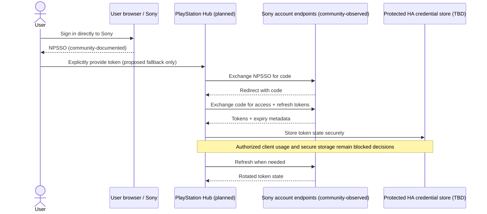

# Protocol 08 — PlayStation Network authentication

**Status:** Source-derived technical specification; Sony-supported third-party authorization remains unverified  
**Reviewed:** 2026-11-05  
**Implementation:** Not started; no live account or console validation  
**Proposed module:** `custom_components/playstation_hub/transport/psn/authentication.py`  
**Reference revisions:** `psn-api` tree `1e9d9a806fcd884a4ddee8086bfe92594611da9f` (historical pin from protocol index); PS5-MQTT tree `7ab3075d276f3eeecd81a3322c72231af8cd51bd` (historical pin). Also reviewed current GitHub files on 2026-11-05; their branch heads may differ from these pins.

> **Evidence boundary:** Official PlayStation help confirms account sign-in, passkeys, two-step verification and account security. The NPSSO-to-OAuth-token exchange below is reverse-engineered/community-documented behavior, **not** an officially published third-party Sony integration authorization contract. Do not imply Sony approval, guaranteed endpoint stability or permission to reuse another application's OAuth client credentials.

## 1. Purpose and boundaries

Allow a user to **optionally** link a PlayStation Network (PSN) account to PlayStation Hub for PSN presence and game enrichment (Protocols 09–10). LAN discovery, basic console availability and locally authorized control must remain operational without PSN. Account authorization is distinct from console Remote Play registration (Protocol 04); credentials and failure states must not be conflated.

This specification covers account bootstrap, token refresh, identity lookup, storage, error handling and unlinking. Presence response mapping is Protocol 09; game metadata is Protocol 10.

## 2. Evidence inventory

| ID | Evidence | Classification | What it establishes |
| --- | --- | --- | --- |
| AUTH-01 | Official PlayStation account help and security settings | OFFICIAL | Sony supports browser sign-in, passkeys and 2SV, with user-managed account security. |
| AUTH-02 | `psn-api/src/authenticate/exchangeNpssoForAccessCode.ts` | SOURCE-CONFIRMED | Community implementation sends NPSSO cookie to Sony account OAuth authorization endpoint and reads a returned authorization code from a redirect. |
| AUTH-03 | `psn-api/src/authenticate/exchangeAccessCodeForAuthTokens.ts` | SOURCE-CONFIRMED | Community implementation exchanges an authorization code for access/refresh tokens with a form POST. |
| AUTH-04 | `psn-api/src/authenticate/exchangeRefreshTokenForAuthTokens.ts` | SOURCE-CONFIRMED | Community implementation uses a refresh-token grant and maps token lifetime fields. |
| AUTH-05 | `ps5-mqtt/server/src/psn-account.ts` | SOURCE-CONFIRMED | Reference application prefers stored refresh-token continuity, falls back to NPSSO, resolves account profile, and isolates PSN activity errors. |
| AUTH-06 | PS5-MQTT configuration documentation | SOURCE-CONFIRMED | Multiple PSN accounts are supported; token persistence and user-facing reauthentication instructions are described. |
| AUTH-07 | Home Assistant application credentials developer documentation | OFFICIAL | Supported OAuth integration helpers have provider/client-credential prerequisites, which are **not established for this Sony flow**. |

`SOURCE-CONFIRMED` means observed in upstream source, **not** confirmed by Sony or by PlayStation Hub.

## 3. Reference community authentication flow

The implementation in `achievements-app/psn-api` uses this observed sequence:

1. User signs in to PlayStation in **their own browser**, with Sony-managed password, passkey or 2SV.
2. The community workflow retrieves an `npsso` token from `https://ca.account.sony.com/api/v1/ssocookie` in the signed-in browser. **NPSSO is password-equivalent secret material.**
3. The community code sends an authorization request to `https://ca.account.sony.com/api/authz/v3/oauth/authorize`, using `Cookie: npsso=...` and manual redirect handling. It obtains an authorization code from the redirect's `Location` query parameter.
4. It POSTs a form to `https://ca.account.sony.com/api/authz/v3/oauth/token` using `grant_type=authorization_code`, the authorization code and a redirect URI, receiving an access token, refresh token and expiration values.
5. Later it POSTs to the same token endpoint with `grant_type=refresh_token` to renew the credentials.
6. PS5-MQTT loads a user's profile after authentication to resolve an account ID; optional presence enrichment is handled separately.

The reference code uses a specific mobile-client identifier, Basic Authorization value, redirect URI and scopes. **Do not copy these into PlayStation Hub or treat them as public client credentials licensed for third-party distribution.** Their owner, permitted usage, consent semantics and long-term validity must be established before implementation. Exact literals can be inspected in the pinned upstream source during a controlled legal/security review; this document intentionally does not reproduce reusable credentials.

### Sequence diagram (source-derived, non-shippable design)



**Security constraint:** The sequence above documents third-party behavior, not an approved user experience. The preferred eventual UX is provider-authorized account linking without manual secret extraction **if Sony offers a suitable supported route**. We must not build a fake Sony sign-in form or ask for the user's Sony password in Home Assistant.

## 4. Identity and credential model (proposed)

Keep per-account identity independent of console identity:

- `account_id`: provider-resolved stable account identifier, not a user-editable display name.
- `online_id`: display name, changeable and non-authoritative for identity.
- `credential_state`: `not_configured | connecting | authorized | refresh_required | reauth_required | unavailable | revoked`.
- `access_token`, `refresh_token`, optional `npsso`: secret-bearing fields; never returned to frontend or diagnostics.
- `access_expires_at` and `refresh_expires_at`: UTC timestamps derived from provider-relative expiry using a safety margin.
- `last_auth_success_at`, `last_error_category`, `last_refresh_attempt_at`: sanitized operational metadata.
- `auth_generation`: optional monotonic generation to prevent late refresh responses from overwriting newer state.

Multiple PSN accounts must be independently configurable, refreshable and removable. An account-to-console association is a separate best-effort domain relation; an account may be active on more than one device and presence must not automatically prove which console is playing.

## 5. Proposed lifecycle and state transitions

1. **Unlinked:** no PSN account configured; LAN features continue unaffected.
2. **Authorized:** after a permitted, verified authentication path succeeds, resolve provider account ID and persist credentials atomically.
3. **Operational:** reuse a valid access token; refresh shortly before expiry or after a properly classified expiry response.
4. **Refresh:** serialize refresh per account, apply bounded timeouts, validate all returned fields, and atomically store new tokens before using them. Handle refresh-token rotation; never overwrite newer credentials with an older concurrent response.
5. **Transient failure:** preserve existing credentials securely, apply jittered exponential backoff and show PSN enrichment unavailable rather than claiming the console is offline.
6. **Invalid credentials / explicit revocation:** stop using the credentials, require deliberate reauthentication; do not retry invalid tokens in a tight loop.
7. **Unlink:** stop scheduling requests, cancel pending work, delete the account's local credential material and associated mapping, and define history-retention policy separately. Remote Sony-side revocation is **unverified** and must not be claimed unless implemented and confirmed.

### Reauthentication rule

A stale or expired NPSSO must **not** trigger browser scraping, password handling, repeated automated Sony logins or silent token harvesting. If the supported renewal chain cannot proceed, expose a safe reauthentication state. Reference PS5-MQTT can fall back to a previously configured NPSSO; whether PlayStation Hub should retain NPSSO after bootstrap is an **OPEN SECURITY DECISION**. Prefer not retaining bootstrap-only secrets if a supported flow makes that possible.

## 6. Home Assistant integration boundary (proposed)

- Implement account setup and removal using a Home Assistant config flow/options/reauth flow as appropriate; all operations must be asynchronous or use approved executor mechanisms.
- Assess `application_credentials` and `config_entry_oauth2_flow` **only if** a provider-supported OAuth application registration and proper client credential ownership can be established. A borrowed mobile app client ID does not satisfy that requirement.
- Keep tokens backend-only and protected by Home Assistant's appropriate secret/config-entry storage model, following current HA API guidance after source review. Do not assume `Store` automatically encrypts secrets at rest.
- Do not expose NPSSO, tokens, `Authorization` or `Cookie` in logs, stack traces, diagnostics, event bus, entity attributes, frontend responses, backups shared publicly, or test fixtures.
- Ensure configuration removal stops account refresh tasks and resources, without degrading LAN monitoring for unrelated devices.
- Preserve precise error typing so optional PSN failure never prevents setup of LAN-only functionality.
- Never include real token material in the repository or tests.

### Proposed Python interface contract (not implemented)

```python
from dataclasses import dataclass
from datetime import datetime
from enum import StrEnum


class PsnCredentialState(StrEnum):
    NOT_CONFIGURED = "not_configured"
    AUTHORIZED = "authorized"
    REAUTH_REQUIRED = "reauth_required"
    UNAVAILABLE = "unavailable"
    REVOKED = "revoked"


@dataclass(frozen=True, slots=True)
class PsnAccountIdentity:
    account_id: str
    online_id: str | None


@dataclass(frozen=True, slots=True)
class PsnAuthorizationSnapshot:
    identity: PsnAccountIdentity
    state: PsnCredentialState
    access_expires_at: datetime | None
    last_success_at: datetime | None
```

This is a design example, **not** an API implementation. Actual interfaces, dependencies and secret-store ownership remain subject to ADR approval.

## 7. Error taxonomy (proposed)

| Category | Example | Required behavior |
| --- | --- | --- |
| `invalid_npsso` | Missing or invalid authorization redirect/code | Reject bootstrap; sanitize server response; request user action. |
| `unauthorized_client` | Provider rejects application/client identity | **Block** integration flow; do not search for bypasses. |
| `invalid_grant` | Expired/revoked refresh token | Move to `reauth_required`; do not loop indefinitely. |
| `rate_limited` | HTTP 429 | Honor Retry-After where trustworthy; bounded backoff. |
| `provider_unavailable` | 5xx, DNS or timeout | Mark PSN data unavailable, keep LAN controls and stored history. |
| `malformed_response` | Unexpected JSON, missing token or expiry | Reject atomically; never persist incomplete credentials. |
| `identity_mismatch` | Linked token resolves another account ID | Stop and require explicit user review. |
| `storage_failure` | No durable protected storage | Do not report authorized success; no in-memory-only silent success. |
| `unlinked` | User removes account | Cancel refresh work, clear locally held secrets and associations. |

All HTTP responses and redirects must be validated and size bounded. Do not follow an arbitrary OAuth redirect host; redact response bodies and URLs that may contain sensitive parameters. Set retry limits and a configurable, conservative rate policy.

## 8. Test plan before any shipping implementation

- [ ] Legal/provider-client authorization review, and document a compliant Sony-supported method or explicitly block shipping PSN authorization.
- [ ] Synthetic NPSSO bootstrap cases: success, invalid token, absent redirect, malicious redirect, altered code, transport timeout.
- [ ] Authorization code exchange: successful response, malformed JSON, missing token fields, HTTP 401/403/429/5xx.
- [ ] Refresh: valid token, near expiry, rotation, expired refresh, concurrent refresh, cancellation, restart between refresh and persistence.
- [ ] Account identity: renamed display name, mismatched account ID, multiple linked accounts, duplicate linking.
- [ ] Privacy: token redaction in diagnostics, HTTP exceptions, error logs, frontend and backups; credential removal behavior.
- [ ] Resilience: no-PSN LAN setup, provider outage, internet loss, restore from old backup, corrupt credential metadata.
- [ ] Authentication UX: security language, account unlink, explicit permission, useful reauth errors.
- [ ] Live PSN testing **only with an authorized test account and after resolving the client/endpoint permission gate**. Never run automated login attempts with real user credentials during documentation.

## 9. Open decisions / blockers

- **BLOCKED:** Is there a Sony-supported third-party OAuth authorization method for the desired PSN capabilities? Which application/client credentials and redirect URI can we lawfully own and distribute?
- **BLOCKED:** Are the presence endpoints and requested scopes contractually permitted and stable enough for an integration?
- **OPEN:** User-consent UX, optional/manual NPSSO fallback, and whether retaining NPSSO is acceptable.
- **OPEN:** Home Assistant credential storage and reauth APIs, config-entry boundaries, migration and backup secrecy.
- **OPEN:** Official account unlink/revocation mechanism; what remains locally versus remotely after unlinking.
- **OPEN:** Endpoint compatibility, scopes, rate limits, token clock skew, client error schemas and firmware/account-region differences.
- **OPEN:** Whether PSN presence is a required release feature or a later optional feature gated on verified authorization.

**Release decision:** PlayStation Hub must not ship an undocumented borrowed-client PSN login flow as though it were Sony-approved. A LAN-only release may proceed while PSN authorization is blocked, if consistent with product scope and quality gates.

## 10. Source references

### Official

- Sony PlayStation account security (PT): https://www.playstation.com/pt-pt/support/account/
- Sony PlayStation passkey support: https://www.playstation.com/en-us/support/account/set-up-passkey/
- Home Assistant application credentials: https://developers.home-assistant.io/docs/core/platform/application_credentials

### Community implementations (not official Sony API guarantees)

- psn-api overview: https://github.com/achievements-app/psn-api
- NPSSO authorization code: https://github.com/achievements-app/psn-api/blob/main/src/authenticate/exchangeNpssoForAccessCode.ts
- Access/refresh exchange: https://github.com/achievements-app/psn-api/blob/main/src/authenticate/exchangeAccessCodeForAuthTokens.ts
- Refresh-token exchange: https://github.com/achievements-app/psn-api/blob/main/src/authenticate/exchangeRefreshTokenForAuthTokens.ts
- OAuth base URL: https://github.com/achievements-app/psn-api/blob/main/src/authenticate/AUTH_BASE_URL.ts
- PS5-MQTT account adapter: https://github.com/FunkeyFlo/ps5-mqtt/blob/main/ps5-mqtt/server/src/psn-account.ts
- PS5-MQTT account configuration: https://github.com/FunkeyFlo/ps5-mqtt/blob/main/add-ons/ps5-mqtt/DOCS.md

## 11. Related documents

- [Protocol index](README.md)
- [Protocol 04 — Remote Play registration](04-remote-play-registration.md)
- [Protocol 09 — PSN presence](09-psn-presence.md)
- [Protocol 10 — Game metadata](10-game-metadata.md)
- [Security architecture](../architecture/security-architecture.md)
- [Architecture guide](../../ARCHITECTURE_GUIDE.md)

**Research result:** The community token exchange, renewal, identity and persistence sequence is documented sufficiently to plan boundaries and synthetic tests. Sony authorization for third-party client use, permitted scopes/endpoints and a compliant account-linking UX remain unresolved. No network authentication was attempted.

## 12. Follow-up research — OAuth client, browser handoff and initial NPSSO capture (2026-11-05)

### 12.1 Product requirement versus demonstrated capability

**PRODUCT REQUIREMENT:** Account linking should be as automatic as possible: from the PlayStation Hub sidebar, the user opens Sony's own sign-in experience; an existing Sony browser session should be reused if Sony allows; account linking and token renewal should complete with minimal intervention. Do not request the Sony password inside the Home Assistant UI. The account flow must support multiple accounts and reauthentication.

**SOURCE-CONFIRMED:** Community libraries retrieve NPSSO by having a user open `https://ca.account.sony.com/api/v1/ssocookie` in a Sony-authenticated browser. The endpoint displays a JSON object containing the NPSSO when the browser's Sony session is valid. PSNAWP documentation describes this interactive procedure. A backend Home Assistant process does **not** inherit a user's browser cookies.

**UNVERIFIED / BLOCKED:** No generally available Sony third-party PSN authorization/client-registration process was established for an independent Home Assistant integration. Sony partner/player APIs and third-party client permissions must not be conflated. An OAuth authorization endpoint being reachable does not itself grant permission to register an arbitrary redirect URI.

**BROWSER SECURITY FACT:** Home Assistant-origin JavaScript cannot directly read the response body or cookies of an unrelated Sony origin without appropriate server/browser permissions. `window.open` or an iframe does not bypass the same-origin policy. A credentials-bearing cross-origin `fetch` additionally requires Sony's compatible CORS response and browser cookie policy; such Sony support is **not demonstrated**. Never design production around unsupported cross-origin access.

**SOURCE-CONFIRMED reference:** `tmrp/psn-mcp/src/psn/browser-login.ts` launches its **own local browser instance** with an isolated temporary profile and a loopback Chrome DevTools Protocol endpoint, then uses `Storage.getCookies` to locate NPSSO. This is proof of concept for a locally controlled browser, **not** for remotely controlling a user's existing Edge/Chrome from Home Assistant OS. Our one-HACS-integration constraint excludes a mandatory companion browser, extension or service.

**POTENTIAL FUTURE OPTION:** A legitimately registered Sony OAuth client, supported redirect URI and Home Assistant config-flow callback would provide the cleanest browser-based account linking without copying a secret. This remains a dependency on Sony authorization, not a current implementation guarantee. Bookmarklets/extensions/CDP are investigation references, not approved release dependencies.

**ASSISTED FALLBACK:** Display the Sony NPSSO link, allow the user to sign in on Sony, and have the user explicitly paste the NPSSO into a Home Assistant reauth/config form. A valid pre-existing Sony browser session may remove the need for another login, but not the user-mediated transfer. Treat pasted NPSSO as an extremely sensitive bearer secret, never save it to browser localStorage or URLs.

### 12.2 Community OAuth exchange and entitlement boundary

The `psn-api`, PSNAWP and `psn-mcp` implementations use Sony account OAuth endpoints and parameters associated with a PlayStation mobile application. These findings establish **observed code paths only**, not a Sony-documented permission to distribute that application's OAuth client identifiers, embedded Basic credentials, scopes or custom redirect URI. No credentials or production account login were tested here.

The PSN OAuth flow must remain a **shipping blocker** until an acceptable client/endpoint usage basis is established. A functional LAN-only release may be scoped separately.

## 13. Follow-up research — official HA integration versus Emkraan and PSNAWP

### 13.1 Implementations reviewed

- **Official Home Assistant Core**: `homeassistant/components/playstation_network/config_flow.py`, `helpers.py`, `coordinator.py`, `__init__.py`, `manifest.json` on the `dev` branch, reviewed 2026-11-05. It accepts NPSSO through the HA config/reauth flow, uses PSNAWP 3.0.3, runs blocking calls through an executor and configures the user data coordinator at a 30-second interval. It does not persist its underlying PSNAWP `token_response` separately in the reviewed files.
- **Emkraan custom integration**: `custom_components/playstation_network/{compat,helpers,coordinator,__init__,config_flow,diagnostics}.py`, reviewed 2026-11-05. Its manifest targets `PSNAWP>=3.0.3`, while the official HA manifest pins `PSNAWP==3.0.3`. It stores a full token response in config entry data and re-injects the saved response at setup.
- **PSNAWP**: PyPI lists 3.0.3 released on 2026-03-07 as the latest package found on 2026-11-05. Current `master` source for `PSNAWP.__init__` and `Authenticator.__init__` supports optional `token_response` that preserves absolute expiry timestamps, but this development-branch functionality must **not** be assumed to exist in the released 3.0.3 constructor. The Emkraan code injects the token response into `authenticator.token_response` after initialization on the version it supports.
- **Caution:** A version range such as `>=3.0.3` can install future behavior changes. Pin and test compatible dependency versions for the actual implementation and avoid undocumented/private internals where possible.

### 13.2 Source-confirmed refresh race

Emkraan `compat.py` documents that several Home Assistant executor threads can use one PSNAWP client. Near token expiry, more than one thread can try to refresh with the same token. Under its observed provider behavior the first refresh rotates the refresh token; a subsequent request with the old token may return `invalid_grant` and spuriously cause reauthentication.

Emkraan installs a per-client `threading.Lock` wrapper around `fetch_access_token_from_refresh`, checks expiry again after acquiring the lock, and applies a 60-second early-refresh margin. On rotation, a callback schedules persistence back on the HA event loop via `hass.loop.call_soon_threadsafe`. The config entry is updated with `hass.config_entries.async_update_entry` **without a reload**, because reload would interrupt active coordinators and may compound races.

**DESIGN DIRECTION:** Implement one serialized, single-flight renewal operation **per PSN account**. Every consumer waits for the same renewal result. Accept only credential generations newer than the current generation, prevent overwrites from late responses, and persist a newly rotated token before declaring the renewal durable. Prefer maintained public library interfaces or a wrapper over global monkey patching.

**RISK IN REFERENCE IMPLEMENTATION:** Emkraan's `compat.py` also monkey-patches the global `PSNAWPError.__init__` to parse string-valued OAuth errors such as `invalid_grant`, whereas the upstream exception parser expects nested PSN-style errors. Do not apply a process-wide monkey patch in PlayStation Hub; validate provider error bodies and isolate errors at the adapter boundary.

### 13.3 Persistence and crash window

Emkraan stores the token response in `ConfigEntry.data`, copies it into PSNAWP on startup, compares before update, and redacts `token_response`, `access_token`, `refresh_token`, and `id_token` in its diagnostics. This is a demonstrated approach to **survive restarts**, not a guarantee that config entries are an encrypted vault.

**DESIGN DIRECTION:** Keep non-secret account identity, preferences and versioned metadata in HA config entries. Choose secret persistence explicitly after a security and Home Assistant API review. Keep credentials outside HACS-managed integration sources and outside the game-history SQLite database. Make token writes durable and idempotent, and do not announce success before storage acknowledges the write. Choose any additional encryption at rest only alongside a realistic key-management, restore and recovery design.

**UNAVOIDABLE FAILURE WINDOW:** If the provider rotates a refresh token and the host crashes *before* the new token is durably written, the old saved token might already be invalid. A post-response synchronous durable write narrows this window but cannot make Sony's response and the local disk update a distributed atomic transaction. Recovery may require a new authorized NPSSO.

**LIFECYCLE RULE:** Token-only changes must not reload the integration. Cancel/await in-flight refreshes on unload and unlink. Reauthentication must check stable account ID and prevent a different Sony account from silently replacing an existing account.

### 13.4 Timeouts, rotation and scheduling

- Prefer one early-refresh policy (initial **60-second safety margin**) plus on-demand validation when a request is made; both paths share single-flight locking.
- Use the returned `expires_in` / `refresh_token_expires_in` to compute UTC absolute expiries **once on receipt**. Persist those absolute timestamps; do not extend lifetime merely by reading tokens or restarting Home Assistant.
- Reference community descriptions of access-token lifetime of roughly one hour and refresh-token lifetime of roughly two months are **observations, not guarantees**. Rotation, account changes, sign-outs and Sony policy can invalidate them sooner.
- A 30-second HA data coordinator refresh interval is a **reference implementation**, not a reason to refresh OAuth tokens or PSN presence every 30 seconds. Rate control should be designed by endpoint, freshness requirement and privacy, with bounded backoff.
- A network timeout or 5xx must not be classified as `invalid_grant`. A genuine `invalid_grant` requires safe reauth handling. HTTP 429 requires backoff and honoring trustworthy `Retry-After`. Avoid retry storms and indefinite automatic login attempts.

## 14. Home Assistant OS backup and restore research

**OFFICIAL source:** The current Home Assistant backup documentation says backups are encrypted by default, but settings allow configuration of encryption for backup locations. Home Assistant OS backups include the `config` directory in the Home Assistant settings selection; automatic backups include settings, while other selected categories depend on user configuration. An encrypted archive protects backups at rest/in transit; this does **not** imply locally running config entries or Store files are automatically encrypted.

**DESIGN DIRECTION:** Verify the chosen credential file/config-entry store is inside the selected backup scope using a synthetic non-secret test record and a restore exercise. Never publish decrypted backups, raw `.storage` contents, access tokens, refresh tokens or NPSSO. A backup's token may be stale because Sony rotates refresh tokens after backup creation.

**RECOVERY POLICY:** After backup restore, attempt the restored token only within bounded authorization rules; if definitively invalid, request account reauthentication without deleting local LAN devices or historical statistics. Notify the user of the difference between credentials restored from backup and currently accepted credentials. Do not claim that a backup can reverse remote token revocation.

**FURTHER REVIEW REQUIRED:** Exact secret storage mechanism/API, permissions, HA Core restore behaviors across supported versions, automatic backup inclusion, removal/retention on unlink, and independent security review before implementation.

## 15. Proposed design interfaces and test gates

### Interfaces (architectural proposals, not implemented)

- `PsnAuthorizationBootstrap` — obtains an initial credential from an authorized user-facing method; assisted NPSSO initially, full OAuth callback only if Sony permits.
- `PsnTokenManager` — one account-scoped token lifecycle, early/on-demand refresh, single-flight, error classification and generation tracking.
- `PsnCredentialRepository` — durable per-account persistence, atomic replacement, restore, redaction and deletion; implementation selected after ADR.
- `PsnAccountRegistry` — provider-stable account identity, duplicate-account prevention, association with console records without treating presence as proof of console identity.
- `PsnApiAdapter` — transport-independent access to provider APIs; consumers never touch bearer tokens or storage.
- `PsnAuthenticationDiagnostics` — only sanitized state, refresh timing categories and errors, never secret values.

### Required synthetic test cases

- [ ] Five simultaneous calls with expired access token result in **one** refresh.
- [ ] A second waiter sees the first renewal's persisted token, without another refresh.
- [ ] A delayed old response cannot overwrite a newer credential generation.
- [ ] Provider token rotation succeeds but credential persistence fails: clearly report non-durable state.
- [ ] Crash injected between remote rotation and local write: reauth is safe; history is preserved.
- [ ] Restart from current credentials and restart from an older backup (potentially invalid token).
- [ ] Token-only persistence triggers no config entry reload, and leaves existing entity subscriptions intact.
- [ ] Two accounts refresh independently without cross-account tokens or locking.
- [ ] Provider `invalid_grant`, `invalid_client`, HTTP 401, HTTP 403, 429, 5xx, malformed JSON and network timeout are individually categorized.
- [ ] A string-valued OAuth `error` JSON body does not crash exception handling.
- [ ] Reauth with another `account_id` is rejected without replacing the linked identity.
- [ ] Diagnostics, logs, exceptions, backups used in tests and frontend payloads contain **no real credentials**.
- [ ] Losing PSN connectivity never changes a confirmed LAN console state to offline.
- [ ] Browser already logged into Sony: assisted NPSSO can be retrieved manually; automatic cross-origin capture remains unverified.
- [ ] Provider authorization/client registration and permitted API access gates have been reviewed before any live test or release.

## 16. Additional source register (reviewed 2026-11-05)

### Official product / platform documentation

- Home Assistant PlayStation Network integration: https://www.home-assistant.io/integrations/playstation_network/
- Home Assistant Core config flow: https://github.com/home-assistant/core/blob/dev/homeassistant/components/playstation_network/config_flow.py
- Home Assistant Core main coordinator: https://github.com/home-assistant/core/blob/dev/homeassistant/components/playstation_network/coordinator.py
- Home Assistant Core manifest: https://github.com/home-assistant/core/blob/dev/homeassistant/components/playstation_network/manifest.json
- Home Assistant Config Entries documentation: https://developers.home-assistant.io/docs/config_entries_index/
- Home Assistant application credentials: https://developers.home-assistant.io/docs/core/platform/application_credentials
- Home Assistant backups: https://www.home-assistant.io/common-tasks/general/backups
- Sony PlayStation partner program: https://partners.playstation.net/
- Browser same-origin policy: https://developer.mozilla.org/en-US/docs/Web/Security/Same-origin_policy
- CORS credentialed requests: https://developer.mozilla.org/en-US/docs/Web/HTTP/Guides/CORS

### Community source files (not Sony API authorization)

- PSNAWP PyPI releases: https://pypi.org/project/psnawp/
- PSNAWP source Authenticator: https://github.com/isFakeAccount/psnawp/blob/master/src/psnawp_api/core/authenticator.py
- PSNAWP client initialization: https://github.com/isFakeAccount/psnawp/blob/master/src/psnawp_api/psnawp.py
- PSNAWP NPSSO getting started: https://github.com/isFakeAccount/psnawp/blob/master/README.md
- Emkraan refresh guard and error parser: https://github.com/Emkraan/homeassistant-playstationnetwork/blob/main/custom_components/playstation_network/compat.py
- Emkraan token persistence: https://github.com/Emkraan/homeassistant-playstationnetwork/blob/main/custom_components/playstation_network/coordinator.py
- Emkraan startup restore: https://github.com/Emkraan/homeassistant-playstationnetwork/blob/main/custom_components/playstation_network/__init__.py
- Emkraan setup/reauth: https://github.com/Emkraan/homeassistant-playstationnetwork/blob/main/custom_components/playstation_network/config_flow.py
- Emkraan secret redaction: https://github.com/Emkraan/homeassistant-playstationnetwork/blob/main/custom_components/playstation_network/diagnostics.py
- Emkraan changelog: https://github.com/Emkraan/homeassistant-playstationnetwork/blob/main/CHANGELOG.md
- psn-mcp browser-controlled NPSSO capture: https://github.com/tmrp/psn-mcp/blob/main/src/psn/browser-login.ts

**Research checkpoint:** Authorization architecture, token lifecycle, race avoidance, HA Core/Emkraan differences, HA backups and browser security are documented. An independently authorized Sony OAuth callback, cross-origin NPSSO capture, approved secure persistence mechanism and live interoperability are **not confirmed**. No code was implemented and no Sony login attempted.
